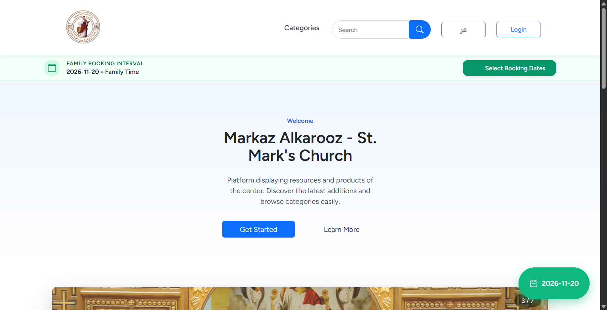
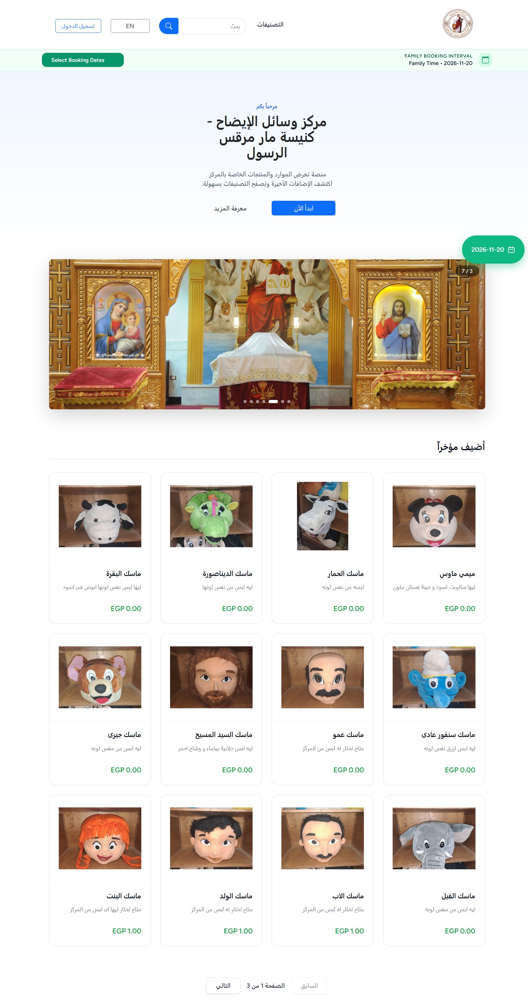
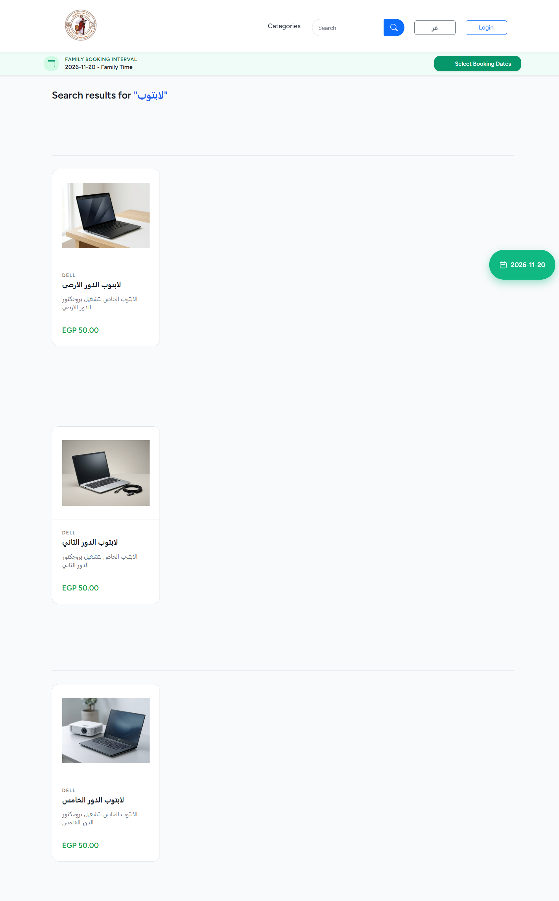
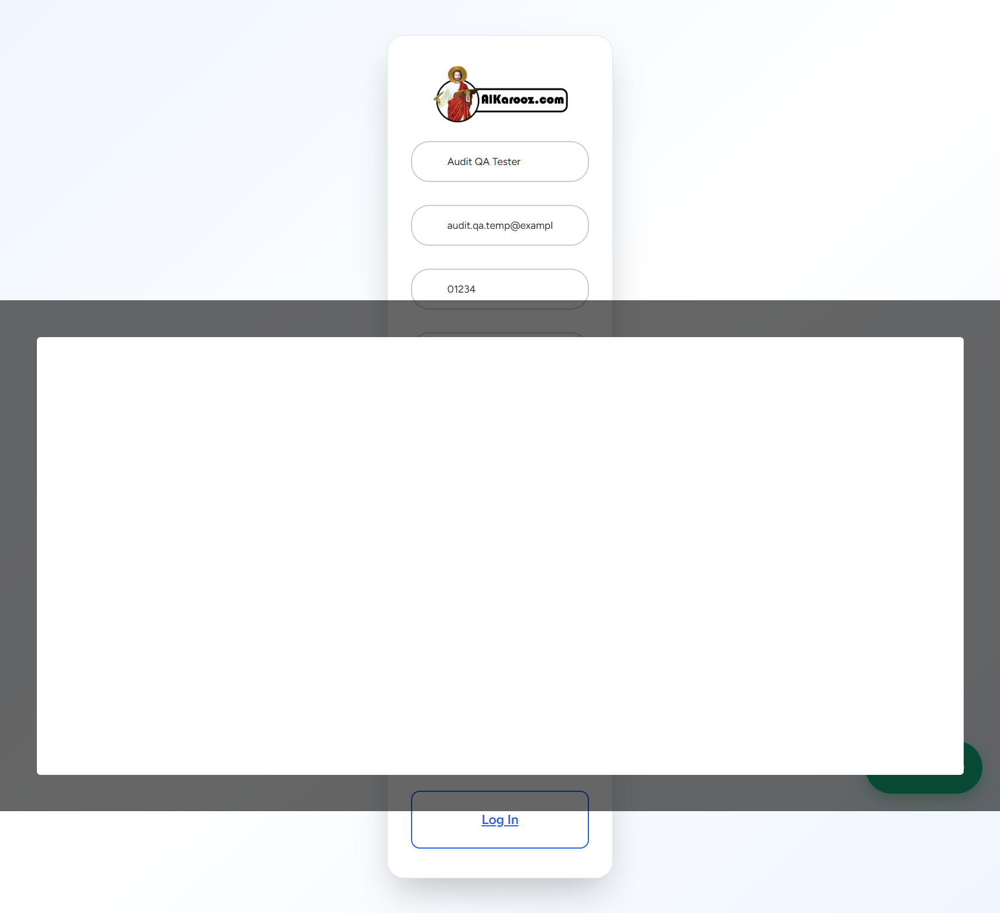
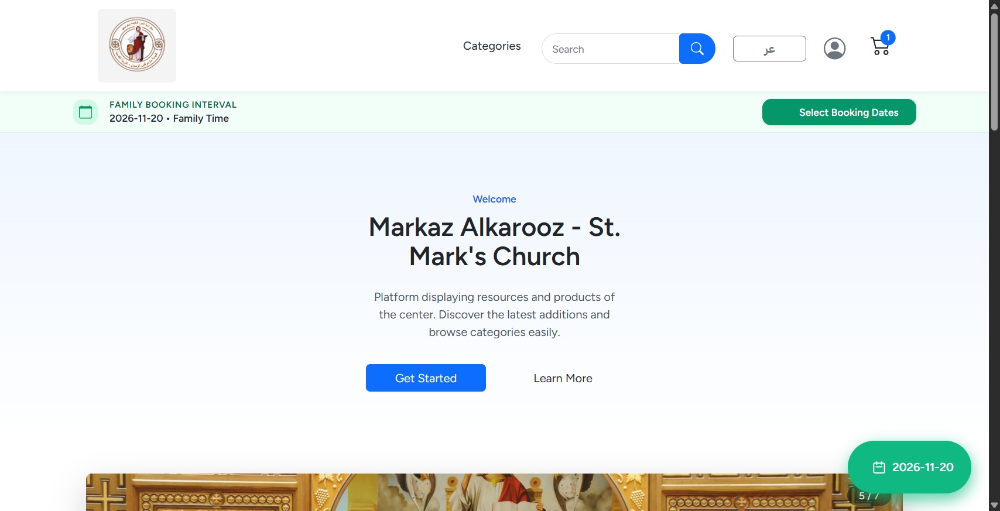
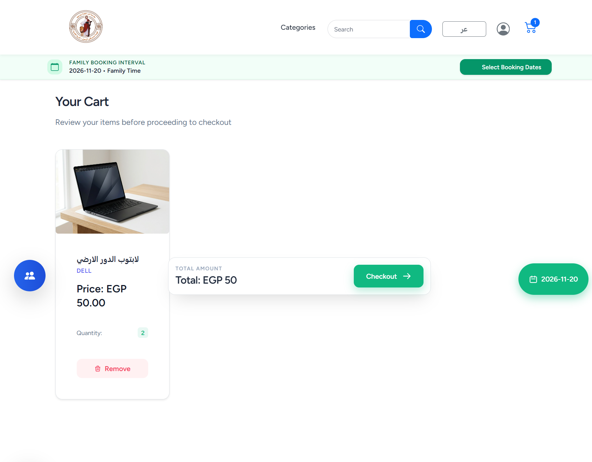
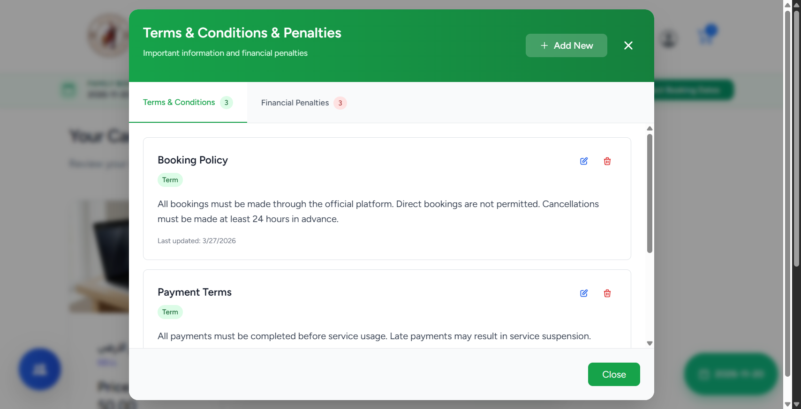
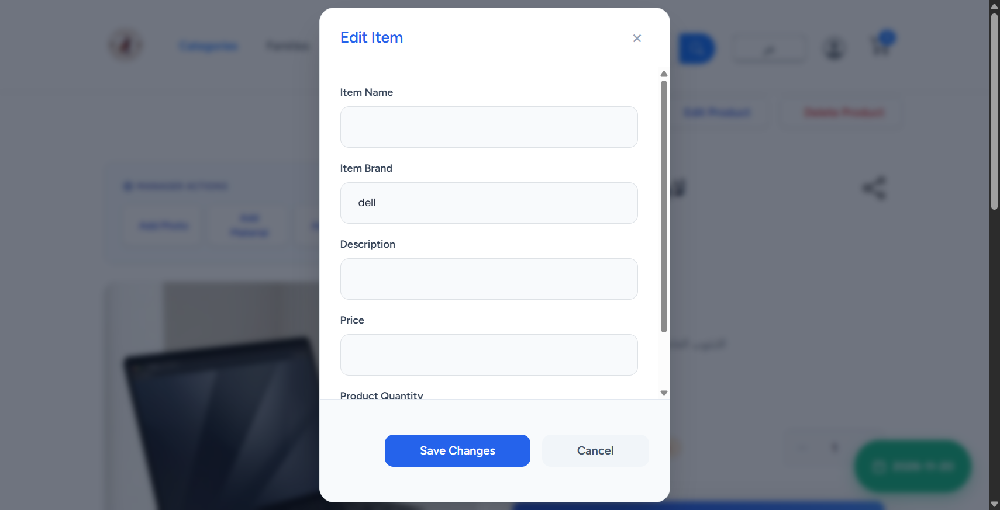
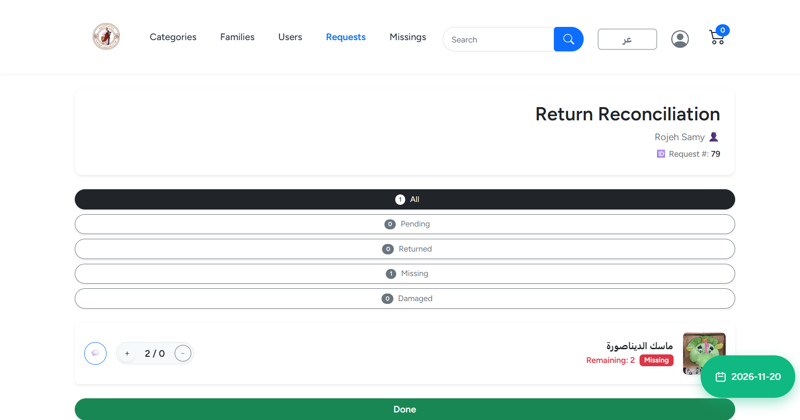

# Complete Website Audit & Improvement Roadmap — Markaz Alkarouz

**Project:** Markaz Alkarouz (`مركز وسائل الإيضاح` — St. Mark's Church Visual Aids & Equipment Rental Platform)  
**Target URL Audited:** `http://127.0.0.1:8000` (Laravel 12 + Inertia.js + React 18 + Vite 7 + MariaDB 10.11.16)  
**Audit Type:** Strictly Read-Only Codebase, Database, Security, Performance, SEO, Accessibility & Live Browser QA Audit  
**Audit Date:** November 20, 2026  

---

## 1. Executive Summary

### Overall Verdict: **NOT PRODUCTION-READY**

Markaz Alkarouz has a promising functional foundation—covering bilingual (Arabic/English) equipment browsing, time-window-based rental availability, Osra (church family group) scheduling, and an end-to-end borrowing/return reconciliation workflow. However, **the application currently contains severe security, data-integrity, functional, and usability blockers** that prevent safe production deployment.

Specifically, unauthenticated guests and standard users can bypass frontend-only restrictions to browse restricted internal equipment (`can_go_outside = 0`), inspect other users' private booking requests via an Insecure Direct Object Reference (IDOR), view/manage Terms & Penalties UI controls, and crash server endpoints (`/users` and `/sign_up` validation) with raw HTTP 500 errors. On the business-logic layer, the booking/inventory state machine exhibits severe synchronization bugs (`ProcessDelayedRequests` auto-accepts requests without deducting stock while subsequent `done`/`reject` restores it, `done()` permits double-submission, and `CartPage` ignores item quantity in its total price calculation). On the frontend, a global floating button obscures primary CTAs (`LOG IN`, `Checkout (1)`, `Confirm Password`), a broken Tailwind utility (`bottom-26`) pushes the Terms button off-screen, `404` routes crash to a blank white page, `EditItemModal` opens with blank fields on product pages, and Bootstrap 5 + custom CSS `!important` rules collide with Tailwind CSS.

### Audit Scope & Methodology

This audit combined **four independent verification pillars**:
1. **Complete Static Codebase Audit:** Inspected all backend routes, middleware, controllers (13), models (16), migrations (18 + seeders), console commands/jobs/notifications, frontend pages (22), components (41), CSS modules/stylesheets (16), locales (`en.json`, `ar.json`), and configuration files.
2. **Live Database & Dependency Inspection:** Audited live MariaDB `10.11.16` `SHOW CREATE TABLE` DDL, row counts, migration drift, `failed_jobs`, and ran `npm audit` on frontend dependencies.
3. **Live Browser QA Across 3 Roles & 5 Viewports:** Executed Chrome DevTools MCP testing against `http://127.0.0.1:8000` in an isolated guest session, an authenticated regular `user` session (using a temporary QA test account registered via `/sign_up`), and an elevated `manager` session across `375×812`, `390×844`, `768×1024`, `1366×768`, and `1920×1080` in both English (LTR) and Arabic (RTL), capturing **44 screenshots** in `website-audit/screenshots/`.
4. **Automated & Standards-Based Audits:** Executed 4 Lighthouse audits (`/home` Desktop, `/home` Mobile, `/items/23` Desktop, `/login` Desktop) and evaluated the UI/UX against 8 explicit industry standards and design skill guides.

### Summary Table of Discovered Issues

| Metric | Count | Verification Status |
|---|---:|---|
| **Total Items Documented** | **67** | **62 Verified Defects + 5 Informational Recommendations** |
| **Critical Issues** | **12** | 12 Verified |
| **High Issues** | **22** | 22 Verified |
| **Medium Issues** | **20** | 20 Verified |
| **Low Issues** | **8** | 8 Verified |
| **Informational Recommendations** | **5** | 5 Non-Defect Enhancements |

### Top 5 Immediate Release Blockers

1. **`AUDIT-001` (Critical):** Unauthenticated/unauthorized IDOR on `GET /requests/{request}` leaks any user's booking details.
2. **`AUDIT-002` & `AUDIT-003` (Critical):** Frontend-only enforcement of `can_go_outside = 0` and Terms & Penalties CRUD controls exposes restricted inventory and administrative actions.
3. **`AUDIT-004` & `AUDIT-005` (Critical):** Inventory corruption across auto-accept / `done()` / `returnMissing()` plus client-supplied `total_price` tampering and `CartPage` quantity-ignored totals.
4. **`AUDIT-006`, `AUDIT-007`, `AUDIT-008`, `AUDIT-010`, `AUDIT-012` (Critical):** Core workflows are broken or crash outright—`/requests` shows 0 requests for managers, `/users` crashes HTTP 500 for guests, `/404` renders a blank white screen, invalid `/sign_up` input throws an HTTP 500 Inertia iframe, and `EditItemModal` clears/blanks product fields.
5. **`AUDIT-011` (Critical):** `users.osra_id` uses `ON DELETE CASCADE` (deleting a church family deletes all its users and their requests) alongside a broken migration chain with 4 pending/failing migrations.

### Audit Limitations & Constraints

- **No Destructive Writes Executed:** Per strict audit rules, real customer orders (`requests.createFromCart`), status mutations (`accept`/`done`/`reject`/`return`), emails, and user/category deletions were **not** executed against production records. Instead, those write paths were verified by deep code inspection and live non-mutating UI/modal inspection. A temporary QA user (`audit.qa.temp@example.test`) was created via `/sign_up`, briefly elevated to `manager` to inspect all authenticated and manager routes, and cleanly deleted immediately afterward, leaving database row counts identical to baseline.
- **`composer audit` Unavailable:** The `composer` CLI executable is not installed in the system `PATH` on this Windows host, so PHP/Composer package advisory scanning (`composer audit`) could not be run; PHP dependencies are inventoried from `composer.json`.
- **Lighthouse Performance / Core Web Vitals Tool Limitation:** The available Chrome DevTools MCP `lighthouse_audit` tool executes Accessibility, Best Practices, SEO, and Agentic Browsing categories, and omits the Performance / Core Web Vitals category by tool design. Accordingly, no LCP, INP, or CLS scores are fabricated; Section 13 reports actual measured asset sizes, Vite bundle weights, storage sizes, and local HTTP response timings, while marking live CWV timings as unmeasured in browser lab/field.
- **Dedicated `admin`-Only Role Variant:** Database inspection showed all 3 existing accounts have `user_type = 'manager'`. Routes shared by `admin,manager` were tested under the elevated `manager` role; the `admin` role differs only in middleware (`role:admin,manager` vs `role:manager`), verified in `routes/web.php`.

---

## 2. Project Architecture Overview

### Purpose & Domain

**Markaz Alkarouz** (`مركز وسائل الإيضاح` — St. Mark's Church Visual Aids Center) is a church inventory & equipment rental portal. Church members and *Osra* (family/ministry group) leaders browse visual aids, costumes, electronics, projectors, microphones, and props; choose either their recurring *Osra* meeting time or a custom date/time interval; add items to a cart; and submit booking requests. Center staff (`admin` and `manager` roles) review requests, manage return reconciliation (tracking returned, missing, or damaged units), recover missing items, and administer categories, products, *Osras*, users, terms/penalties, and homepage carousel slides.

### Request & Data Flow Architecture

```
Browser (React 18 + Inertia Client + BookingProvider + i18next)
   │  GET/POST/PUT/PATCH/DELETE (Ziggy route() helpers + XSRF-TOKEN cookie)
   ▼
Laravel 12 HTTP Kernel (bootstrap/app.php)
   ├─► Web Middleware:
   │     1. ProcessDelayedRequests (auto-accepts expired pending requests on EVERY HTTP hit)
   │     2. HandleInertiaRequests (shares auth.user + osra_info on EVERY Inertia response)
   │     3. AddLinkHeadersForPreloadedAssets
   ├─► Route Middleware:
   │     - guest
   │     - role:user,admin,manager (CheckRole — returns Errors/403 with HTTP 200)
   │     - role:admin,manager
   │     - auth + role:manager
   ▼
Controllers (13 files — business logic & validation inline)
   ├─► Eloquent Models (16 files — MariaDB markaz_alkarouz)
   └─► Inertia::render('PageName', [...])  OR  response()->json([...])
```

### Role-Based Access Control (RBAC) Matrix (Observed vs. Intended)

| Role | Intended Access | Observed Server Gaps |
|---|---|---|
| **Guest** | Home, public `can_go_outside=1` categories, search, `/login`, `/sign_up` | Can bypass `can_go_outside=0` via `/home?page=2`, `/all-categories`, `/main_categories/7`, `/categories/10`, `/items/23`, `/search`; hits HTTP 500 on `/users`, `/osras`; hits blank crash on 404. |
| **User** (`user_type='user'`) | All catalog, `/cart`, `/requests/create-from-cart`, `/profile`, own `/requests/{id}` | Can view **any** user's `/requests/{id}` (IDOR); sees `+ Add New`/`Edit`/`Delete` in `TermsAndPenaltiesModal`; can add `can_go_outside=0` items to cart. |
| **Admin** (`user_type='admin'`) | User rights + `/requests`, `/doneRequest/{id}`, `/missings` | `/requests` query filters by `Auth::id()` so admins cannot see other users' requests. |
| **Manager** (`user_type='manager'`) | Full catalog, Osra, User, Carousel, Terms/Penalties CRUD | Same `/requests` query bug; `EditItemModal` opens blank on `ProductPage`; can delete own user row; `Categories.jsx` / `MainCategories.jsx` / `OsraPage.jsx` have broken submissions. |

---

## 3. Technologies Discovered

| Layer | Technology / Package | Declared / Observed Version | Audit Notes |
|---|---|---|---|
| **Backend Runtime** | PHP (XAMPP) | `8.5.12` (`composer.json` requires `^8.2`) | CLI missing `intl` extension (`artisan db:show --counts` crashes). |
| **Backend Framework** | `laravel/framework` | `^12.0` | Breeze starter scaffolding (`ProfileUpdateRequest`, unused auth tests). |
| **SSR / Bridge** | `inertiajs/inertia-laravel` | `^2.0` | Server-side Inertia adapter. |
| **Route Helper** | `tightenco/ziggy` | `^2.0` (`ziggy-js ^2.6.2`) | `@routes` in Blade + stale committed `resources/js/ziggy.js`. |
| **Auth / Excel** | `laravel/sanctum`, `maatwebsite/excel` | `^4.0`, `*` | **Unbounded `*` constraint** on `maatwebsite/excel`; neither Sanctum API routes nor `ImportController` exist. |
| **Frontend Core** | `react`, `react-dom` | `^18.2.0` | SPA mounted in `resources/js/app.jsx`. |
| **Frontend Inertia** | `@inertiajs/react` **AND** `@inertiajs/inertia` | `^2.3.4` + `^0.11.1` | **Conflicting dual adapters**: old v0.11 `Inertia.post`/`Inertia.delete` mixed with v2 `router`/`useForm`. |
| **Build Tool** | `vite`, `laravel-vite-plugin` | `^7.0.7`, `^2.0.0` | `vite.config.js` hardcodes `base: "/markaz_alkarouz/public/"`; `public/hot` points to `:5173`. |
| **CSS Frameworks** | `tailwindcss`, `@tailwindcss/vite`, `bootstrap`, `bootstrap-icons` | `3.2.1`, `4.0.0`, `5.3.8`, `1.13.1` | **Triple CSS conflict**: Tailwind v3 config + unused Tailwind v4 Vite plugin + Bootstrap 5 `!important` + custom `theme.css`. |
| **UI / Animation / Icons** | `@headlessui/react`, `framer-motion`, `lucide-react`, `color-namer` | `^2.0.0`, `^12.23.26`, `^0.562.0`, `^1.4.0` | `@headlessui/react` is unused (modals built manually without focus traps); `framer-motion` & `lucide-react` used only on 403/404/500 pages. |
| **i18n** | `i18next`, `react-i18next`, `i18next-browser-languagedetector` | `^25.8.20`, `^16.5.8`, `^8.2.1` | Bilingual EN/AR with RTL switching in `resources/js/i18n.js`. |
| **Database** | MariaDB | `10.11.16-MariaDB` | Database `markaz_alkarouz`, 21 tables live (including Spatie permission tables with no Spatie composer dependency). |
| **Node Runtime** | Node.js | `v26.13.1` | Running Vite dev server on `127.0.0.1:5173`. |

---

## 4. Overall Quality Assessment

| Discipline | Rating (0–10) | Assessment Summary |
|---|---|---|
| **Security Posture** | **2.0 / 10** | Critical IDOR on `/requests/{id}`, missing server-side `can_go_outside` check, unrestricted upload on carousel photos, client-controlled `total_price`, `CheckRole` HTTP 200 leak, missing security headers, 18 npm CVEs. |
| **Backend Reliability** | **3.0 / 10** | Unhandled 500s on `/users`, `/osras`, `/sign_up` validation; missing `ImportController` & `ProcessRequest` job; broken inventory math across auto-accept, `done()`, and `returnMissing()`. |
| **Database & Data Integrity** | **3.5 / 10** | `ON DELETE CASCADE` on `users.osra_id`, 4 broken/pending migrations, live schema drift, missing FKs on `cart_products`/`request_products`, missing search/status indexes, `utf8mb3` vs `utf8mb4` collations. |
| **Frontend Engineering** | **3.5 / 10** | Rules of Hooks violation (`DoneRequest.jsx`), `EditItemModal` prop mismatch, `SearchResult` 1-per-row loop bug, `CartPage` qty-ignored total, broken `bottom-26`, legacy Inertia v0.11 mixing, triple CSS collision. |
| **UI / Visual Design** | **4.0 / 10** | Clean intentions on `/login` and Tailwind product cards, but crippled by inconsistent card systems, overlapping floating buttons, Bootstrap/theme.css collisions, broken avatars, and unstyled `/register`. |
| **UX & User Flows** | **3.5 / 10** | `FloatingSettingsButton` covers `LOG IN` & `Checkout`; Terms button unreachable by mouse; silent cart wipe on date change; managers see 0 requests; missing breadcrumbs, footer, and recovery CTAs. |
| **Responsive & RTL** | **3.0 / 10** | Mobile menu `min-width: 380px` overflow, 2-col Bootstrap grid clipping on 375px, table clipping on `/users`, hardcoded `dir="rtl"` breaking English `DoneRequest` & `Missings`, broken AR login eye icon. |
| **Performance** | **4.5 / 10** | Heavy unoptimized images (`1.2 MB` fallback webp, `734 KB` logo, `5.45 MB` storage), `799 KB` entry JS+CSS bundle, global write middleware on every HTTP hit, broken `sw.js`. |
| **SEO** | **4.0 / 10** | Lighthouse SEO 92, but zero meta descriptions, non-semantic `<div>` product/category links, wrong Arabic `<title>` in EN mode, broken 404 crash, no sitemap, no Open Graph/canonicals. |
| **Accessibility** | **3.5 / 10** | Lighthouse 87–90 / Agentic 50; `role="menu"` error, multiple WCAG AA contrast failures (`2.53:1`), `8×8px` & `24×35px` targets, unlabeled form inputs/close buttons, missing modal dialog ARIA & focus traps. |
| **Automated Test Coverage** | **0.5 / 10** | Only default Breeze boilerplate tests remain—many broken by schema/route divergence (`UserFactory`, `dashboard` route, email login). Zero domain tests. |

---

## 5. Codebase Audit Results

### Structural & Architectural Observations

1. **Fat Controllers, Zero Service/Policy Layer:** All validation, authorization checks, file storage operations, inventory math, and database transactions reside inside controllers (`RequestController` 378 lines, `ProductController` 359 lines, `CategoriesController` 313 lines, `ProfileController` 271 lines).
2. **Broken & Orphaned References:**
   - `routes/web.php:12` imports nonexistent `App\Http\Controllers\ImportController`.
   - `app/Http/Controllers/RequestController.php:6` imports nonexistent `App\Jobs\ProcessRequest` (which directly caused 5 rows in `failed_jobs`).
   - `routes/web.php:186` renders nonexistent Inertia page `'404'` (while both `Pages/404notFound.jsx` and `Pages/Errors/404.jsx` exist in the repository).
   - `app/Http/Requests/ProfileUpdateRequest.php` references nonexistent `name` and `$this->user()->id` (the model uses `full_name` and `user_id`).
   - Unused boilerplate/orphaned files: `app/Jobs/UpdateRequestStatus.php`, `app/Notifications/RequestStatusUpdated.php`, `app/Http/Controllers/PushSubscriptionController.php`, `resources/js/Components/CheckoutModal.jsx`, `resources/js/Components/useTimeFilteredProducts.js` (stubbed no-op), `resources/js/Pages/404notFound.jsx`, `database/migrations/2025_12_25_123255_create_permission_tables.php` (Spatie tables with no `spatie/laravel-permission` package in `composer.json`), `database/seeders/DatabaseSeeder.php` (broken `'name'` field).
3. **Repository Hygiene & Clutter:** Root directory contains `error_log_temp.txt` (11.4 KB leaking old `C:\xampp\htdocs\markaz_alkarouz` stack traces), `update_modals.js` (3.8 KB code generator), `cats.json` (0 B), `cats2.json` (0.3 KB), `docs/returns-feature-prompt.md` (AI prompt file), and `data/` (29 sample images totaling `3.95 MB`), plus duplicated assets across `resources/imgs/` and `public/imgs/`.
4. **Git Working Tree State:** `git status -s` shows 14 modified files already in progress on disk (`composer.json`, `package-lock.json`, 5 controllers, 3 components, 4 pages), demonstrating active unmerged work without automated tests.
5. **Broken Breeze Test Suite:** `tests/Feature/Auth/AuthenticationTest.php:25,30` tests `email` login and `route('dashboard')`, whereas the app authenticates by `mobile` and redirects to `route('home')`. `database/factories/UserFactory.php` has not been inspected for schema parity beyond `DatabaseSeeder` using `'name'` instead of `'full_name'`.

---

## 6. Backend Audit Results

### Middleware (`app/Http/Middleware/`)

- **`ProcessDelayedRequests.php` (lines 17–26):** Registered globally on every `web` route (`bootstrap/app.php:17`). Runs an unindexed `UPDATE requests SET request_status = 'accepted' WHERE request_status = 'pending' AND expiry_time <= now() AND expiry_time IS NOT NULL` on **every single GET/POST/asset-adjacent web request** (including `/login`, `/home`, `/404`). Critically, it updates `request_status` to `'accepted'` **without decrementing `products.inventory_quantity`**, breaking inventory consistency with `RequestController::accept()` and `reject()`.
- **`HandleInertiaRequests.php` (lines 32–73):** Queries `Osra::find()` on every Inertia page load when authenticated (`auth.user` is shared as the full `User` model array rather than a scoped DTO). Line 54 (`now()->next($oldDate->dayOfWeek)`) uses UTC `now()` and jumps 7 days ahead even if today matches the Osra's weekday.
- **`CheckRole.php` (lines 11–22):** Returns `Inertia::render('Errors/403', ...)` with **HTTP 200 OK** (missing `->setStatusCode(403)`), and treats unauthenticated guests (`Auth::user() === null`) identically to unauthorized roles instead of redirecting to `route('login')`.

### Exception Handling (`bootstrap/app.php`)

- Lines 25–35 register a custom `$exceptions->render` closure that intercepts `HttpException` status `419`, and executes `throw $e;` for all other exceptions—bypassing Laravel's default `AuthenticationException` → redirect-to-login handler and HTML/JSON error rendering when `auth` middleware is combined with `role:manager` (verified live: `/users` and `/osras` return raw **HTTP 500** to guests).

### Controllers (13 Files)

- **`Home_controller.php`:** Unbounded `per_page` query parameter (`$perPage = request()->input('per_page', 12)` allows `?per_page=1000000` DoS); executes `Storage::disk('public')->exists(...)` disk stat inside `map()` for every product; leaks `can_go_outside = 0` products on Page 2 to guests; omits `brand` in payload; maps `color` via `$product->colors->first()->color` (works), while `ProductController::show` maps `color_name` (broken).
- **`CategoriesController.php`:**
  - `index()` (`/all-categories`) and `show()` (`/categories/{category}`) and `show_one_main()` (`/main_categories/{id}`) never enforce `can_go_outside = 1` for guests.
  - `show()` queries `$user->cart->products()` **twice** (lines 66–69 and 97–99).
  - `destroy_main()` iterates `$category->products` using `Main_Category::products()` which incorrectly joins `category_id` rather than `main_category_id` (`app/Models/Main_Category.php:27`), risking deletion of unrelated subcategory product photos or missing actual child product files.
  - `store()` / `store_main()` leave `$photoPath` undefined if `hasFile` fails despite validation, and never wrap DB + file delete/upload in transactions.
- **`ProductController.php`:**
  - `show($id)` **omits `withAvailableInWindow(request())`** on both the main product and `relatedProducts`, displaying static `inventory_quantity` instead of window-available stock. It also sets `$product->colors = $product->colors?->pluck('color_name')` (column is `color`, not `color_name`), queries cart items twice (lines 125 & 160), and leaves the old unused `index($id)` method dead.
  - `upload_image()` returns raw JSON `422` on max-5 overflow while returning `back()` otherwise; mixes `jpeg,png,jpg,gif` while `CategoriesController` allows `webp`.
  - `search()` and `getAvailableProducts()` ignore `can_go_outside` for guests; `search()` wraps `LIKE "%{$query}%"` (unindexed full-table scan) and omits `colors`/`sizes` eager loading; `getAvailableProducts()` returns all matching rows unpaginated.
- **`CartController.php`:**
  - `index()` crashes if `Auth::user()` is somehow null (`$user->osra_id` without null-safe operator) and runs `loadMissing(['color', 'size'])` inside an `each()` loop (N+1 queries on pivots).
  - `add()` calls `$cart->products()->syncWithoutDetaching([$request->product_id => ...])`, overwriting prior color/size selections of the same product, and never verifies `inventory_quantity` or `can_go_outside`.
  - `removeProduct()` calls `$cart->products()->detach(...)` without checking `if ($cart)` (fatal null-pointer crash if user has no cart) and without validating `product_id`.
- **`RequestController.php`:**
  - `index()` filters `.where('user_id', Auth::id())` despite being an `admin,manager` route (`routes/web.php:117`). Managers never see users' requests!
  - `show($id)` has **no ownership check**, allowing any logged-in `user` to inspect any other user's booking request (verified on `/requests/79`).
  - `createFromCart()` blindly uses `$request->total_price`, fails with 500 if `$cart` is null or empty (`$cart->products`), does not validate stock availability inside `lockForUpdate()`, and uses `sync($syncData)` keyed by `product_id`.
  - `accept()` lacks `DB::transaction()` and stock sufficiency checks (stock can drop negative).
  - `done()` has no validation on `$productsData` (`checked_qnty` can be negative or exceed `quantity`), does not guard against already-`done`/`rejected` requests (allowing double stock inflation), and discards `shortfall_reason === 'damaged'` without persisting it.
  - `returnMissing()` throws raw `\Exception` (HTTP 500) instead of `ValidationException` when `$qtyToReturn > $missing->quantity`.
- **`ProfileController.php`:** `update()` accepts non-numeric `'mobile' => 'required|string|max:20'` (unlike `digits:11` on registration/profile update); `destroy()` permits a manager to delete their own account; `index()` falls back to `'imgs/AlkarouzCom.png'` (typo—actual file is `AlkaroozCom.png`, causing HTTP 404); `updateProfile()` stores uploads in `'profile_photos'` while `store()`/`update()` store in `'user_photos'`.
- **`OsraController.php`:** Passes unvalidated `$request->all()` directly into `Osra::create()` and `$osra->update()`; `update()` omits `unique` rule exclusion for `osra_code` (allowing duplicate `osra_code` SQL errors); all 3 redirects call broken `->with('success', 'success', 'Osra ...')` (3 args instead of 2!).
- **`Carousel_photos_controller.php`:** `upload_photo()` validates only `'photo' => 'required'`—zero `array`, `image`, `mimes`, or `max` constraints (allows uploading `.php`, `.html`, `.svg`, or arbitrary files to `storage/app/public/carousel_photos`!), and loops `$request->file('photo')` without checking `is_array()` (throws 500 on single non-array upload) and returns void (HTTP 200 empty body).
- **`TermsAndPenaltiesController.php`:** `index()` is accessible to all authenticated users, and `TermsAndPenaltiesModal.jsx` exposes write routes (`store`, `update`, `destroy`) UI buttons to regular users. Backend write routes sit under `role:manager`, returning 403 HTTP 200 Inertia HTML when a user clicks them (though controller returns JSON for managers).

---

## 7. Frontend Audit Results

### Framework & State Management (`app.jsx`, `BookingContext.jsx`, `i18n.js`)

1. **Inappropriate Global Root Components (`app.jsx:35-36`):** `<GlobalCheckoutModal />` and `<FloatingSettingsButton />` wrap **all** pages unconditionally, appearing on `/login`, `/sign_up`, `/register`, `/403`, `/500`, and manager admin pages.
2. **Router Interceptor Mutating All Inertia GET Visits (`BookingContext.jsx:140-172`):** Intercepts every GET navigation to append `time_type`, `osra_date`, or `start_date`/`end_date`/`start_time`/`end_time`, polluting admin URLs (`/users`, `/osras`, `/requests`) and non-booking routes.
3. **Destructive Side Effect Without Confirmation (`BookingContext.jsx:210-240`):** `saveBookingInterval()` silently issues `DELETE /cart/clear` before navigating, destroying the user's cart without warning.
4. **Timezone Bug in Defaults (`BookingContext.jsx:43,49` & `GlobalCheckoutModal.jsx:43`):** `new Date().toISOString().split("T")[0]` computes UTC date instead of local user/church date (wrong around midnight Cairo time).
5. **Broken CSS Cascade (`app.jsx:1-5`):** Loads `app.css` (Tailwind) -> `theme.css` (`.btn { width: 100%; border-radius: 25px }`) -> `responsive-tables.css` -> `bootstrap/dist/css/bootstrap.min.css` (Bootstrap 5 `!important` utilities). Bootstrap overrides Tailwind classes (`py-4`, `px-4`, `text-white`, `gap-2`) globally!

### React Component & Page Defects

- **Rules of Hooks Violation (`DoneRequest.jsx:206-244`):** Early return `if (!requestDetails) return (...)` executes *before* `useState` calls on lines 242–244.
- **Quantity Ignored in Cart Totals (`CartPage.jsx:17` & `GlobalCheckoutModal.jsx:48`):** Both calculate `products.reduce((acc, p) => acc + Number(p.pr_price), 0)` without multiplying by `Number(p.pivot?.quantity || 1)`.
- **Broken Tailwind Class (`CartPage.jsx:214`):** `bottom-26` does not exist in Tailwind v3 (`tailwind.config.js`), causing `bottom: auto` and pushing the floating Terms button completely below the viewport.
- **Prop Mismatches & Broken Submissions:**
  - `EditItemModal.jsx:13-17` reads `currentItem.title`, `.description`, `.price`, whereas `ProductPage.jsx:70,104` passes the raw Eloquent model (`pr_name`, `pr_description`, `pr_price`), leaving Name, Description, and Price blank! Meanwhile `EditItemModal.jsx:23` sends `route("items.update", { item: currentItem.id })` where `currentItem.id` is `undefined` when opened from `ProductPage`!
  - `DeleteItemModal` on `CategoryPage.jsx:185` reads `selectedItem.pr_name` when `selectedItem` uses `.title`.
  - `MainCategories.jsx:42` calls `route("categories.store")` instead of `main_categories.store` when adding a main category (and doesn't pass `can_go_outside` or `main_category_id`).
  - `Categories.jsx:30-41` defines `handleAddConfirm` without forwarding `main_category_id`, and `AddCategoryModal.jsx` ignores `onConfirm` prop altogether and submits via legacy `@inertiajs/inertia` (`Inertia.post`), passing `main_category_id = undefined` on `/all-categories` (string `"undefined"`!).
  - `OsraPage.jsx:13,20-42` copies `initialOsras` into local `useState` (ignores updated Inertia props unless full `window.location.reload()`), and its `handleAdd`/`handleEdit` omit `example_time` (though `AddOsraModal` and `EditOsraModal` submit directly via `useForm` and call `window.location.reload()`).
  - `UsersPage.jsx:69,85` sets `osra_id` in state, reads `editData.osra_code`, and passes `osras` unused into `EditUserModal` which renders a plain text input for `osra_code` initialized empty—clearing a user's Osra unless re-typed!
  - `SignUp.jsx:40,72,98` checks `if (data.osra_id)` (never exists; state has `osra_code`) and renders `errors.name` and `errors.phone` instead of `errors.full_name` and `errors.mobile`! Furthermore, passing `FormData` as the second argument to `useForm().post(url, formData)` in Inertia `useForm` passes `formData` as *visit options* instead of payload (so `useForm` sends internal `data`, while validation errors still fail to render or trigger server exceptions if malformed).
- **1-Per-Row Search Bug (`SearchResult.jsx:62-70`):** Maps each product into a separate `<ItemPack products={[p]} />`, creating a separate 4-column grid containing 1 card per row with empty horizontal dividers.
- **Hardcoded `dir="rtl"` (`DoneRequest.jsx:309`, `Missings.jsx:135`):** Breaks English layout and flips numeric counters (`2 / 0`, `+` / `-`).
- **Crash Vectors:**
  - `Card.jsx:100`, `CategoryProductCard.jsx:122`, `CartCard.jsx:72`, `RequestShow.jsx:250` invoke `namer(color)` directly without `try/catch`; non-CSS strings or `CartCard`'s object argument (where `CartCard` passes `color` object to `namer(color)` instead of `color.color`!) throw `TypeError` and crash the entire React tree if any color row exists!
  - `ProductPage.jsx:93-98` renders `<ItemPack products={relatedProducts} />` without passing `setAlertMessage`, crashing if a user clicks `"Add To Cart"` on a related card!
  - `AddCategoryModal.jsx:47`, `AddMainCategoryModal.jsx:68`, `EditCategoryModal.jsx:66`, `EditMainCategoryModal.jsx:82` access `e.target.files[0].name` without null-checking when the file dialog is cancelled.
- **Unreachable / Dead Components:** `CheckoutModal.jsx`, `useTimeFilteredProducts.js`, `404notFound.jsx`, unused `onEdit`/`onDelete` handlers in `CategoryPage.jsx:60-92` & `SearchResult.jsx:67-68`.

---

## 8. Database Audit Results

Live inspection of `markaz_alkarouz` (`10.11.16-MariaDB`, 21 tables) revealed critical schema, migration, foreign-key, collation, and indexing defects.

### Live Table Inventory & Row Counts

| Table | Live Rows | Engine / Charset | Key Audit Observations |
|---|---:|---|---|
| `brands` | 0 | InnoDB / `utf8mb4_unicode_ci` | Unused table; `products.brand` is a denormalized `varchar(255)`. |
| `cache`, `cache_locks` | 0 | InnoDB / `utf8mb4_unicode_ci` | Default Laravel cache tables. |
| `carousel_photos` | 7 | InnoDB / **`utf8mb3_general_ci`** | **No migration created `photo` column**; `int(11)` PK; `utf8mb3`. |
| `cart` | 2 | InnoDB / `utf8mb4_unicode_ci` | FK `user_id -> users.user_id ON DELETE CASCADE`. |
| `cart_products` | 0 | InnoDB / `utf8mb4_unicode_ci` | **`color_id` and `size_id` are unindexed `int(11)` with NO FKs** (`colors`/`sizes` PKs are `bigint unsigned`). |
| `colors`, `materials`, `sizes` | 0 | InnoDB / `utf8mb4_unicode_ci` | FK `product_id -> products.product_id ON DELETE CASCADE`. |
| `failed_jobs`, `jobs`, `job_batches` | 6 / 0 / 0 | InnoDB / `utf8mb4_unicode_ci` | 5 failed `App\Jobs\ProcessRequest` + 1 Closure error from `2026-06-17`. |
| `main_categories` | 2 | InnoDB / **`utf8mb3_general_ci`** | Signed `bigint(20)` PK; `utf8mb3`; no migration exists for this table! |
| `migrations` | 17 | InnoDB / `utf8mb4_unicode_ci` | **4 pending migrations** fail or conflict with live DB! |
| `missings` | 6 | InnoDB / **`utf8mb3_general_ci`** | No migration exists for `missings`; `osra_code` has no FK/index; no `created_at`/`updated_at` timestamps. |
| `osra` | 2 | InnoDB / `utf8mb4_unicode_ci` | **Duplicate unique indexes** (`osra_code` AND `osra_code_2`); `example_date`/`example_time` added outside migrations. |
| `password_reset_tokens` | 0 | InnoDB / `utf8mb4_unicode_ci` | Unused (no password reset route/UI exists). |
| `pr_photos` | 27 | InnoDB / `utf8mb4_unicode_ci` | FK `product_id -> products.product_id ON DELETE CASCADE`. |
| `products` | 27 | InnoDB / `utf8mb4_unicode_ci` | **`inventory_quantity int(3)`** signed; no index on `pr_name` or `brand`. |
| `request_products` | 24 | InnoDB / `utf8mb4_unicode_ci` | `color_id`/`size_id` are unindexed `int(11)` with no FKs; **`shortfall_reason` column absent**; no migration ran for quantities/comment. |
| `requests` | 20 | InnoDB / `utf8mb4_unicode_ci` | `osra_code` has no FK/index; **`request_status` & `expiry_time` unindexed**; `start_time`/`end_time`/`osra_numeric_time` are `TIME` (`HH:MM:SS`) while query scope appends `:00`! |
| `sessions` | 9 | InnoDB / `utf8mb4_unicode_ci` | Valid FK + `last_activity` index. |
| `sub_categories` | 4 | InnoDB / `utf8mb4_unicode_ci` | Renamed manually from `categories` outside migrations! |
| `terms_and_penalties` | 6 | InnoDB / `utf8mb4_unicode_ci` | `created_by` & `updated_by` FKs default to `ON DELETE RESTRICT` → **deleting a manager who created a term crashes with SQL FK constraint error!** |
| `users` | 3 | InnoDB / `utf8mb4_unicode_ci` | **`osra_id` FK has `ON DELETE CASCADE`** (deleting an Osra silently deletes all its users, carts, and requests!); missing `remember_token`/`email_verified_at` in live table vs migration! |

### Critical Schema & Migration Findings

1. **Broken Migration Reproducibility (`php artisan migrate` fails):**
   - `2025_01_01_000000_add_should_update_at_to_user_requests_table` references nonexistent `user_requests` table (**Pending**).
   - `2026_03_27_122658_create_carousel_photos_table` (**Pending** — table already created manually without `photo` column in migration!).
   - `2026_06_20_000000_add_quantities_to_request_products_table` (**Pending** — attempts to create `colors.color_id` unsigned FKs on columns manually created as signed `int(11)`, which will fail on MySQL/MariaDB!).
   - `2026_06_25_225209_create_sessions_table` (**Pending** — duplicates `sessions` already created by `2025_12_18_021918`).
   - Meanwhile `main_categories`, `missings`, `sub_categories` rename, `products.main_category_id`, `products.inventory_quantity`, `requests.expiry_time`, and `osra.example_date`/`example_time` were applied via manual SQL outside Laravel migrations (`migrate:fresh` cannot rebuild the application!).
2. **Broken `TIME` Column `CONCAT` in `Product::scopeWithAvailableInWindow` (`app/Models/Product.php:102-109`):** Live `requests.start_time`, `end_time`, and `osra_numeric_time` have MySQL type `TIME`, which formats as `'10:26:00'` (already containing seconds). Appending `':00'` produces `'2026-07-23 10:26:00:00'`—an invalid MySQL datetime string! Lexicographical string comparisons and invalid datetime literals corrupt overlap calculations.

---

## 9. Security Audit Results

| OWASP / Domain Area | Finding | Severity | Verification |
|---|---|---|---|
| **Broken Access Control (A01)** | `RequestController::show($id)` lacks `$request->user_id === Auth::id()` or role check (`AUDIT-001`). | **CRITICAL** | Verified live on `/requests/79` as regular `user`. |
| **Broken Access Control (A01)** | `can_go_outside = 0` restricted items enforced only on `MainCategories.jsx` UI; `/home?page=2`, `/all-categories`, `/main_categories/7`, `/categories/10`, `/items/23`, `/search`, `/cart/add` expose them (`AUDIT-002`). | **CRITICAL** | Verified live across 5 routes + cart add. |
| **Broken Access Control (A01)** | `TermsAndPenaltiesModal` displays `+ Add New`, `Edit`, `Delete` buttons to regular `user` (`AUDIT-003`). | **CRITICAL** | Verified live in Chrome (`user` role). |
| **Broken Access Control (A01)** | `CheckRole` returns HTTP 200 on 403 and fails to redirect guests; `/users` and `/osras` crash HTTP 500 for guests (`AUDIT-007`, `AUDIT-016`). | **CRITICAL / HIGH** | Verified via `curl` & Chrome (`HTTP/1.0 500`, `200 OK` on `/cart`). |
| **Unrestricted File Upload (A04)** | `Carousel_photos_controller::upload_photo` lacks `image`/`mimes`/`max` validation (`AUDIT-009`). | **CRITICAL** | Verified in `Carousel_photos_controller.php:28-37`. |
| **Business Logic / Tampering (A04)** | `RequestController::createFromCart` trusts client `total_price`; `done()` trusts unvalidated `checked_qnty` allowing negative/over-limit stock inflation (`AUDIT-004`, `AUDIT-005`). | **CRITICAL** | Verified in `RequestController.php:84,159-198`. |
| **Mass Assignment / Input Integrity** | `OsraController` passes `$request->all()` to `create`/`update`; `ProfileController::update` allows arbitrary non-numeric mobile; manager can self-delete (`AUDIT-015`). | **HIGH** | Verified in `OsraController.php:51,67`, `ProfileController.php:140,186`. |
| **Security Misconfiguration (A05)** | `APP_DEBUG=true`, `SESSION_ENCRYPT=false`, `SESSION_SECURE_COOKIE` unset (`null`), 7-day `Max-Age=604800`, `X-Powered-By: PHP/8.5.12`, **0 security headers** (`CSP`, `X-Frame-Options`, `X-Content-Type-Options`, `Referrer-Policy` all absent) (`AUDIT-013`). | **HIGH** | Verified via `.env`, `config/session.php`, and live HTTP response headers. |
| **Vulnerable Components (A06)** | `npm audit` reports **18 vulnerabilities** (2 critical, 11 high, 4 moderate, 1 low) including `axios` (via `@inertiajs/inertia`), `shell-quote` (via `concurrently`), `vite`, `rollup`, `postcss`, `lodash-es` (`AUDIT-014`). *(Composer audit unavailable: `composer` not in PATH.)* | **HIGH** | Verified via `npm.cmd audit`. |
| **CSRF / XSS / SQLi** | Laravel CSRF token (`XSRF-TOKEN` + `@csrf` meta) is active on POST/PUT/DELETE routes; React auto-escapes JSX (`dangerouslySetInnerHTML` absent); Eloquent parameterizes `LIKE` bindings. *However*, `RequestController::done` raw `DB::table` + missing validation & `Carousel` unrestricted upload create secondary XSS/stored-HTML risks if `.html`/`.svg` is uploaded to `public/storage`. | **Mixed** | Verified across controllers & JSX components. |


---

## 10. UI/UX Audit Results (Dedicated Standards-Grounded Evaluation)

### 10.1 Reference Standards & Design Skills Studied

Prior to auditing the UI/UX, all 8 requested reference skills and official design standards were fetched/verified and their core principles extracted and adapted specifically to **Markaz Alkarouz** (a bilingual Arabic/English church visual-aids & equipment rental platform serving church families and center coordinators—requiring clarity, trust, low-friction booking, strict role separation, and bidirectional RTL/LTR parity rather than generic SaaS marketing aesthetics):

| Reference Source | HTTP Verification | Core Evaluation Principles Applied to Markaz Alkarouz |
|---|---|---|
| **UI Design Skill** (`mblode/agent-skills/skills/ui-design/SKILL.md`) | **200 OK** (25,556 chars) | Audit-mode `file:line` & rendered evidence discipline; Deslop rule (delete redundant/conflicting chrome like misplaced FABs); Break-mode stress testing (long Arabic/English strings, 0/empty/overflow states, RTL); stable control dimensions; consistent tokens. |
| **Frontend Design Skill** (`PracticalSwan/agent-skills/frontend-design/SKILL.md`) | **200 OK** (16,186 chars) | **Hard Gates:** WCAG 2.2 AA accessibility, functional correctness, usable responsive behavior, complete state coverage (loading/empty/error/success/disabled); Commerce + Product/Workspace dual-mode fit; visible trust, pricing clarity, error prevention, and confirmation before destructive actions. |
| **UI/UX Architect Skill** (`Emmraan/agent-skills/skills/design-ux/ui-ux/SKILL.md`) | **200 OK** (29,811 chars) | Information Architecture (MECE categories, Miller's Law, Front-Door Thinking, Recognition over Recall); 5 mandatory screen states; Cognitive Walkthrough (4-question task test); Nielsen's 10 Heuristics; UX Laws (Jakob, Hick, Fitts, Von Restorff, Peak-End, Doherty Threshold); WCAG 2.1/2.2 & RTL internationalization. |
| **Material Design 3** (`m3.material.io`) | **200 OK** (63,617 chars) | Semantic color roles & minimum contrast; FAB restraint (at most 1 primary FAB per screen, never occluding CTAs or inputs); clear visual elevation hierarchy; inline field validation over native `alert()`. |
| **Apple Human Interface Guidelines** (`developer.apple.com/design/human-interface-guidelines/`) | **200 OK** | Minimum `44×44px` comfortable touch targets on mobile; clarity & deference (controls must not obscure content); consistent navigation bars; non-disruptive feedback; clean RTL mirroring. |
| **WCAG 2.2 Level AA** (`w3.org/TR/WCAG22/`) | **200 OK** | Contrast ≥ 4.5:1 (normal text) / ≥ 3:1 (large text & UI components); minimum `24×24px` target size (2.5.8); keyboard operability (2.1.1); semantic landmarks & valid ARIA (1.3.1, 4.1.2); reflow without 2D scroll (1.4.10). |
| **Nielsen Norman Group 10 Heuristics** (`nngroup.com/articles/ten-usability-heuristics/`) | **200 OK** | Systematic audit across Visibility of System Status, Match with Real World, User Control & Freedom, Consistency & Standards, Error Prevention, Recognition vs Recall, Flexibility/Efficiency, Minimalist Design, Error Recovery, Help & Documentation. |
| **Core Web Vitals** (`web.dev/articles/vitals`) | **200 OK** | Operational targets: LCP ≤ 2.5s, INP ≤ 200ms, CLS ≤ 0.1; budget images/JS/CSS and avoid unmeasured performance claims. |

---

### 10.2 Nielsen's 10 Usability Heuristics Evaluation

| # | Heuristic | Status | Markaz Alkarouz Findings & Evidence | Related Issues |
|---|---|---|---|---|
| **1** | **Visibility of system status** | ❌ **Fail** | `CartPage` displays **`Total: EGP 50`** for qty 2 × EGP 50.00; `/requests` tells managers **`No requests found`** despite 20 active DB requests; `saveBookingInterval()` clears cart silently with no warning; `ProductPage` shows static stock instead of window-available stock; invisible green icon inside green `"Select Booking Dates"` button; `LoginMessage` flashes repeatedly on pagination. | `AUDIT-005`, `AUDIT-006`, `AUDIT-018`, `AUDIT-029`, `AUDIT-033`, `AUDIT-039` |
| **2** | **Match between system and the real world** | ❌ **Fail** | In Arabic mode, `OsraTimeBar` stays English (`"FAMILY BOOKING INTERVAL"`, `"Select Booking Dates"`), `DoneRequest` forces `dir="rtl"` in English flipping fractions to `2 / 0` and `+`/`-` buttons; `/missings` subtitle says **`"Manage all registered users"`**; `/sign_up` submit button says **`"Add User"`**; `AddOsraModal` labels date fields `"Next Osra Is On"` while page says `"Family"`. | `AUDIT-024`, `AUDIT-032`, `AUDIT-040`, `AUDIT-056` |
| **3** | **User control and freedom** | ❌ **Fail** | `LoginMessage` has no close button (`×`); `saveBookingInterval()` wipes the cart with zero undo or confirmation; `/register` has no NavBar or Back link to `/users`; `EditImagesModal` hides delete behind desktop hover (no touch/keyboard delete); modals ignore `Escape` key and lack backdrop close in many CSS-module modals. | `AUDIT-031`, `AUDIT-033`, `AUDIT-039`, `AUDIT-054` |
| **4** | **Consistency and standards** | ❌ **Fail** | **Three conflicting card designs** (Tailwind `Card.jsx` on Home, Bootstrap `CategoryProductCard.jsx` on CategoryPage, custom `CartCard.jsx` on CartPage); 4 brand spellings (`Markz alkarooz`, `Markaz Alkarooz`, `Markaz Al-Karouz`, `مركز وسائل الإيضاح`); `/sign_up` and `/register` use completely different UI from `/login`; Bootstrap `!important` collides with Tailwind and `theme.css`. | `AUDIT-035`, `AUDIT-041`, `AUDIT-043`, `AUDIT-056` |
| **5** | **Error prevention** | ❌ **Fail** | `EditItemModal` opens with blank Name/Description/Price on `ProductPage` (risking data loss); managers can click `Delete` on their own active account; `RequestController::done()` allows double submission & unvalidated negative counts; `saveBookingInterval()` deletes cart without prompt; invalid `/sign_up` mobile triggers HTTP 500 iframe instead of inline hint. | `AUDIT-004`, `AUDIT-010`, `AUDIT-012`, `AUDIT-015`, `AUDIT-033` |
| **6** | **Recognition rather than recall** | ⚠️ **Partial** | No breadcrumbs on `/main_categories/{id}`, `/categories/{id}`, or `/items/{id}` (subcategory heading says generic `"Sub Categories"` without parent name); `EditUserModal` requires typing an `osra_code` from memory instead of selecting from the `osras` list already passed as a prop; navbar search box clears the user's query on `/search`. | `AUDIT-026`, `AUDIT-042`, `AUDIT-057` |
| **7** | **Flexibility and efficiency of use** | ❌ **Fail** | `SearchResult` stacks 1 card per row over ~2,000px height; `CartPage` lacks +/- quantity controls (must delete and re-visit item); `DoneRequest` filter pills stretch 100% width vertically on desktop; `FloatingSettingsButton` buries `Checkout (1)` making 1-click checkout unreachable by mouse on `/home`. | `AUDIT-019`, `AUDIT-025`, `AUDIT-035`, `AUDIT-065` |
| **8** | **Aesthetic and minimalist design** | ⚠️ **Partial** | Individual Tailwind surfaces (`/login` desktop, `Card.jsx`, `/search` empty state) show good modern intent, but hero excessive whitespace pushes carousel off 768px fold; `/home` logged-in mobile shows wide gray header box; `FloatingSettingsButton` + `.mobile-floating-cart` + checkout bar collide visually. | `AUDIT-019`, `AUDIT-022`, `AUDIT-042`, `AUDIT-055` |
| **9** | **Help users recognize, diagnose, and recover from errors** | ❌ **Fail** | 404 renders a **100% blank white screen**; `/users` guest access crashes HTTP **500**; `/sign_up` validation shows a blank **500** Inertia iframe; guest `Errors/403` gives no `"Log In"` button; broken manager avatars show raw alt text; form errors rely on blocking native `alert()`. | `AUDIT-007`, `AUDIT-008`, `AUDIT-010`, `AUDIT-016`, `AUDIT-017`, `AUDIT-054` |
| **10** | **Help and documentation** | ❌ **Fail** | No `<footer>` with church center contact/hours/support anywhere; `"Forgot your password?"` says `"Please contact support"` with zero contact info; `"Osra Code"` on `/sign_up` gives no hint where users obtain their family code; Terms button on `/cart` is off-screen (`bottom-26`) so users cannot read rental rules/penalties. | `AUDIT-020`, `AUDIT-042`, `AUDIT-054` |

---

### 10.3 Cognitive Walkthrough & UX Laws Critique

1. **Journey 1 — Guest Discovery & Onboarding (`/home` → `/categories` → `/items/23` → `/login` / `/sign_up`):**
   - *Visual Hierarchy & Fold (Fitts's Law & Above-the-Fold Priority):* On `1366×768` (`screenshots/01-home-desktop-1366.png`) and `768×1024` (`screenshots/18-home-tablet-768.png`), the centered hero column (`md:col-start-2 md:col-span-1`) allocates generous vertical padding that pushes the carousel to the bottom edge and forces 4-line wrapping on tablet. `"Learn More"` lacks button framing (low perceived affordance).
   - *Interruptive Feedback (Peak-End & Doherty):* `LoginMessage` pops up as a full-screen dimmed red overlay immediately upon entering `/home` before a visitor has seen a single product, auto-vanishes without a close button, and **re-flashes** on pagination.
   - *Search & Discovery (Jakob's Law & Gestalt Proximity):* Searching `"لابتوب"` (`screenshots/09-search-results-1per-row-bug.png`) stacks each card in its own isolated `ItemPack` section, leaving ~75% of the viewport empty—violating Gestalt similarity/proximity and forcing excessive vertical scrolling.
   - *Authentication Friction (Von Restorff & Hick's Law):* On `/login` desktop (`screenshots/11-login-desktop-en-clipping.png`), `FloatingSettingsButton` clips `"Create an account →"`, and on `375×812` mobile (`screenshots/23-login-mobile-375-cta-covered.png`) it covers ~45% of the primary **`LOG IN`** CTA. In Arabic RTL (`screenshots/12-login-desktop-ar-rtl-bugs.png`), the eye icon overlaps password dots, hero copy stays English, and punctuation reverses (`?Don't have an account`). On `/sign_up` (`screenshots/13-signup-desktop-1366.png`, `screenshots/25-signup-validation-500-iframe.png`), the primary submit CTA reads `"Add User"`, inputs lack labels, and invalid mobile numbers crash into an HTTP 500 iframe.

2. **Journey 2 — Authenticated User Cart & Booking (`/items/23` → `/home` → `/cart` → `GlobalCheckoutModal`):**
   - *E-Commerce Trust & Pricing Accuracy (Hard Gate):* Adding qty `2` of an EGP 50.00 laptop yields **`Price: EGP 50.00 | Quantity: 2 | Total: EGP 50`** on `/cart` (`screenshots/28-user-cart-total-bug-1366.png`)—an immediate loss of billing trust.
   - *Dual-FAB Collision (Material Design 3 FAB Discipline):* On `/home` with items in the cart (`screenshots/26-user-home-checkout-buried-1366.png`), `FloatingSettingsButton` (`z-40`) sits directly over `Checkout (1)` (`z-40`) at `bottom-6 right-6`, completely burying the primary conversion CTA.
   - *Off-Screen Policies (`bottom-26`):* The Terms & Conditions modal button (`screenshots/28-user-cart-total-bug-1366.png` — absent on screen) sits outside the viewport due to invalid Tailwind class `bottom-26`; when opened via keyboard (`screenshots/31-user-terms-modal-role-leak.png`), regular users erroneously see `+ Add New`, `Edit`, and `Delete` controls.

3. **Journey 3 — Manager Order Fulfillment & Return Reconciliation (`/requests` → `/doneRequest/79` → `/missings` → `/items/23`):**
   - *Broken Primary Workflow:* `/requests` (`screenshots/37-manager-requests-empty-bug-1366.png`) displays **`All Requests 0`** because `RequestController::index()` filters by the manager's own `user_id`.
   - *Silent Data-Loss Risk:* Clicking `Edit Product` on `/items/23` (`screenshots/36-manager-edit-item-empty-bug.png`) opens `EditItemModal` with blank Name, Description, and Price.
   - *RTL/CSS/Domain Mismatch:* `/doneRequest/79` (`screenshots/38-manager-done-request-rtl-bug-1366.png`) forces `dir="rtl"` in English, reverses counters to `2 / 0`, and stretches filter pills to 100% width; `/missings` (`screenshots/39-manager-missings-wrong-subtitle-1366.png`) displays `"Manage all registered users"`.

### Embedded Visual Evidence Gallery (Selected Key Screens)

| Surface & Defect | Screenshot |
|---|---|
| `/home` Desktop `1366×768` (invisible green calendar icon, hero padding) |  |
| `/home` Arabic RTL (untranslated OsraTimeBar, `7 / 3` counter flip, `EGP` untranslated) |  |
| `/search?query=لابتوب` (1-per-row `ItemPack` stacking bug) |  |
| `/login` Arabic RTL (eye icon overlap, untranslated hero & footer, clipped FAB) |  |
| `/sign_up` Validation HTTP 500 blank Inertia iframe |  |
| `/home` (`user`) — `FloatingSettingsButton` buries `Checkout (1)` |  |
| `/cart` (`user`) — `Total: EGP 50` for qty=2 & off-screen Terms button |  |
| Terms Modal (`user`) — `+ Add New` / `Edit` / `Delete` role leak |  |
| `/items/23` (`manager`) — `EditItemModal` opens with blank Name/Description/Price |  |
| `/doneRequest/79` (`manager`) — hardcoded `dir="rtl"`, `2 / 0` counter, 100%-wide filter pills |  |

---

## 11. Responsive Design Results

All 5 required viewports were tested in live Chrome DevTools across key routes:

| Viewport | Routes Inspected | Layout, Overflow & Usability Findings | Evidence |
|---|---|---|---|
| **Mobile Small (`375×812`)** | `/home` (closed & open menu), `/categories/10`, `/items/23`, `/login`, `/sign_up`, `/cart`, `/profile`, `/requests`, `/doneRequest/79`, `/missings`, `/osras`, `/users` | **Critical Failures:**<br>1. Open hamburger menu forces `Login` button to `min-width: 380px` (`NavBar.css:248`), overflowing a 375px screen; hamburger morphs into deformed `>` chevron; no menu backdrop.<br>2. `/categories/10` 2-column Bootstrap grid (`col-6`) clips right card off-screen.<br>3. `FloatingSettingsButton` covers ~45% of `LOG IN` (`/login`) and `Confirm Password` (`/sign_up`).<br>4. `.mobile-floating-cart` + `FloatingSettingsButton` + `Checkout (1)` triple/quad-overlap on `/home` & `/cart`, and floating cart renders over `Edit Profile` modal `Cancel` button.<br>5. `/users` clips `Add User` CTA off right edge and hides Actions column.<br>6. `.mobile-lang-btn` is squished (`24×35px`). | `screenshots/20-home-mobile-375.png`<br>`screenshots/21-home-mobile-375-menu-overflow.png`<br>`screenshots/22-category-products-mobile-375-clipped.png`<br>`screenshots/23-login-mobile-375-cta-covered.png`<br>`screenshots/24-signup-mobile-375-input-covered.png`<br>`screenshots/27-user-home-mobile-375-triple-overlap.png`<br>`screenshots/29-user-cart-mobile-375-quad-overlap.png`<br>`screenshots/32-user-profile-edit-modal-375.png`<br>`screenshots/42-manager-users-mobile-375-clipped.png` |
| **Mobile Standard (`390×844`)** | `/home`, `/items/23` | `FloatingSettingsButton` overlaps carousel `6 / 7` counter (`/home`) and lower-right of product image (`/items/23`); OsraTimeBar wraps to 2 lines with invisible-icon left gap; `.mobile-lang-btn` remains `24×35px`; 2-col related product cards sit tight against right edge. | `screenshots/19-home-mobile-390.png` |
| **Tablet (`768×1024`)** | `/home`, `/categories`, `/items/23` | `/home` hero column (`md:col-start-2 md:col-span-1`) narrows to 1/3 width, wrapping `Markaz Alkarooz - St. Mark's Church` into 4 lines and wrapping both hero CTAs onto 2 lines (`Get / Started`, `Learn / More`); desktop navbar collapses early at `<1000px` into hamburger + tiny `24×35px` `عر` button. Product grid (3 cols) and `/items/23` stack without overflow. | `screenshots/18-home-tablet-768.png` |
| **Laptop (`1366×768`)** | All guest, `user`, and `manager` routes | `/home` hero pushes carousel to bottom edge of 768px fold; wide empty gap in navbar center; `/search` stacks 1 card/row wasting 75% width; `/login` FAB clips `"Create an account →"`; `/home` (`user`) FAB buries `Checkout (1)`; `/users` FAB overlaps Row #4 actions; `/doneRequest` stretches filter pills 100% vertically. | `screenshots/01-home-desktop-1366.png`<br>`screenshots/09-search-results-1per-row-bug.png`<br>`screenshots/11-login-desktop-en-clipping.png`<br>`screenshots/26-user-home-checkout-buried-1366.png`<br>`screenshots/41-manager-users-1366.png` |
| **Desktop Large (`1920×1080`)** | `/home`, `/items/23` | Centered `.container` (`1280px` max) prevents line-length bloat and has zero horizontal overflow; however, `FloatingSettingsButton` floats disconnected at the far bottom-right viewport edge, and OsraTimeBar contrast/icon and contrast failures remain. | `screenshots/17-home-desktop-1920.png` |

---

## 12. Functional Testing Results

All safe, non-destructive routes and interactive flows were verified in live Chrome across **Guest**, **Regular `user`**, and **Elevated `manager`** sessions:

| Route / Flow | Role Tested | HTTP Status | Observed Behavior & Defects | Evidence |
|---|---|---|---|---|
| `GET /` | Guest | `302 → 200` | Redirects cleanly to `/home`. | Live HTTP + Browser |
| `GET /home` | Guest / `user` / `manager` | `200 OK` | Carousel renders 7 slides (all `/imgs/img1.jpg` DB rows); Next/Prev/dots work; Pagination `?page=2` works (`Page 2 of 3`), exposing `can_go_outside=0` items to guests; `LoginMessage` re-flashes on Page 1 return; `user` `Checkout (1)` buried under FAB; `user` + `manager` navbar updates properly. | `screenshots/01`, `26`, `44` |
| Language Toggle (`EN` ↔ `عربي`) | Guest | Client | Switches `document.dir` `ltr`/`rtl`, but OsraTimeBar, `/login` hero/footer, `EGP`, and ARIA labels remain English; `/login` eye icon overlaps text; carousel counter flips `7 / 3`. | `screenshots/02`, `12` |
| `GlobalCheckoutModal` | Guest | Client | Opens via OsraTimeBar; `Cancel` / `×` closes cleanly. *(Save intentionally NOT clicked per read-only rule; code verified to call `DELETE /cart/clear` silently.)* | `screenshots/03` |
| `GET /categories` | Guest / `manager` | `200 OK` | Guest sees 1 category (`clothes and tools`); `manager` sees both (`electronics` + `clothes and tools`) plus Add/Edit/Delete controls. | `screenshots/04`, `35` |
| `GET /main_categories/7`, `/all-categories`, `/categories/10` | Guest | `200 OK` | **Access control bypass:** restricted `can_go_outside=0` electronics (`laptops`, `mics`, `speackers`) load with HTTP 200. | `screenshots/05`, `06` |
| `GET /items/23` + `ShareModal` + Add to Cart | Guest / `user` / `manager` | `200 OK` | Guest sees item details & `ShareModal` (opens/copies/closes); `user` increments qty to `2` and adds to cart (`1 items in cart`); `manager` clicks `Edit Product` → `EditItemModal` opens with **blank Name/Description/Price**! | `screenshots/07`, `08`, `36` |
| `GET /search?query=لابتوب` & `?query=zzznonexistent` | Guest | `200 OK` | Matches stack 1-per-row; non-existent query shows empty state card (`No results found`). | `screenshots/09`, `10` |
| `GET /login` + Forgot Modal | Guest | `200 OK` | Forgot modal opens/closes; in AR RTL hero/footer stay English and eye icon collides. | `screenshots/11`, `12` |
| `GET /sign_up` & Validation Test | Guest | `200` / **`500`** | Invalid mobile `01234` returned **HTTP 500** + blank white Inertia error iframe; valid mobile `01099999988` registered temp QA user and redirected to `/home`. | `screenshots/13`, `25` |
| `GET /cart`, `ManagersModal`, `TermsAndPenaltiesModal`, Remove | Guest / `user` | `200 OK` | Guest gets `Errors/403` (HTTP **200**). `user` sees `Total: EGP 50` for qty 2 (`EGP 50.00`); `ManagersModal` logs 2 avatar HTTP 500s + React DOM warnings; Terms button unreachable by mouse (`bottom-26`) and exposes `+ Add New`/`Edit`/`Delete` to `user`; `Remove` cleans cart to 0. | `screenshots/14`, `28`, `30`, `31` |
| `GET /profile` + Edit Modal + Logout | `user` / `manager` | `200 OK` | Logs HTTP 404 for `imgs/AlkarouzCom.png`; Edit Profile modal `Cancel` overlapped by floating cart at 375px; `Logout` cleanly redirects to `/login`. | `screenshots/32` |
| `GET /requests/79` | `user` | `200 OK` | **IDOR confirmed:** regular `user` viewed another user's request (`ماسك الديناصورة`, qty 2, timeslot). | `screenshots/33` |
| `GET /requests` | Guest / `user` / `manager` | `200 OK` | Guest/user see 403 (`200 OK`). **`manager` sees `No requests found` (`All Requests 0`)** due to `where('user_id', Auth::id())`. | `screenshots/37` |
| `GET /doneRequest/79` + `ReconciliationModal` | `manager` | `200 OK` | Renders forced `dir="rtl"`, `2 / 0` reversed counter, 100%-wide filter pills; modal opens/cancels cleanly. | `screenshots/38` |
| `GET /missings` | `manager` | `200 OK` | Renders forced `dir="rtl"` and wrong subtitle `"Manage all registered users"` (`6` items, `17` missing qty). | `screenshots/39` |
| `GET /osras` + `AddOsraModal` | `manager` | `200 OK` | Renders 2 families; modal opens/cancels cleanly. | `screenshots/40` |
| `GET /users` + `EditUserModal` | Guest / `user` / `manager` | **`500`** / `403` / `200` | **Guest crashes HTTP 500**; `user` gets 403; `manager` sees 4 rows with 2 broken 500 avatars, active self-Delete button, and mobile clipping. | `screenshots/16`, `41`, `42` |
| `GET /register` | `manager` | `200 OK` | Standalone unstyled form without NavBar or Back button. | `screenshots/43` |
| `GET /nonexistent-audit-test-404` | Guest | `404` | **100% blank white screen** (`Uncaught Error: Page not found: ./Pages/404.jsx`). | `screenshots/15` |

---

## 13. Performance Results

### Measurement Transparency

As noted in Section 1, the Chrome DevTools MCP `lighthouse_audit` tool executes Accessibility, Best Practices, SEO, and Agentic Browsing checks, and excludes the Performance / Core Web Vitals category. **No LCP, INP, or CLS values were fabricated.** Below are the **actual measured asset, build, storage, and HTTP server timings** plus verified runtime bottlenecks.

### Measured Production Bundle & Asset Inventory

| Asset / Resource | Measured Size | Source / Observation |
|---|---:|---|
| `public/build/assets/app-B-GCB92Q.js` | **498.13 KB** (~486.5 KiB) | Single monolithic entry JS bundle (React, Inertia, Bootstrap JS, i18next + all locales, Ziggy). |
| `public/build/assets/app-BkG5t4Tp.css` | **302.01 KB** (~294.9 KiB) | Combined Tailwind + **full Bootstrap 5 CSS (`251.4 KB` source)** + `theme.css` + `responsive-tables.css`. |
| `public/build/assets/index-8Va69QDH.js` | **122.92 KB** | Shared chunk (contains `color-namer` / `framer-motion` / dependencies). |
| `public/build/assets/proxy-BkSleLgx.js` | **113.47 KB** | Shared dependency chunk. |
| `public/build/assets/index-CpnVY-jA.js` | **34.21 KB** | Shared dependency chunk. |
| `public/build/assets/CartPage-C9pFan1e.js` | **25.05 KB** | Page chunk. |
| `public/build/assets/ProductPage-Ies9EkSG.js` | **21.54 KB** | Page chunk. |
| `public/build/assets/shopping-BMOKy8B1.webp` & `public/imgs/shopping.webp` | **1,226.08 KB** (1.20 MB) | **Fallback placeholder image is 1.2 MB** and duplicated in both `public/imgs/` and Vite `build/assets/`! |
| `public/build/assets/AlkaroozCom-BYL8fIzM.png` | **751.66 KB** (734 KB) | Navbar/Login logo PNG is ~734 KB (rendered at `65–130px`, vastly oversized). |
| `public/build/assets/img1-CW6i2ERM.jpg` & `public/imgs/img1.jpg` | **593.89 KB** (580 KB) | Fallback carousel image loaded 7 times in current DB carousel. |
| `storage/app/public/` (33 images total) | **5,450.5 KB** (~5.32 MB) | `products`: 27 files (`4,389.8 KB`); `categories`: 4 files (`571.3 KB`); `main_categories`: 2 files (`489.4 KB`). No thumbnail resizing or WebP conversion on upload. |

### Measured Local HTTP Response Times (Single-Request Localhost Timings)

| Route | HTTP Status | Measured Response Time |
|---|---:|---:|
| `/cart` (Guest 403) | `200 OK` | **79 ms** |
| `/categories` (Guest) | `200 OK` | **95 ms** |
| `/all-categories` (Guest) | `200 OK` | **99 ms** |
| `/sign_up` (Guest) | `200 OK` | **109 ms** |
| `/requests` (Guest 403) | `200 OK` | **115 ms** |
| `/login` (Guest) | `200 OK` | **156 ms** |
| `/home` (Guest) | `200 OK` | **167 ms** |

*(Note: `lighthouse_audit` total navigation+audit run duration was `11,208–15,222 ms` under Vite dev HMR.)*

### Highest-Impact Performance Optimization Opportunities

1. **Compress & Deduplicate Static Media (`shopping.webp`, `AlkaroozCom.png`, `img1.jpg`):** Resizing `AlkaroozCom.png` (`734 KB` → `<25 KB` WebP/optimized PNG) and `shopping.webp` (`1.2 MB` → `<15 KB` lightweight placeholder SVG/WebP) removes nearly **2 MB** of redundant payload across `public/imgs/` and Vite chunks.
2. **Eliminate Bootstrap 5 CSS/JS Overhead (`251.4 KB` CSS + bundle JS):** Migrating remaining Bootstrap utility classes to Tailwind removes ~250 KB of conflicting CSS and eliminates the CSS cascade collision (`AUDIT-035`).
3. **Remove `ProcessDelayedRequests` Write Query from Global Web Middleware (`AUDIT-037`):** Move delayed request acceptance to Laravel's scheduler (`app/Console/Kernel.php` already defines `requests:process-delayed`), add indexes on `requests(request_status, expiry_time)`, and process via transactional service that decrements stock.
4. **Fix `scopeWithAvailableInWindow` SQL & Duplicate Queries (`AUDIT-018`, `AUDIT-034`, `AUDIT-037`):** Replace correlated `CONCAT` subqueries with indexed `JOIN` aggregation, remove duplicate cart-item queries (`CategoriesController::show`, `ProductController::show`), avoid `Storage::exists()` disk calls inside collection `map()`, and add `per_page` bounds.
5. **Fix `Cart::products()` Always-On Image Eager Load & `sw.js` (`AUDIT-038`):** Avoid eager-loading all `images` on `Cart::products` when only product IDs are plucked on every page (`Home_controller`, `CategoriesController`, `ProductController`, `ProfileController`, `OsraController`, `RequestController`).

---

## 14. SEO Results

### Measured Lighthouse SEO Scores

| Audited Page | Device | Lighthouse SEO Score | Measured Failures |
|---|---|---:|---|
| `/home` | Desktop & Mobile | **92 / 100** | Missing `<meta name="description">`. |
| `/items/23` | Desktop | **92 / 100** | Missing `<meta name="description">`. |
| `/login` | Desktop | **92 / 100** | Missing `<meta name="description">`. |

### Additional Technical & Content SEO Findings

- **Missing Meta Descriptions, Open Graph & Canonicals (`resources/views/app.blade.php`):** Zero pages define `<meta name="description">`, `<link rel="canonical">`, `og:*`, or `twitter:*` tags; Inertia `<Head>` only sets `title`.
- **Non-Crawlable Navigation (`Card.jsx`, `CategoryCard.jsx`, `CartCard.jsx`):** Product cards on `/home`, category cards on `/categories`, and related items on `/items/23` use clickable `<div>`/`<article>` elements with `onClick={() => router.get(...)}` instead of semantic `<a href>` / `<Link>` tags—invisible to search engine crawlers.
- **Broken 404 HTTP/JS Handling (`routes/web.php:185`):** Unknown URLs return HTTP `404` status (good), **but** render a broken JS module crash (`./Pages/404.jsx` not found) causing a blank screen and `ERRORED_DOCUMENT_REQUEST` in Lighthouse.
- **Broken Relative Manifest Path (`app.blade.php:9`):** `<link rel="manifest" href="manifest.json">` resolves to `/categories/manifest.json` or `/items/manifest.json` on nested routes instead of `/manifest.json`.
- **Root 302 Redirect (`/` → `/home`) & Query Parameter Duplication:** `/` issues a temporary `302` redirect to `/home`, while `BookingContext` appends `time_type`, `osra_date`, `start_date`, etc. to every internal URL—creating infinite crawlable parameter combinations with no canonical URLs.
- **Uninformative `<title>` Tags & Mixed Brand Spellings:** Most pages reuse generic `t('home.page_title')` (`"Markz alkarooz"`), while `/all-categories`, `/search`, and fallback show raw Arabic `"مركز وسائل الإيضاح"` (`APP_NAME` in `.env`) even in English mode. Product/category names are omitted from `<title>` tags.
- **No XML Sitemap:** `public/robots.txt` allows all (`Disallow:` empty) but provides no `Sitemap:` directive and no `sitemap.xml` exists.

---

## 15. Accessibility Results

### Measured Lighthouse Accessibility & Agentic Browsing Scores

| Page | Device | Accessibility | Agentic Browsing | Key Automated Failures |
|---|---|---:|---:|---|
| `/home` | Desktop | **87 / 100** | **50 / 100** | `aria-required-children`, `color-contrast`, `target-size`, `label-content-name-mismatch`, `landmark-one-main`. |
| `/home` | Mobile | **87 / 100** | **50 / 100** | Same 5 audits + `24×35px` mobile language button & carousel dots (`8×8px`). |
| `/items/23` | Desktop | **89 / 100** | **50 / 100** | `aria-required-children`, `color-contrast`, `label-content-name-mismatch`, `landmark-one-main`. |
| `/login` | Desktop | **90 / 100** | **100 / 100** | `color-contrast`, `target-size` (`8×8px` dots), `label-content-name-mismatch`, `landmark-one-main`. |

### Detailed WCAG 2.2 AA & Inclusive Design Audit

1. **Color Contrast Failures (WCAG 1.4.3, 1.4.11):**
   - `FloatingSettingsButton` white `#ffffff` on `#10b981` (`16px` bold) = **2.53:1** (requires ≥ 4.5:1).
   - Product prices `#16a34a` (`text-green-600`) on `#ffffff` (`18px`) = **3.29:1** (requires ≥ 4.5:1).
   - `OsraTimeBar` CTA `#ffffff` on `#059669` (`14px` bold) = **3.76:1** (requires ≥ 4.5:1), plus its **green calendar `<svg className="text-emerald-600">` inside the green button** is virtually invisible (`~1.0–1.1:1`).
   - `/login` `"Don't have an account?"` `#9ca3af` on `#ffffff` = **2.53:1**, and inactive language tab `عربي` `#64748b` on `#f1f5f9` = **4.34:1**.
   - `BookingContext`/Auth muted placeholders & `Home` `text-slate-400` icons show insufficient non-text/text contrast.
2. **Invalid ARIA & Missing Landmarks (WCAG 1.3.1, 4.1.2):**
   - `NavBar.jsx:171` assigns `role="menu"` to `<div id="main-navigation">` containing `<a>`, `<form role="search">`, and `<button>`, violating `aria-required-children` and cutting Agentic Browsing score in half (`50`).
   - Zero `<main>` or `<footer>` (`contentinfo`) landmarks exist on any page.
   - `PasswordChecklist.jsx:4` puts `aria-hidden` on every criterion item inside an `aria-live="polite"` container, hiding live feedback from screen readers!
   - `label-content-name-mismatch`: Language buttons show `"عر"` / `"EN"` but declare `aria-label="Toggle language"`; `FloatingSettingsButton` shows `"2026-11-20"` but declares `aria-label="Open booking settings"`.
3. **Keyboard Navigation & Modal Dialog Accessibility (WCAG 2.1.1, 2.1.2, 2.4.3):**
   - Product cards (`Card.jsx`), category cards (`CategoryCard.jsx`), cart cards (`CartCard.jsx`), `RequestShow` product cards, and the Share icon (`ShareModal.jsx:57` ``) are clickable `<div>`/`` elements unreachable via keyboard `Tab`.
   - All custom modals (`GlobalCheckoutModal`, `ShareModal`, `EditItemModal`, `EditUserModal`, `AddCategoryModal`, `AddOsraModal`, `ProfilePage` modals, `ReconciliationModal`, `Login` Forgot modal) lack `role="dialog"`, `aria-modal="true"`, `aria-labelledby`, `Escape`-key close handlers, focus traps, and focus restoration—while `EditImagesModal` hides image delete buttons behind mouse-only `:hover`.
   - `BookingContext` / `GlobalCheckoutModal` radio toggle inputs use `display: none` (`CheckoutModal.module.css:116`), removing keyboard radio navigation!
4. **Target Sizes (WCAG 2.2 SC 2.5.8 ≥ `24×24px`; Apple HIG ≥ `44×44px`):**
   - Carousel dots: `8×8px` (`Carousel.jsx:101`, `Login.jsx:95`).
   - Mobile language button: `24×35px` (`NavBar.jsx:74`).
   - `DoneRequest` & `Missings` +/- steppers: `28×28px` (`DoneRequest.jsx:442`, `Missings.jsx:86`).
5. **Form Labeling & Heading Hierarchy (WCAG 1.3.1, 3.3.2):**
   - `SignUp.jsx`, `Register.jsx`, `AddItemModal`, `EditItemModal`, `AddOsraModal`, `AddCategoryModal`, `AddMainCategoryModal`, `NavBar` search, and `ShareModal` URL input lack `<label htmlFor>` / `aria-label` associations; close `×` buttons lack accessible names.
   - Heading hierarchy breaks on nearly every page (`Categories` skips `h2→h5`, `ProfilePage` starts at `h5`, `UsersPage` / `OsraPage` / `DoneRequest` / `Missings` start at `h2`).
6. **Dynamic `<html lang>` / `<html dir>` & Forced RTL:**
   - `i18n.js:34-41` updates `lang` and `dir` on client mount/toggle, whereas `DoneRequest.jsx:309` and `Missings.jsx:135` hardcode `dir="rtl"`, overriding English LTR layout and inverting numeric ratios.

---

## 16. Complete List of Discovered Issues

Every issue below is uniquely numbered (`AUDIT-001` through `AUDIT-067`) and includes all 12 required audit attributes. **Verification Status** explicitly distinguishes **Verified** defects (62) from **Recommendations** (5).

---

### CRITICAL ISSUES (12)

#### `AUDIT-001` — Insecure Direct Object Reference (IDOR) on `/requests/{request}` Exposes Any User's Booking Data
- **1. Issue ID:** `AUDIT-001`
- **2. Issue Title:** IDOR on `/requests/{request}` Exposes Any User's Booking Details (`RequestController::show`)
- **3. Severity:** **CRITICAL** *(Verified)*
- **4. Category:** Security / Broken Access Control (OWASP A01)
- **5. Exact Location:** `routes/web.php:81-82`; `app/Http/Controllers/RequestController.php:47-73` (`RequestShow` page)
- **6. Detailed Explanation:** `Route::get('/requests/{request}', [RequestController::class, 'show'])` is placed inside the `role:user,admin,manager` middleware group. `RequestController::show($id)` runs `UserRequest::with(...)->findOrFail($id)` without verifying `$request->user_id === Auth::id()` or checking if the authenticated user is an `admin`/`manager`.
- **7. Why It Is a Problem:** Server-side authorization must verify object ownership, not merely route-level authentication.
- **8. Impact:** Any logged-in regular `user` can enumerate sequential `request_id` integers (`/requests/1`, `/requests/2`, ..., `/requests/79`) to harvest every church member's full name, Osra group, booked items, schedule windows, and coordinator comments.
- **9. Evidence:** Verified in `app/Http/Controllers/RequestController.php:47-53` and confirmed live during Pass A (`user` account `Audit QA Tester` accessed `/requests/79` with HTTP `200 OK`, viewing another requester's order for `ماسك الديناصورة`, qty `2`, `2026-07-23 10:26:00 → 11:00:00`; see `screenshots/33-user-idor-request-79.png`).
- **10. Recommended Solution:** Enforce authorization via a `UserRequestPolicy::view(User $user, UserRequest $userRequest)` (allowing `in_array($user->user_type, ['admin', 'manager']) || $userRequest->user_id === $user->user_id`) and call `$this->authorize('view', $userRequest)` inside `RequestController::show()`.
- **11. Estimated Complexity:** Easy
- **12. Dependencies / Risks:** Ensure `CheckRole` / Exception handler returns a proper `403` Inertia response.

#### `AUDIT-002` — Missing Server-Side Enforcement of `can_go_outside = 0` Exposes Restricted Electronics Catalog & Cart
- **1. Issue ID:** `AUDIT-002`
- **2. Issue Title:** Frontend-Only `can_go_outside` Check Allows Guests & Unauthorized Cart Adds on Restricted Items
- **3. Severity:** **CRITICAL** *(Verified)*
- **4. Category:** Security / Authorization Bypass (OWASP A01)
- **5. Exact Location:** `resources/js/Pages/MainCategories.jsx:131`; `app/Http/Controllers/Home_controller.php:17-38`; `app/Http/Controllers/CategoriesController.php:14-119,232-261`; `app/Http/Controllers/ProductController.php:113-183,259-333`; `app/Http/Controllers/CartController.php:80-102`
- **6. Detailed Explanation:** `MainCategories.jsx:131` hides main categories where `can_go_outside === 0` (`electronics`) when `!user`. However, zero backend queries filter by `can_go_outside` for guests or regular requests: `/home?page=2`, `/all-categories`, `/main_categories/7`, `/categories/10`, `/items/23`, `/search`, and `/api/available-products` all serve restricted `can_go_outside=0` items freely, and `CartController::add` and `RequestController::createFromCart` never enforce `can_go_outside` rules for custom/outside time intervals.
- **7. Why It Is a Problem:** Hiding UI cards in React is security-by-obscurity; URLs, APIs, and POST endpoints remain open.
- **8. Impact:** Unauthorized guests browse internal electronics inventory (laptops, microphones, speakers), and users can add/book non-takeout equipment outside permitted rules.
- **9. Evidence:** Verified in live Chrome Pass 1 (`/main_categories/7` returned HTTP `200 OK` displaying `laptops`, `mics`, `speackers` — `screenshots/05-main-category-7-bypass.png`; `/home?page=2` exposed `سماعه بلوتوث` & `مايكات بسلك`; `/search?query=لابتوب` exposed 3 laptops — `screenshots/09-search-results-1per-row-bug.png`).
- **10. Recommended Solution:** Enforce `whereHas('main_category', fn($q) => $q->where('can_go_outside', 1))` (or authenticated/permission checks per business rule) in a shared Eloquent scope across `Home_controller`, `CategoriesController`, `ProductController`, `CartController::add`, and `RequestController::createFromCart`.
- **11. Estimated Complexity:** Medium
- **12. Dependencies / Risks:** Requires clarifying whether `can_go_outside=0` prohibits guest visibility AND/OR `customTime` outside-church bookings for logged-in users (`CartController.php:54-59` checks it on `/cart` only to pass `can_go_outside` prop, which `GlobalCheckoutModal` completely ignores!).

#### `AUDIT-003` — Terms & Penalties Management UI Exposed to Regular Users
- **1. Issue ID:** `AUDIT-003`
- **2. Issue Title:** `TermsAndPenaltiesModal` Renders `+ Add New`, `Edit`, and `Delete` Controls to Regular Users
- **3. Severity:** **CRITICAL** *(Verified)*
- **4. Category:** Security / Authorization & Frontend Exposure
- **5. Exact Location:** `resources/js/Components/TermsAndPenaltiesModal.jsx:173-183,343-369`; `resources/js/Pages/CartPage.jsx:206-209`; `routes/web.php:169-172`
- **6. Detailed Explanation:** `TermsAndPenaltiesModal.jsx` renders `+ Add New`, per-item `Edit`, and per-item `Delete` action buttons unconditionally to every user viewing `/cart` without checking `auth?.user?.user_type === 'manager'`. Even if backend routes sit under `role:manager`, `CheckRole` returns HTTP 200 on 403 and `TermsAndPenaltiesModal.jsx:76,118` relies on `response.ok`—so clicking Delete/Save shows a deceptive failure/success flow or confuses users.
- **7. Why It Is a Problem:** Administrative CRUD controls must never appear in customer-facing modals; violates RBAC UI separation and causes confusion/error loops.
- **8. Impact:** Every regular customer opening Terms & Conditions on `/cart` sees management controls to edit/delete church legal terms and financial penalties (and can attempt API requests).
- **9. Evidence:** Verified in `TermsAndPenaltiesModal.jsx:173-183,343-369` and confirmed live in Pass A as regular user `Audit QA Tester` (`screenshots/31-user-terms-modal-role-leak.png`).
- **10. Recommended Solution:** Pass `isManager` (or read `usePage().props.auth?.user?.user_type === 'manager'`) inside `TermsAndPenaltiesModal`, hide all Add/Edit/Delete controls for non-managers, and return proper HTTP `403` JSON responses on `/api/*` routes for unauthorized requests.
- **11. Estimated Complexity:** Easy
- **12. Dependencies / Risks:** Relies on fixing `CheckRole` (`AUDIT-016`) to return JSON 403 for API calls.

#### `AUDIT-004` — Inventory Corruption Across Booking Auto-Accept, Double-`done()`, and `returnMissing()`
- **1. Issue ID:** `AUDIT-004`
- **2. Issue Title:** Critical Inventory Stock Drift Across `ProcessDelayedRequests`, `RequestController::done()`, and `returnMissing()`
- **3. Severity:** **CRITICAL** *(Verified)*
- **4. Category:** Backend / Data Integrity & Business Logic
- **5. Exact Location:** `app/Http/Middleware/ProcessDelayedRequests.php:20-24`; `app/Console/Commands/ProcessDelayedRequests.php:17-20`; `app/Http/Controllers/RequestController.php:138-245,298-356`
- **6. Detailed Explanation:**
  1. `ProcessDelayedRequests` (middleware and command) flips expired `pending` requests to `'accepted'` via bulk SQL `->update(['request_status' => 'accepted'])` **without decrementing `products.inventory_quantity`**. Yet `RequestController::accept()` decrements `inventory_quantity`, and `reject()`/`done()` increment `inventory_quantity` assuming an `'accepted'` request previously decremented it!
  2. `RequestController::done()` (lines 157–245) **never checks whether `$request->request_status === 'done'` or `'rejected'`** and **never validates `$productsData`** (`checked_qnty` is cast to `(int)` with zero bounds: negative values or values `> quantity` are accepted, and submitting `/done` twice increments `inventory_quantity` twice and creates duplicate `missings` rows!).
  3. `RequestController::accept()` lacks `DB::transaction()`, `lockForUpdate()`, and stock >= 0 checks, allowing `inventory_quantity` to go negative under concurrency.
  4. `RequestController::returnMissing()` throws raw `\Exception` (500) on over-return and never verifies whether `request_status` or missing pivot counts stay consistent.
- **7. Why It Is a Problem:** Physical warehouse stock diverges permanently from DB `inventory_quantity` (creating phantom stock or negative stock), corrupting all availability checks.
- **8. Impact:** Double-booked church equipment, phantom stock inflation after auto-accepted orders finish, and unrecoverable inventory mismatches.
- **9. Evidence:** Verified directly in `ProcessDelayedRequests.php:20-24` vs `RequestController.php:146-152,157-245,309-325`.
- **10. Recommended Solution:** Centralize status transitions in a transactional `RequestLifecycleService` using `lockForUpdate()`: auto-accept must deduct stock inside a transaction per request; `done()` must reject already-`done`/`rejected` requests (and validate `0 <= checked_qnty <= pivot.quantity` via Form Request); `accept()` must prevent negative stock.
- **11. Estimated Complexity:** Hard
- **12. Dependencies / Risks:** Requires auditing existing 20 DB requests/stock counts before rollout (`AUDIT-034`).

#### `AUDIT-005` — Client-Side `total_price` Tampering & Cart Pricing Quantity Bug
- **1. Issue ID:** `AUDIT-005`
- **2. Issue Title:** Server Trusts Client-Submitted `total_price` & `CartPage` Ignores Quantity in Total Calculation
- **3. Severity:** **CRITICAL** *(Verified)*
- **4. Category:** Security & Business Logic / E-Commerce Integrity
- **5. Exact Location:** `app/Http/Controllers/RequestController.php:84,96,109`; `resources/js/Pages/CartPage.jsx:17,39,171`; `resources/js/Components/GlobalCheckoutModal.jsx:48,96,103`
- **6. Detailed Explanation:**
  1. `CartPage.jsx:17` and `GlobalCheckoutModal.jsx:48` compute `products.reduce((acc, p) => acc + Number(p.pr_price), 0)`—completely omitting `Number(p.pivot?.quantity || 1)`!
  2. `RequestController::createFromCart()` (`line 96`) blindly saves `$request->total_price ?? 0` into `requests.total_price` instead of calculating `SUM(product.pr_price * pivot.quantity)` server-side.
- **7. Why It Is a Problem:** Violates server-side price authority (OWASP A04 Business Logic) and misinforms users about checkout totals.
- **8. Impact:** Any user can intercept `POST /requests/create-from-cart` and submit `total_price: 0` (live DB shows 15+ requests with `total_price: 0.00`!), while legitimate customers with qty `2` of an EGP 50.00 item see `Total: EGP 50` instead of `EGP 100.00`.
- **9. Evidence:** Verified in code and confirmed live on `/cart` (`Price: EGP 50.00`, `Quantity: 2`, `Total: EGP 50` — `screenshots/28-user-cart-total-bug-1366.png`).
- **10. Recommended Solution:** Remove client `total_price` from backend trust (`RequestController::createFromCart` must compute total directly from authoritative DB `products.pr_price * cart_products.quantity`), and fix `CartPage.jsx` and `GlobalCheckoutModal.jsx` reducers to multiply by `Number(p.pivot?.quantity || 1)`.
- **11. Estimated Complexity:** Easy
- **12. Dependencies / Risks:** Existing historical `requests` rows retain old totals; note `CheckoutModal.jsx` (unused) has no `total_price` calculation itself.

#### `AUDIT-006` — `RequestController::index()` Filters by `Auth::id()`, Blinding Managers & Admins from User Requests
- **1. Issue ID:** `AUDIT-006`
- **2. Issue Title:** Admin/Manager Requests Dashboard Shows 0 Requests Due to `where('user_id', Auth::id())` Filter
- **3. Severity:** **CRITICAL** *(Verified)*
- **4. Category:** Backend / Broken Core Functionality
- **5. Exact Location:** `app/Http/Controllers/RequestController.php:16-25`; `routes/web.php:116-117`
- **6. Detailed Explanation:** `GET /requests` is restricted to `role:admin,manager` as the central admin request-management queue (`Requests.jsx` has Accept/Done/Reject buttons and requester names). Yet `RequestController::index()` executes `->where('user_id', Auth::id())`, filtering out all requests created by every other user!
- **7. Why It Is a Problem:** Completely breaks the admin/manager order-approval and reconciliation workflow.
- **8. Impact:** Managers and admins see `"All Requests 0"` and `"No requests found."` even when 20 requests exist in the database, making it impossible to discover, accept, reject, or reconcile member requests via the UI.
- **9. Evidence:** Verified in `RequestController.php:23` and confirmed live in Pass B as elevated `manager` (`screenshots/37-manager-requests-empty-bug-1366.png` shows `All Requests 0` while DB holds `20` rows).
- **10. Recommended Solution:** Remove `->where('user_id', Auth::id())` from `RequestController::index()` (and add server-side pagination + status/date filters instead of loading all records).
- **11. Estimated Complexity:** Easy
- **12. Dependencies / Risks:** Pair with `AUDIT-047`/`AUDIT-048` indexes on `requests.request_status` and `created_at` as request volume grows.

#### `AUDIT-007` — Unauthenticated Access to `auth+role` Routes Throws Unhandled HTTP 500
- **1. Issue ID:** `AUDIT-007`
- **2. Issue Title:** `bootstrap/app.php` Re-Throws `AuthenticationException`, Crashing `/users` & `/osras` with HTTP 500 for Guests
- **3. Severity:** **CRITICAL** *(Verified)*
- **4. Category:** Security & Reliability / Error Handling
- **5. Exact Location:** `bootstrap/app.php:25-35`; `routes/web.php:133,156,162`
- **6. Detailed Explanation:** Manager-only routes wrap `middleware(['auth', 'role:manager'])`. When an unauthenticated guest requests `/users`, `/osras`, or `/register`, `Authenticate` throws `AuthenticationException`. The custom `$exceptions->render` callback in `bootstrap/app.php:26-34` checks `if ($e instanceof HttpException)` (which `AuthenticationException` is not) and executes `throw $e;` unconditionally—short-circuiting Laravel's built-in exception handler that normally redirects guests to `/login`.
- **7. Why It Is a Problem:** Re-throwing inside `$exceptions->render` bypasses framework recovery, producing raw server crashes and leaking stack traces when `APP_DEBUG=true`.
- **8. Impact:** Any guest visiting `/users`, `/osras`, or `/register` (or following a bookmarked admin URL after session expiration) hits an unhandled **HTTP 500 Internal Server Error**.
- **9. Evidence:** Verified in `bootstrap/app.php:26-34`, via `curl` (`HTTP/1.0 500 Internal Server Error` on `/users` & `/osras`), and live Chrome (`screenshots/16-error-500-users-guest.png`).
- **10. Recommended Solution:** Remove `throw $e;` from `$exceptions->render` in `bootstrap/app.php` (return `null` so Laravel handles `AuthenticationException` → redirect `/login`, `404`, `403`, and `500` normally), and render `Errors/403`, `Errors/404`, `Errors/500` cleanly when `!app()->hasDebugModeEnabled()`.
- **11. Estimated Complexity:** Easy
- **12. Dependencies / Risks:** Also fixes `/items/999999` raw 500 vs clean 404 when `APP_DEBUG=false`.

#### `AUDIT-008` — Global 404 Fallback Crashes to 100% Blank White Screen (`Page not found: ./Pages/404.jsx`)
- **1. Issue ID:** `AUDIT-008`
- **2. Issue Title:** `Route::fallback` References Missing Inertia Component `'404'`, Crashing Browser to Blank White Page
- **3. Severity:** **CRITICAL** *(Verified)*
- **4. Category:** Frontend / Routing & Availability
- **5. Exact Location:** `routes/web.php:185-189`; `resources/js/Pages/Errors/404.jsx`; `resources/js/Pages/404notFound.jsx`
- **6. Detailed Explanation:** `routes/web.php:186` returns `Inertia::render('404')`. Neither `resources/js/Pages/404.jsx` exists (actual files are `Pages/Errors/404.jsx` and `Pages/404notFound.jsx`). `resolvePageComponent` throws an uncaught Promise rejection in Vite/React, leaving `#app` completely empty.
- **7. Why It Is a Problem:** Users mistyping any URL or clicking a stale bookmark hit an unrecoverable blank white screen with no navigation.
- **8. Impact:** Complete loss of UI and recovery paths on all 404 URLs; Lighthouse `lighthouse_audit` fails completely with `ERRORED_DOCUMENT_REQUEST`.
- **9. Evidence:** Verified via filesystem check (`Test-Path resources\js\Pages\404.jsx` = `False`) and live Chrome on `/nonexistent-audit-test-404` (console error `Uncaught (in promise) Error: Page not found: ./Pages/404.jsx`, 0 DOM children in `RootWebArea`, `screenshots/15-error-404-blank-crash.png`).
- **10. Recommended Solution:** Change `routes/web.php:186` to `Inertia::render('Errors/404')` and delete the unused `resources/js/Pages/404notFound.jsx` + `NotFound.module.css`.
- **11. Estimated Complexity:** Easy
- **12. Dependencies / Risks:** Ensure `Errors/404.jsx` also handles HTTP 404 model-not-found exceptions gracefully.

#### `AUDIT-009` — Unrestricted Arbitrary File Upload in `Carousel_photos_controller::upload_photo`
- **1. Issue ID:** `AUDIT-009`
- **2. Issue Title:** Unvalidated Multi-File Upload Allows Non-Image / Executable / Oversized Files in `Carousel_photos_controller`
- **3. Severity:** **CRITICAL** *(Verified)*
- **4. Category:** Security / Unrestricted File Upload (OWASP A04/A05)
- **5. Exact Location:** `app/Http/Controllers/Carousel_photos_controller.php:26-38`
- **6. Detailed Explanation:** `upload_photo()` validates only `'photo' => 'required'`. It lacks `'photo' => 'required|array'` and `'photo.*' => 'image|mimes:jpeg,png,jpg,webp|max:2048'`. Any manager (or compromised account) can upload `.php`, `.html`, `.svg` (stored XSS!), or multi-gigabyte files directly into `storage/app/public/carousel_photos`, exposed publicly via `/storage/carousel_photos/...`. Furthermore, uploading a single non-array `photo` causes `foreach ($request->file('photo') ...)` to crash with a 500 error, and the method returns no response.
- **7. Why It Is a Problem:** Unrestricted upload to a web-accessible directory (`public/storage`) enables Stored XSS (`.svg`/`.html`), storage exhaustion DoS, and potential server-side execution if Apache PHP handling isn't strictly disabled inside `storage/`.
- **8. Impact:** Compromise of admin/user browsers via malicious SVG/HTML carousel files or server disk exhaustion.
- **9. Evidence:** Verified directly in `app/Http/Controllers/Carousel_photos_controller.php:28-38`.
- **10. Recommended Solution:** Enforce `'photo' => ['required', 'array', 'max:10']` and `'photo.*' => ['required', 'image', 'mimes:jpg,jpeg,png,webp', 'max:2048']`, return a proper JSON `201` / redirect response, and disable script execution in `public/storage/.htaccess`.
- **11. Estimated Complexity:** Easy
- **12. Dependencies / Risks:** Align frontend `EditImagesModal.jsx` error handling to display Laravel `422` validation messages.

#### `AUDIT-010` — `/sign_up` Validation Failure Triggers HTTP 500 Blank Inertia Iframe & Hides Error Messages
- **1. Issue ID:** `AUDIT-010`
- **2. Issue Title:** Invalid Input on `/sign_up` Crashes with HTTP 500 Inertia Modal & Mismatched Error Keys (`errors.phone`/`errors.name`)
- **3. Severity:** **CRITICAL** *(Verified)*
- **4. Category:** Security & Functionality / Broken Registration Flow
- **5. Exact Location:** `resources/js/Pages/Auth/SignUp.jsx:30-49,72,98`; `resources/js/Pages/Auth/Register.jsx:31-45,64,104`
- **6. Detailed Explanation:** `SignUp.jsx:43` calls `useForm().post(route("sign_up.store"), formData, { headers: ... })`. In `@inertiajs/react` `useForm`, `post(url, options)` expects **visit options** as the 2nd parameter—NOT `FormData`! Passing a `FormData` instance (and then an object as an unused 3rd arg) breaks Inertia's header/option handling, and `SignUp.jsx:40` checks `if (data.osra_id)` even though state holds `osra_code`. Worse, `SignUp.jsx` (and `Register.jsx`) renders `{errors.name}` and `{errors.phone}` whereas `RegisteredUserController` returns validation errors keyed under `full_name` and `mobile`! Live testing invalid 5-digit mobile `01234` returned an **HTTP 500 Internal Server Error** inside an Inertia fullscreen blank iframe!
- **7. Why It Is a Problem:** New users entering any typo (e.g., 10-digit phone or duplicate email) receive a terrifying fullscreen 500 error modal instead of inline validation feedback, completely blocking registration.
- **8. Impact:** Registration conversion failure and exposed server error state for normal user validation mistakes.
- **9. Evidence:** Verified in `SignUp.jsx:30-49,72,98` and confirmed live in Pass A when submitting mobile `01234` (`screenshots/25-signup-validation-500-iframe.png` + Chrome console `ID 8: 500 Internal Server Error`).
- **10. Recommended Solution:** Use `post(route("sign_up.store"), { forceFormData: true })` (since `useForm` automatically serializes `data`, including `osra_code` and `user_photo`), fix error bindings to `errors.full_name` and `errors.mobile` in both `SignUp.jsx` and `Register.jsx`, and remove `throw $e` in `bootstrap/app.php` (`AUDIT-007`).
- **11. Estimated Complexity:** Easy
- **12. Dependencies / Risks:** Also add client-side validation messages in `SignUp.jsx` and `Register.jsx` and fix `Register.jsx` `Confirm Password` error display.

#### `AUDIT-011` — Catastrophic `ON DELETE CASCADE` on `users.osra_id` & Broken Database Migration Chain
- **1. Issue ID:** `AUDIT-011`
- **2. Issue Title:** Deleting an Osra Cascades to Delete All Users/Requests, Alongside 4 Pending/Broken Migrations & Missing Tables
- **3. Severity:** **CRITICAL** *(Verified)*
- **4. Category:** Database / Schema Integrity & Data Loss Risk
- **5. Exact Location:** `database/migrations/2025_12_18_021918_create_users_table.php:168`; live `users` DDL; `artisan migrate:status` (4 Pending migrations: `2025_01_01_000000`, `2026_03_27_122658`, `2026_06_20_000000`, `2026_06_25_225209`)
- **6. Detailed Explanation:**
  1. `users.osra_id` foreign key is defined with `ON DELETE CASCADE` (`users_osra_id_foreign`). Deleting a single Osra family (`DELETE /osras/{osra}`) permanently cascade-deletes **every user assigned to that Osra**, which in turn cascades to **all their carts, requests, request_products, and missings records**!
  2. Live database inspection proves the migration chain is irreparably drifted: `main_categories`, `missings`, `sub_categories` rename, `products.main_category_id`, `products.inventory_quantity`, `requests.expiry_time`, and `osra.example_date/time` were created manually outside migrations; 4 migrations remain `Pending` and will fail (`user_requests` doesn't exist, `carousel_photos` & `sessions` already exist, and `2026_06_20` tries unsigned FKs on `int(11)` columns).
- **7. Why It Is a Problem:** A single routine manager action (`Delete Family`) can wipe out dozens of member accounts and historical rental/missing logs, and the project cannot be deployed cleanly to staging/production via `php artisan migrate`.
- **8. Impact:** Irreversible mass data loss and failed deployments/CI builds.
- **9. Evidence:** Verified in live `SHOW CREATE TABLE users`, `SHOW CREATE TABLE main_categories/sub_categories/missings`, and `artisan migrate:status` output.
- **10. Recommended Solution:** Change `users.osra_id` FK to `ON DELETE SET NULL` (after backing up DB), reconcile all manual schema changes into clean idempotent Laravel migrations (or dump a squashed `schema/mysql-schema.sql` + clean incremental migrations), and add confirmation guards when deleting an Osra with assigned users.
- **11. Estimated Complexity:** Hard
- **12. Dependencies / Risks:** Must inspect live production DB state before squashing or altering FKs; never run destructive `migrate:fresh` against production data.

#### `AUDIT-012` — `EditItemModal` Opens with Blank Name, Description & Price on `ProductPage`
- **1. Issue ID:** `AUDIT-012`
- **2. Issue Title:** `EditItemModal` Displays Empty Name/Description/Price & Sends `undefined` ID on `ProductPage`
- **3. Severity:** **CRITICAL** *(Verified)*
- **4. Category:** Frontend / Broken Admin CRUD & Data Loss Risk
- **5. Exact Location:** `resources/js/Pages/ProductPage.jsx:70,103-109`; `resources/js/Components/EditItemModal.jsx:11-27`
- **6. Detailed Explanation:** `CategoryPage` formats products with `{ id, title, description, price, inventory_quantity }`, whereas `ProductPage` passes the raw Eloquent model `{ product_id, pr_name, pr_description, pr_price, inventory_quantity }` to `EditItemModal`. `EditItemModal.jsx:13-17` reads `currentItem.title`, `currentItem.description`, and `currentItem.price` (all `undefined` on `ProductPage`!) and `EditItemModal.jsx:23` submits `route("items.update", { item: currentItem.id })` where `currentItem.id` is `undefined`! Worse, `EditItemModal` calls `router.put` directly, ignoring `ProductPage`'s `onConfirm={handleEditItem}` prop (which itself omits `inventory_quantity`!).
- **7. Why It Is a Problem:** Managers attempting to edit an item from its detail page face blank fields and an invalid PUT URL (`/items` instead of `/items/23`), breaking product editing and risking accidental field clearing.
- **8. Impact:** Complete failure of product editing from `ProductPage`; broken manager administration.
- **9. Evidence:** Verified in `EditItemModal.jsx:11-27` and confirmed live in Pass B on `/items/23` (`screenshots/36-manager-edit-item-empty-bug.png` shows `Item Name`, `Description`, `Price` completely blank).
- **10. Recommended Solution:** Normalize product field mapping in `EditItemModal` (`title ?? pr_name`, `description ?? pr_description`, `price ?? pr_price`, `id ?? product_id`), add validation error display, and unify whether `EditItemModal` or its parent performs the `router.put` call (including `inventory_quantity` in `ProductPage`).
- **11. Estimated Complexity:** Easy
- **12. Dependencies / Risks:** Test editing from both `CategoryPage` and `ProductPage`.

---

### HIGH ISSUES (22)

#### `AUDIT-013` — Missing HTTP Security Headers, `APP_DEBUG=true`, Exposed `X-Powered-By`, and Weak Session Cookie Flags
- **1. Issue ID:** `AUDIT-013`
- **2. Issue Title:** Security Misconfiguration: Zero Security Headers, `APP_DEBUG=true`, `SESSION_ENCRYPT=false`, Unencrypted 7-Day Session Without `Secure`
- **3. Severity:** **HIGH** *(Verified)*
- **4. Category:** Security / Configuration (OWASP A05)
- **5. Exact Location:** `.env`; `config/session.php:35,50,172`; live HTTP headers on `http://127.0.0.1:8000`
- **6. Detailed Explanation:** Live HTTP responses lack `Content-Security-Policy`, `X-Frame-Options` (clickjacking risk), `X-Content-Type-Options: nosniff`, `Referrer-Policy`, and `Permissions-Policy`, while exposing `X-Powered-By: PHP/8.5.12`. `.env` runs with `APP_DEBUG=true` and `SESSION_ENCRYPT=false`; `SESSION_LIFETIME` resolves to 7 days (`Max-Age=604800` observed in `Set-Cookie`), and `SESSION_SECURE_COOKIE` is unset.
- **7. Why It Is a Problem:** Exposes stack traces/config metadata on errors, increases clickjacking/MIME-sniffing/XSS blast radius, and leaves long-lived session cookies unencrypted over HTTP in production if misconfigured.
- **8. Impact:** Higher risk of session hijacking, clickjacking, and sensitive environment disclosure upon deployment.
- **9. Evidence:** Verified in `.env` non-secret output, `config/session.php`, and `curl -I http://127.0.0.1:8000/home` (`CSP=`, `XFO=`, `XCTO=`, `X-Powered-By: PHP/8.5.12`, `Max-Age=604800`).
- **10. Recommended Solution:** Add a Laravel security-headers middleware setting `X-Frame-Options: DENY`, `X-Content-Type-Options: nosniff`, `Referrer-Policy: strict-origin-when-cross-origin`, and a baseline `Content-Security-Policy`; disable `expose_php` in `php.ini`; enforce `APP_DEBUG=false`, `SESSION_ENCRYPT=true`, `SESSION_SECURE_COOKIE=true`, and shorter session lifetime (`120` min) in production `.env`.
- **11. Estimated Complexity:** Easy
- **12. Dependencies / Risks:** Test CSP carefully with Vite build hashes and Bunny Fonts (`fonts.bunny.net`).

#### `AUDIT-014` — 18 Known Vulnerable npm Dependencies (2 Critical, 11 High) & Unbounded `composer.json` Constraint
- **1. Issue ID:** `AUDIT-014`
- **2. Issue Title:** `npm audit` Reports 18 Vulnerabilities (Critical `shell-quote` / High `axios`, `vite`, `rollup`, `postcss`, `lodash-es`) + `maatwebsite/excel: *`
- **3. Severity:** **HIGH** *(Verified)*
- **4. Category:** Security / Vulnerable Components (OWASP A06)
- **5. Exact Location:** `package.json:10-37`; `package-lock.json`; `composer.json:14`
- **6. Detailed Explanation:** `npm audit` reports **18 vulnerabilities (2 critical, 11 high, 4 moderate, 1 low)**: `shell-quote` (via `concurrently`), `axios` (installed inside legacy `@inertiajs/inertia`'s nested `node_modules` with CSRF/SSRF/prototype-pollution advisories, no fix while `@inertiajs/inertia` remains!), `vite` (`7.0.7` path traversal/arbitrary read advisories), `rollup`, `postcss`, `lodash-es`, `browserslist`, `form-data`, `nanoid`, `picomatch`, `source-map-js`, `qs`, `follow-redirects`, `baseline-browser-mapping`, `@babel/core`. Additionally, `composer.json:14` uses `"maatwebsite/excel": "*"` (unbounded wildcard). *(Note: `composer audit` could not run because `composer` is not in PATH.)*
- **7. Why It Is a Problem:** Outdated/vulnerable packages expose supply-chain, SSRF/prototype-pollution, and dev-server file-read risks, and `*` version constraints break reproducible builds.
- **8. Impact:** Known CVEs in shipped frontend dependencies (`@inertiajs/inertia` → `axios`) and build tooling (`vite`/`rollup`/`postcss`).
- **9. Evidence:** Verified via `npm.cmd audit` output (18 vulnerabilities) and `composer.json:14`.
- **10. Recommended Solution:** Remove deprecated `@inertiajs/inertia` (`^0.11.1`) entirely (migrate its 3 callers to `@inertiajs/react`), run `npm audit fix` / upgrade `vite` & transitive dependencies, pin `"maatwebsite/excel"` to an explicit major range, and run `composer audit` in an environment with Composer installed.
- **11. Estimated Complexity:** Medium
- **12. Dependencies / Risks:** Requires migrating `AddCategoryModal`, `AddMainCategoryModal`, and `DeleteOsraModal` from `@inertiajs/inertia` to `@inertiajs/react` first.

#### `AUDIT-015` — Mass Assignment in `OsraController`, Weak `ProfileController::update` Validation & Manager Self-Deletion
- **1. Issue ID:** `AUDIT-015`
- **2. Issue Title:** `OsraController` Uses `$request->all()`, Omits `unique` on Update, `ProfileController` Allows Non-Numeric Mobile & Self-Deletion
- **3. Severity:** **HIGH** *(Verified)*
- **4. Category:** Security & Data Integrity / Input Validation
- **5. Exact Location:** `app/Http/Controllers/OsraController.php:40-70`; `app/Http/Controllers/ProfileController.php:136-195`; `resources/js/Pages/UsersPage.jsx:207-212`
- **6. Detailed Explanation:**
  1. `OsraController::store` and `update` pass `$request->all()` directly into `Osra::create()`/`update()`, and `update()` omits `Rule::unique('osra', 'osra_code')->ignore($osra->osra_id, 'osra_id')` (causing a raw SQL duplicate-key 500 crash if an existing `osra_code` is entered).
  2. `ProfileController::update` validates `'mobile' => 'required|string|max:20'` (instead of `digits:11` + `unique:users,mobile`)—note `ProfileController::updateProfile` also forgets `unique:users,mobile`! Since `mobile` is the login identifier (`LoginRequest.php:44`), duplicate mobile numbers allow authentication ambiguity/account collision!
  3. `ProfileController::destroy(User $user)` allows an authenticated manager to delete their own active account (verified live in Pass B: Row #4 `Audit QA Tester` renders an active Delete button).
- **7. Why It Is a Problem:** Duplicate `mobile` values break login uniqueness; self-deletion locks out the last manager; `$request->all()` violates explicit validated-data boundaries.
- **8. Impact:** Duplicate phone logins, SQL integrity 500 crashes, and accidental admin lockout.
- **9. Evidence:** Verified in `OsraController.php:51,62,67`, `ProfileController.php:140,186-195,207`, and Pass B screenshot `screenshots/41-manager-users-1366.png`.
- **10. Recommended Solution:** Pass `$validated` instead of `$request->all()`, add `Rule::unique` for `osra_code` and `users.mobile` (and enforce `unique` index on `users.mobile` in DB), enforce `digits:11` on admin user edits, and guard `if ($user->user_id === Auth::id()) abort(403/422)` in `ProfileController::destroy()`.
- **11. Estimated Complexity:** Easy
- **12. Dependencies / Risks:** Verify no duplicate `mobile` values exist in `users` before adding the unique DB index.

#### `AUDIT-016` — `CheckRole` Middleware Returns HTTP 200 on 403 & Fails to Redirect Guests to `/login`
- **1. Issue ID:** `AUDIT-016`
- **2. Issue Title:** `CheckRole` Serves `Errors/403` with HTTP 200 Status and Sends Unauthenticated Guests to 403 Instead of `/login`
- **3. Severity:** **HIGH** *(Verified)*
- **4. Category:** Security & UX / Middleware Routing
- **5. Exact Location:** `app/Http/Middleware/CheckRole.php:11-22`; `routes/web.php:81,116`
- **6. Detailed Explanation:** `CheckRole::handle` checks `!$role || !in_array($role, $roles)` and returns `Inertia::render('Errors/403', ...)` without `->toResponse($request)->setStatusCode(403)` and without separating unauthenticated guests (`!Auth::check()`) from unauthorized authenticated roles.
- **7. Why It Is a Problem:** Violates HTTP semantics (returns `200 OK` on an access-denied page, confusing APIs/crawlers/fetch clients), breaks `response.ok` error detection in modals (`TermsAndPenaltiesModal`), and leaves guests stuck on a 403 wall without redirecting them to sign in.
- **8. Impact:** Guests visiting `/cart` or `/requests` hit a dead-end `403` page with no Login CTA instead of redirecting cleanly to `/login`, and AJAX calls mistake 403 HTML pages for `200 OK` responses.
- **9. Evidence:** Verified in `CheckRole.php:15-19`, HTTP check (`GET /cart` returned `HTTP 200`, `79ms`), and `screenshots/14-error-403-cart-guest.png`.
- **10. Recommended Solution:** If `!Auth::check()`, redirect to `route('login')` (or return `401` JSON for XHR/API); if authenticated without permission, return `403` JSON for `expectsJson()` or `Inertia::render('Errors/403', ...)->toResponse($request)->setStatusCode(403)` (and add a `"Log In"` button on `Errors/403.jsx` when `!auth.user`).
- **11. Estimated Complexity:** Easy
- **12. Dependencies / Risks:** Apply `auth` middleware consistently across all protected route groups.

#### `AUDIT-017` — Multiple Uncaught Null-Pointer & Broken File-Path Crashes (`CartController`, `RequestController`, `Main_Category`, Manager Avatars)
- **1. Issue ID:** `AUDIT-017`
- **2. Issue Title:** Fatal Null-Pointer & Storage File Crashes Across Cart, Requests, Categories, and Manager Directory
- **3. Severity:** **HIGH** *(Verified)*
- **4. Category:** Backend / Reliability & Error Handling
- **5. Exact Location:** `app/Http/Controllers/CartController.php:104-111`; `app/Http/Controllers/RequestController.php:92-133`; `app/Models/Main_Category.php:23-38`; `storage/app/public/` vs `users.user_photo`
- **6. Detailed Explanation:**
  1. `CartController::removeProduct()` does `$cart = Cart::where(...)->first(); $cart->products()->detach(...)` without checking `if ($cart)` or validating `product_id` → fatal PHP Error if cart doesn't exist.
  2. `RequestController::createFromCart()` does `$cart = Cart::where(...)->with('products')->first();` and loops `$cart->products` inside `DB::transaction` without checking `if (!$cart || $cart->products->isEmpty())` → fatal PHP Error (`Attempt to read property "products" on null`) or empty 0-product request creation!
  3. `Main_Category::products()` (`Main_Category.php:27`) joins `'category_id'` instead of `'main_category_id'`, and `sub_category()` (`line 34`) uses `belongsTo` instead of `hasMany` (`CategoriesController::destroy_main` calls `$category->products`, deleting wrong files or missing child images).
  4. Two of the 3 live manager accounts have `user_photo` paths pointing to missing files in `storage/app/public/` (`user_photos` doesn't exist on disk; `storage/app/public` has only `categories`, `main_categories`, `products`), causing `/storage/...` requests to hit Laravel's `storage.local` fallback route and return **HTTP 500**!
- **7. Why It Is a Problem:** Predictable edge cases and stale DB image references cause unhandled server 500s and broken avatars across `/users` and `ManagersModal`.
- **8. Impact:** Broken UI avatars (HTTP 500 errors in console), failed deletes on main categories, and fatal 500 errors on cart/checkout edge cases.
- **9. Evidence:** Verified in controller/model source, `storage/app/public` listing, and Pass A/B Chrome console (`ID 8`, `ID 9` HTTP 500 on manager avatars — `screenshots/30-user-managers-modal-broken-avatars.png` & `41-manager-users-1366.png`).
- **10. Recommended Solution:** Guard `$cart` null/empty states in `CartController` and `RequestController`; fix `Main_Category::products()` (`'main_category_id', 'category_id'`) and `sub_categories()` (`hasMany`); check `Storage::disk('public')->exists($user->user_photo)` (matching `Home_controller` pattern) before generating `asset('storage/...')`, plus clean/fallback `onError` handlers on `ManagersModal` & `UsersPage` avatars.
- **11. Estimated Complexity:** Medium
- **12. Dependencies / Risks:** Investigate why `/storage/{path}` (`storage.local` fallback in Laravel 12) returns HTTP 500 instead of 404 when a file is missing under `storage/app/public`.

#### `AUDIT-018` — Time-Window Availability Query Bugs (`CONCAT` on `TIME`, Missing Scope on `/items/{id}`, Overwritten Cart Variants)
- **1. Issue ID:** `AUDIT-018`
- **2. Issue Title:** `scopeWithAvailableInWindow` Broken `CONCAT` Format, Omitted on Product Detail, and Cart Overwrites Variants
- **3. Severity:** **HIGH** *(Verified)*
- **4. Category:** Backend / Business Logic & Booking Accuracy
- **5. Exact Location:** `app/Models/Product.php:69-120`; `app/Http/Controllers/ProductController.php:115,134`; `app/Http/Controllers/CartController.php:93-99`
- **6. Detailed Explanation:**
  1. In `Product::scopeWithAvailableInWindow`, lines 102–109 run `CONCAT(r.start_date, ' ', r.start_time, ':00')` and `CONCAT(r.osra_date, ' ', r.osra_numeric_time, ':00')`. Because MariaDB columns `start_time`, `end_time`, and `osra_numeric_time` are `TIME` columns (`HH:MM:SS`, e.g., `10:26:00`), appending `':00'` generates `'2026-07-23 10:26:00:00'`—an **invalid datetime string**—and compares strings instead of `TIMESTAMP`/`DATETIME`! Meanwhile `targetStart`/`targetEnd` also mix `H:i` and `H:i:s` if seconds are included.
  2. `ProductController::show($id)` (and its `relatedProducts` query) omits `withAvailableInWindow(request())`, showing total raw `inventory_quantity` on `/items/{id}` even when all units are already booked in the chosen window!
  3. `CartController::add()` uses `syncWithoutDetaching([$request->product_id => ...])`, keying `cart_products` exclusively by `product_id` so adding a second color/size of the same product silently overwrites the first.
- **7. Why It Is a Problem:** Time-window availability is the core differentiator of an equipment rental system; inaccurate overlap queries allow double-bookings and show contradictory stock between `/home` and `/items/{id}`.
- **8. Impact:** Users see inaccurate stock on product detail pages, valid bookings may falsely overlap/miss overlap due to `:00:00`, and multi-variant orders lose selections.
- **9. Evidence:** Verified in `Product.php:81-110`, MariaDB `requests` DDL (`TIME` columns), `ProductController.php:115,134`, and `CartController.php:93`.
- **10. Recommended Solution:** Normalize `start_time`/`end_time` via `TIME_FORMAT(..., '%H:%i:%s')` or `TIMESTAMP(date, time)` in SQL; apply `withAvailableInWindow(request())` in `ProductController::show` (and preserve `0`-stock items on detail page showing `"Out of stock for this window"` rather than 404); key cart/request items cleanly when variants differ.
- **11. Estimated Complexity:** Medium
- **12. Dependencies / Risks:** `Product::show` must use a modified availability scope (selecting `requested_quantity` without the `> 0` `WHERE` clause so `/items/{id}` renders `"Out of stock"` instead of 404).

#### `AUDIT-019` — Global `FloatingSettingsButton` Renders Everywhere & Buries `Checkout (1)`, `LOG IN`, and Form Inputs
- **1. Issue ID:** `AUDIT-019`
- **2. Issue Title:** Unscoped `FloatingSettingsButton` Overlaps Primary CTAs (`Checkout`, `LOG IN`, `Confirm Password`, Carousel & Table Actions)
- **3. Severity:** **HIGH** *(Verified)*
- **4. Category:** Frontend / UI Overlap & Conversion Blocker
- **5. Exact Location:** `resources/js/app.jsx:35-36`; `resources/js/Components/FloatingSettingsButton.jsx:13-34`; `resources/js/Pages/Home.jsx:157`; `resources/js/Pages/CategoryPage.jsx:194`; `resources/js/Pages/SearchResult.jsx:100`
- **6. Detailed Explanation:** `app.jsx` renders `<FloatingSettingsButton />` globally at `fixed bottom-6 right-6 z-40` on **every** page—including `/login`, `/sign_up`, `/register`, `/cart`, `/profile`, `Errors/*`, and all `manager`/`admin` pages! Moreover, `Home.jsx`, `CategoryPage.jsx`, and `SearchResult.jsx` render the floating `Checkout (N)` button at the **exact same `fixed bottom-6 right-6 z-40` position**. Because `FloatingSettingsButton` mounts after `<Component>` in `app.jsx`, it completely buries `Checkout (N)` underneath!
- **7. Why It Is a Problem:** Violates Material Design 3 FAB discipline (one primary action, never overlapping interactive controls) and Apple HIG deference; directly blocks conversion CTAs and authentication forms.
- **8. Impact:** Logged-in users cannot click `Checkout (1)` on `/home` (`screenshots/26`); mobile users cannot tap `LOG IN` cleanly (`screenshots/23`) or use `Confirm Password` (`screenshots/24`); desktop `/login` clips `"Create an account →"` (`screenshots/11`); `/users` Row #4 buttons are covered (`screenshots/41`).
- **9. Evidence:** Verified across 11 screenshots (`11`, `12`, `13`, `23`, `24`, `26`, `27`, `36`, `38`, `41`, `43`).
- **10. Recommended Solution:** Render booking interval controls **only** inside an authenticated/catalog customer layout (never on `/login`, `/sign_up`, `/register`, `/cart`, `Errors/*`, or `admin`/`manager` views), remove the redundant duplicate `FloatingSettingsButton` altogether since `OsraTimeBar` already provides `"Select Booking Dates"`, or position `Checkout (N)` independently in a clean dedicated layout slot.
- **11. Estimated Complexity:** Easy
- **12. Dependencies / Risks:** Coordinate positioning with `.mobile-floating-cart` (`AUDIT-022`).

#### `AUDIT-020` — Broken Tailwind Utility `bottom-26` Pushes Terms & Conditions Button Off-Screen on `/cart`
- **1. Issue ID:** `AUDIT-020`
- **2. Issue Title:** Invalid Tailwind v3 Class `bottom-26` Renders Cart Terms & Conditions Button Outside Viewport
- **3. Severity:** **HIGH** *(Verified)*
- **4. Category:** Frontend / CSS & Broken Feature
- **5. Exact Location:** `resources/js/Pages/CartPage.jsx:212-214`; `tailwind.config.js`
- **6. Detailed Explanation:** `CartPage.jsx:214` styles the floating Terms & Conditions button with `fixed bottom-26 left-8`. Tailwind v3's spacing scale has `bottom-24` (`6rem`) and `bottom-28` (`7rem`), **not `bottom-26`** (and arbitrary `bottom-[6.5rem]` is not used). Consequently, `bottom` computes to `auto`, leaving the button positioned below the viewport scroll/visible fold where Playwright/CDP mouse clicks fail (`did not become interactive`).
- **7. Why It Is a Problem:** Users preparing to submit a rental booking cannot see or click the Terms, Conditions & Financial Penalties modal via mouse or touch.
- **8. Impact:** Legal terms and financial penalty rules are invisible and unreachable on `/cart` (`screenshots/28-user-cart-total-bug-1366.png` shows only the blue Managers FAB on the left).
- **9. Evidence:** Verified via `CartPage.jsx:214`, `get_css_styles` (`bottom: auto`), live mouse-click timeout in Chrome, and `screenshots/28-user-cart-total-bug-1366.png`.
- **10. Recommended Solution:** Move Terms & Conditions and Managers Directory triggers out of floating corner circles into an inline card/header link strip inside `CartPage` (e.g., an explicit `"View Terms & Penalties"` notice/checkbox before Checkout, and a `"Need help? Contact Managers"` link), eliminating floating collisions altogether.
- **11. Estimated Complexity:** Easy
- **12. Dependencies / Risks:** Ensure RTL alignment (`start-8` instead of `left-8` if any floating button remains).

#### `AUDIT-021` — Mobile Open Hamburger Menu Overflows `375px` Viewport (`min-width: 380px`), Deformed Close Icon & No Backdrop
- **1. Issue ID:** `AUDIT-021`
- **2. Issue Title:** Mobile Menu `Login` Button Forces `380px` Width on `375px` Screen + Broken `>` Hamburger Close Morph
- **3. Severity:** **HIGH** *(Verified)*
- **4. Category:** Responsive Design / Mobile Navigation
- **5. Exact Location:** `resources/css/NavBar.css:246-250,305-316`; `resources/js/Components/NavBar.jsx:122-172`
- **6. Detailed Explanation:** `NavBar.css:246-250` defines `@media (max-width: 1000px) { .nav-actions .btn-sm { min-width: 380px; } }`! On a `375×812` mobile viewport, opening the menu renders the `Login` button wider than the screen itself. Simultaneously, `.nav-toggle.open .bar1`/`.bar3` uses `transform: translateY(0px) rotate(±45deg)` around `rect[y="6"]` and `rect[y="16"]` (`transform-origin: center`), which shifts the bars horizontally into a deformed **`>`** arrow instead of a centered **`×`**, while the floating dropdown lacks a backdrop scrim and clips the hero headline underneath.
- **7. Why It Is a Problem:** Breaks WCAG 1.4.10 Reflow (horizontal scrolling/overflow on 375px) and confuses mobile users with a `>` icon that looks like "forward" rather than "close".
- **8. Impact:** Broken mobile navigation layout and horizontal clipping for all mobile visitors.
- **9. Evidence:** Verified via `NavBar.css:246-250`, live `get_css_styles` confirming active `min-width: 380px`, and `screenshots/21-home-mobile-375-menu-overflow.png`.
- **10. Recommended Solution:** Replace `min-width: 380px` with `width: 100%; min-width: 0;`, render a proper SVG `×` icon when `open === true` (or use `transform-box: fill-box` with vertical translation to center `y=11`), and replace the floating `nav-links` box with a clean slide-down drawer + backdrop.
- **11. Estimated Complexity:** Easy
- **12. Dependencies / Risks:** Test in both LTR and RTL (`[dir="rtl"]` drawer alignment).

#### `AUDIT-022` — Triple/Quad Floating Controls Overlap on Mobile & Active Cart FAB Remains Visible on `/cart` and Over Modals
- **1. Issue ID:** `AUDIT-022`
- **2. Issue Title:** `.mobile-floating-cart`, `Checkout (1)`, `FloatingSettingsButton` & Bottom Bar Collide on `375×812` and Over Modals
- **3. Severity:** **HIGH** *(Verified)*
- **4. Category:** Responsive Design / Mobile UX
- **5. Exact Location:** `resources/css/NavBar.css:414-460`; `resources/js/Components/NavBar.jsx:38-50`; `resources/js/Pages/CartPage.jsx:165`; `resources/css/ProfilePage.module.css:8`
- **6. Detailed Explanation:** `.mobile-floating-cart` (`position: fixed; bottom: 25px; right: 25px; z-index: 9999`) renders on **every** mobile route `< 1000px` for logged-in users—**even when already on `/cart`**, and at `z-index: 9999` which is **higher** than `ProfilePage`'s modal (`z-index: 1050`) and `CartPage`'s sticky checkout bar (`z-[1000]`)! On `/home` (`375×812`), `.mobile-floating-cart`, `FloatingSettingsButton`, and `Checkout (1)` triple-stack in the bottom-right corner; on `/cart` (`375×812`), 4 elements collide (floating cart sits atop `Checkout`, total bar covers card price/Remove, FAB sits underneath); on `/profile` (`375×812`), the floating cart overlaps the `Edit Profile` modal's `Cancel` button.
- **7. Why It Is a Problem:** Prevents mobile users from reading cart line prices, tapping `Cancel` in modals, or tapping `Checkout` cleanly.
- **8. Impact:** Severely degraded mobile usability across `/home`, `/cart`, `/profile`, and all authenticated pages.
- **9. Evidence:** Confirmed live in Pass A screenshots `screenshots/27-user-home-mobile-375-triple-overlap.png`, `29-user-cart-mobile-375-quad-overlap.png`, and `32-user-profile-edit-modal-375.png`.
- **10. Recommended Solution:** Put the cart badge inside the sticky mobile top header (remove `.mobile-floating-cart` completely or suppress it on `/cart` and set `z-index` below modals `z-30`), reserve bottom padding on `/cart`, and ensure all modals use a consistent `z-[1100]+` layer.
- **11. Estimated Complexity:** Easy
- **12. Dependencies / Risks:** Coordinate with `AUDIT-019` (`FloatingSettingsButton` cleanup).

#### `AUDIT-023` — Mobile `375×812` Horizontal Clipping on `/categories/10` (`col-6` Grid) & `/users` Admin Table
- **1. Issue ID:** `AUDIT-023`
- **2. Issue Title:** Right Column Product Cards Clip Off-Screen on `/categories/10` & `/users` Clips `Add User` and Actions on `375×812`
- **3. Severity:** **HIGH** *(Verified)*
- **4. Category:** Responsive Design / Layout & Reflow
- **5. Exact Location:** `resources/js/Pages/CategoryPage.jsx:130-135`; `resources/js/Pages/UsersPage.jsx:117-220`; `resources/css/responsive-tables.css:13-17`
- **6. Detailed Explanation:**
  1. `CategoryPage.jsx:134` uses Bootstrap `col-6 col-md-4 col-lg-3`, and `.card` / product card padding pushes the 2nd column past `375px`, clipping the right edge of column 2 (`لابتوب الدور التاني`).
  2. `UsersPage.jsx` header (`d-flex justify-content-between ... flex-wrap`) + `.users-table` (`min-width: 600px` / `500px` at `<=768px`) causes the `"Add User"` button to clip off the right edge of `375×812`, squeezes empty avatar circles into tall narrow ovals, and hides the entire `Actions` column outside the horizontal scroll container with no visual scroll affordance.
- **7. Why It Is a Problem:** Violates WCAG 2.2 Reflow (1.4.10) and hides primary manager controls (`Add User`, `Edit`, `Delete`) on mobile viewports.
- **8. Impact:** Mobile users on `/categories/{id}` see cut-off product cards, and managers on mobile cannot cleanly add/edit/delete users.
- **9. Evidence:** Verified live at `375×812` (`screenshots/22-category-products-mobile-375-clipped.png`, `screenshots/42-manager-users-mobile-375-clipped.png`).
- **10. Recommended Solution:** Convert `CategoryPage` grid to Tailwind `grid grid-cols-1 sm:grid-cols-2 md:grid-cols-3 lg:grid-cols-4 gap-4` (matching `Home.jsx` cleanly without `row` negative-margin overflow), and convert `UsersPage` mobile view (`< md`) into responsive stacked cards (or ensure header stacks cleanly and avatar uses `shrink-0 w-11 h-11`).
- **11. Estimated Complexity:** Medium
- **12. Dependencies / Risks:** Align with Bootstrap removal (`AUDIT-035`).

#### `AUDIT-024` — Hardcoded `dir="rtl"` Breaks English UI & Flips Counters on `DoneRequest` and `Missings`
- **1. Issue ID:** `AUDIT-024`
- **2. Issue Title:** `DoneRequest.jsx` and `Missings.jsx` Hardcode `dir="rtl"`, Reversing English Layout and Numeric Counters (`2 / 0`, `+` / `-`)
- **3. Severity:** **HIGH** *(Verified)*
- **4. Category:** Frontend / Internationalization & RTL/LTR
- **5. Exact Location:** `resources/js/Pages/DoneRequest.jsx:309,439-479`; `resources/js/Pages/Missings.jsx:83-103,135`
- **6. Detailed Explanation:** While `i18n.js` manages `document.documentElement.dir`, `DoneRequest.jsx:309` and `Missings.jsx:135` hardcode `<div className="container my-4" dir="rtl">`. When viewing in English, headings and metadata right-align awkwardly against an LTR navbar, filter counts render backwards (`(1) All`), and the return counter in `DoneRequest.jsx:460` renders **`2 / 0`** (literally appearing as "2 returned out of 0 rented" instead of `0 / 2`!) with `+` on the left and `−` on the right!
- **7. Why It Is a Problem:** Inverted `2 / 0` fractions create severe cognitive errors during physical equipment return reconciliation, risking wrong counts or false missing-item flags.
- **8. Impact:** High operator error risk when reconciling rented items in English mode, plus jarring UI inconsistency.
- **9. Evidence:** Verified in `DoneRequest.jsx:309`, `Missings.jsx:135`, and Pass B live screenshot `screenshots/38-manager-done-request-rtl-bug-1366.png` (displays `2 / 0` with `+` on left) and `screenshots/39-manager-missings-wrong-subtitle-1366.png`.
- **10. Recommended Solution:** Remove hardcoded `dir="rtl"` from both pages so they inherit `document.documentElement.dir`, and wrap numeric ratios (`{returned} / {rented}`) in `<span dir="ltr">` so fractions always read `returned / rented` regardless of UI direction.
- **11. Estimated Complexity:** Easy
- **12. Dependencies / Risks:** None.

#### `AUDIT-025` — `SearchResult.jsx` Stacks Search Results 1-Per-Row Inside Separate `ItemPack` Grids
- **1. Issue ID:** `AUDIT-025`
- **2. Issue Title:** `SearchResult.jsx` Maps Each Result into Its Own `<ItemPack products={[p]} />`, Wasting 75% Width
- **3. Severity:** **HIGH** *(Verified)*
- **4. Category:** Frontend / Broken Layout & UX
- **5. Exact Location:** `resources/js/Pages/SearchResult.jsx:61-71`; `resources/js/Components/Item-pack.jsx:11-27`
- **6. Detailed Explanation:** `ItemPack` renders a section with `<h2 className="... border-b">`, padding (`py-12`), and a 4-column responsive grid. `SearchResult.jsx:62-70` calls `results.map((p) => <ItemPack products={[p]} />)`—wrapping **each individual product** in its own full-width `ItemPack` with an empty `<h2>` border line above it!
- **7. Why It Is a Problem:** Turns a 4-column search results grid into a single column of isolated cards separated by empty dividers and `py-12` gaps.
- **8. Impact:** 3 search results stretch across ~2,000px of vertical height on `1366×768` with 75% blank whitespace, forcing needless scrolling.
- **9. Evidence:** Verified in `SearchResult.jsx:62-70` and live screenshot `screenshots/09-search-results-1per-row-bug.png`.
- **10. Recommended Solution:** Pass the entire array `<ItemPack category_name="" products={results} setAlertMessage={...} />` once (or render the 4-column grid directly using `ProductCard`).
- **11. Estimated Complexity:** Easy
- **12. Dependencies / Risks:** Also wire `setAlertMessage` + `<TopAlert />` on `SearchResult.jsx` (`AUDIT-027`).

#### `AUDIT-026` — Broken Manager CRUD Submissions & Props Across `Categories.jsx`, `MainCategories.jsx`, `OsraPage.jsx`, and `UsersPage.jsx`
- **1. Issue ID:** `AUDIT-026`
- **2. Issue Title:** Multiple Manager Admin Forms Have Mismatched Routes, Missing Fields, Ignored Handlers & Stale State
- **3. Severity:** **HIGH** *(Verified)*
- **4. Category:** Frontend / Broken Core Functionality
- **5. Exact Location:** `resources/js/Pages/MainCategories.jsx:36-49`; `resources/js/Pages/Categories.jsx:30-41,96-102`; `resources/js/Components/AddCategoryModal.jsx:12-27`; `resources/js/Pages/OsraPage.jsx:13,20-47`; `resources/js/Pages/UsersPage.jsx:62-88`
- **6. Detailed Explanation:**
  1. `MainCategories.jsx:42` defines `handleAddConfirm` posting to `route("categories.store")` instead of `main_categories.store` (missing `can_go_outside`), though `AddMainCategoryModal` bypasses `onConfirm` and submits directly using legacy `Inertia.post`!
  2. `Categories.jsx:30-41` defines `handleAddConfirm` without appending `main_category_id`; `AddCategoryModal.jsx` ignores `onConfirm` and sends `main_category_id` directly—when opened on `/all-categories` (where `main_category_id` prop is `undefined`), it appends `"undefined"` and fails/creates broken records without a parent selector!
  3. `OsraPage.jsx:13` freezes `initialOsras` into `useState` (ignoring Inertia prop updates unless full `window.location.reload()`), and its unused `handleAdd`/`handleEdit` omit `example_time`.
  4. `UsersPage.jsx:69,85` stores `osra_id` in `editData` while sending `osra_code` (which is never pre-populated from `user`—in fact `ProfileController::show_all_users` does not even select `osra_id` or `osra` on `users`!), silently stripping a user's Osra on edit unless the manager remembers and manually re-types `osra_code`!
- **7. Why It Is a Problem:** Admin CRUD flows rely on accidental bypasses (`AddMainCategoryModal`/`AddOsraModal` ignoring parent handlers), lose existing user Osra assignments on save, and fail on `/all-categories`.
- **8. Impact:** Managers unintentionally unassign users from their Osras when editing roles/names, cannot add subcategories cleanly from `/all-categories`, and trigger full-page reloads.
- **9. Evidence:** Verified across `MainCategories.jsx:36-49`, `Categories.jsx:30-41`, `AddCategoryModal.jsx:18`, `OsraPage.jsx:13,20-42`, `UsersPage.jsx:64-85`, and `ProfileController.php:97-109`.
- **10. Recommended Solution:** Include `osra:osra_id,osra_code,osra_name` in `ProfileController::show_all_users()`, convert `EditUserModal`'s Family Code text input into a `<select>` populated from the `osras` prop (pre-selecting current Osra), add a Main Category `<select>` in `AddCategoryModal` when `main_category_id` is absent, remove dead parent handlers, and derive `OsraPage` list directly from props (`usePage().props.osras`).
- **11. Estimated Complexity:** Medium
- **12. Dependencies / Risks:** Align all modals to `@inertiajs/react` `router` / `useForm` (`AUDIT-014`).

#### `AUDIT-027` — Frontend Crash Vectors: Unsafe `namer()` Calls, Missing `setAlertMessage` Prop, & Wrong `DeleteItemModal` Fields
- **1. Issue ID:** `AUDIT-027`
- **2. Issue Title:** `namer()` Throws Unhandled Error on Invalid Colors/Objects, `ProductPage` Crashes on Related Add-to-Cart, & `CategoryPage` Shows Blank Delete Name
- **3. Severity:** **HIGH** *(Verified)*
- **4. Category:** Frontend / Runtime Crash Vectors
- **5. Exact Location:** `resources/js/Components/Card.jsx:100`; `resources/js/Components/CategoryProductCard.jsx:122`; `resources/js/Components/CartCard.jsx:72`; `resources/js/Pages/RequestShow.jsx:250`; `resources/js/Pages/ProductPage.jsx:93-98`; `resources/js/Pages/CategoryPage.jsx:85,185`
- **6. Detailed Explanation:**
  1. `CartCard.jsx:72` passes the *object* `color` (`product.pivot.color`, e.g., `{ color_id, color }`) instead of `color.color` to `namer(color)`! Calling `namer(object)` throws `TypeError` and crashes the entire `/cart` page whenever any product has a color! Meanwhile `Card.jsx`, `CategoryProductCard.jsx`, and `RequestShow.jsx` invoke `namer(...)` without `try/catch` (any non-CSS color label or empty value crashes React).
  2. `ProductPage.jsx:93-98` passes neither `setAlertMessage` nor `<TopAlert />` to `<ItemPack products={relatedProducts} />` (neither does `SearchResult.jsx`). Clicking `"Add To Cart"` on a related card invokes `setAlertMessage(...)` (`Card.jsx:50`), throwing `TypeError: setAlertMessage is not a function`!
  3. `CategoryPage.jsx:185` passes `itemName={selectedItem.pr_name}` to `DeleteItemModal` when `selectedItem` uses `.title` (showing `"Are you sure you want to delete ''?"`), and `ProductPage.jsx:96-97` passes `handleEditItem`/`handleDeleteItem` to `ItemPack` → `Card`, which doesn't even accept/render `onEdit`/`onDelete`.
- **7. Why It Is a Problem:** Any product carrying a `color` record in the DB will crash `/cart`, and adding a related product on `/items/{id}` crashes in JS.
- **8. Impact:** Complete React white-screen crashes for users with colored items in cart or adding related/searched items.
- **9. Evidence:** Verified in `CartCard.jsx:72` (`color` object vs `color.color` on line 67), `Card.jsx:50,100`, `ProductPage.jsx:93-98`, `CategoryPage.jsx:185`.
- **10. Recommended Solution:** Create a safe `getColorName(colorValue)` helper wrapped in `try/catch` (`typeof val === 'string' ? val : val?.color`), guard `setAlertMessage?.(...)` or replace with a global Flash/Toast context, and pass `selectedItem.title || selectedItem.pr_name` to `DeleteItemModal`.
- **11. Estimated Complexity:** Easy
- **12. Dependencies / Risks:** Test `CartPage`, `ProductPage`, `SearchResult`, and `RequestShow` with products having real `colors` DB rows.

#### `AUDIT-028` — React Rules of Hooks Violation in `DoneRequest.jsx`
- **1. Issue ID:** `AUDIT-028`
- **2. Issue Title:** `useState` Hooks Called After Conditional Early Return in `DoneRequest.jsx`
- **3. Severity:** **HIGH** *(Verified)*
- **4. Category:** Frontend / React Correctness
- **5. Exact Location:** `resources/js/Pages/DoneRequest.jsx:206-244`
- **6. Detailed Explanation:** `DoneRequest` checks `if (!requestDetails) { return (...); }` on lines 206–215 **before** calling `useState(initialProducts)`, `useState("all")`, and `useState(null)` on lines 242–244.
- **7. Why It Is a Problem:** Violates React's Rules of Hooks: if `requestDetails` transitions between null/undefined and populated across Inertia transitions, hook call counts change and React throws a fatal render error.
- **8. Impact:** Crash risk on edge-case/loading transitions of the return reconciliation screen.
- **9. Evidence:** Verified directly in `resources/js/Pages/DoneRequest.jsx:206-244`.
- **10. Recommended Solution:** Move all `useState` hooks above the `if (!requestDetails)` guard (initializing `initialProducts` safely from `requestDetails?.products || []`).
- **11. Estimated Complexity:** Easy
- **12. Dependencies / Risks:** None.

#### `AUDIT-029` — WCAG 2.2 AA Color Contrast Failures & Invisible Icon Defect Across Primary CTAs and Prices
- **1. Issue ID:** `AUDIT-029`
- **2. Issue Title:** Failed Color Contrast (`2.53:1–4.34:1`) on `FloatingSettingsButton`, `OsraTimeBar`, Product Prices, Auth Links & Invisible Green Icon
- **3. Severity:** **HIGH** *(Verified)*
- **4. Category:** Accessibility & UI / WCAG 1.4.3, 1.4.11
- **5. Exact Location:** `resources/js/Components/FloatingSettingsButton.jsx:15`; `resources/js/Components/OsraTimeBar.jsx:13-24,80-83`; `resources/js/Components/Card.jsx:93`; `resources/js/Components/ProductDetail.jsx:269`; `resources/js/Pages/Auth/Login.jsx:121,224`
- **6. Detailed Explanation:** Lighthouse measured multiple failing WCAG 2.2 AA contrast ratios (< 4.5:1):
  - `FloatingSettingsButton`: `#ffffff` on `#10b981` = **2.53:1**.
  - Product prices (`EGP 0.00`, `EGP 50.00`): `#16a34a` (`text-green-600`) on `#ffffff` = **3.29:1**.
  - `OsraTimeBar` CTA (`Select Booking Dates`): `#ffffff` on `#059669` = **3.76:1**, AND `<CalendarIcon />` hardcodes `className="text-emerald-600"` (`#059669`) inside the `#059669` button—making the icon **completely invisible** and leaving an awkward empty space!
  - `/login`: `"Don't have an account?"` `#9ca3af` on `#ffffff` = **2.53:1**; inactive `عربي` tab `#64748b` on `#f1f5f9` = **4.34:1**.
- **7. Why It Is a Problem:** Low-vision users and users in bright daylight (e.g., church courtyard mobile usage) cannot comfortably read prices, booking dates, or secondary controls.
- **8. Impact:** Fails WCAG 2.2 AA compliance, lowers Lighthouse Accessibility score, and produces a visible broken empty gap inside `OsraTimeBar`'s button.
- **9. Evidence:** Verified in Lighthouse `color-contrast` JSON audit + live screenshots (`screenshots/01-home-desktop-1366.png`, `11-login-desktop-en-clipping.png`, `20-home-mobile-375.png`).
- **10. Recommended Solution:** Darken primary emerald/green button backgrounds to `#047857` (or `#15803d` for price text = `5.1:1`), update `CalendarIcon` to accept `className="w-4 h-4"` using `currentColor` (so it renders white inside white-text buttons), and darken muted gray labels to `text-slate-600` (`#475569`, ≥ `7:1`).
- **11. Estimated Complexity:** Easy
- **12. Dependencies / Risks:** None.

#### `AUDIT-030` — Invalid `role="menu"` on Navbar (`Agentic = 50`) & Non-Semantic `<div>` Cards Unreachable by Keyboard
- **1. Issue ID:** `AUDIT-030`
- **2. Issue Title:** Invalid `role="menu"` Breaks Accessibility Tree & `<div>`/`` Interactive Elements Block Keyboard Navigation
- **3. Severity:** **HIGH** *(Verified)*
- **4. Category:** Accessibility / ARIA & Keyboard (WCAG 2.1.1, 4.1.2)
- **5. Exact Location:** `resources/js/Components/NavBar.jsx:171`; `resources/js/Components/CategoryCard.jsx:14-29`; `resources/js/Components/Card.jsx:62-65`; `resources/js/Components/CartCard.jsx:50`; `resources/js/Components/shareModal.jsx:57`; `resources/js/Pages/RequestShow.jsx:212`
- **6. Detailed Explanation:**
  1. `NavBar.jsx:171` places `role="menu"` on `<div id="main-navigation">` whose children are `<a>`, `<form role="search">`, and `<button>` rather than `menuitem` elements—explicitly failing Lighthouse `aria-required-children` and dropping Agentic Browsing score from **100** to **50**.
  2. `CategoryCard`, `Card` (Home & Search), `CartCard`, `RequestShow` item cards, and `ShareModal` trigger (``) use clickable `<div>`/`<article>`/`` tags with no `tabIndex`, keyboard `Enter`/`Space` handlers, or semantic `<Link>`/`<button>` wrappers.
- **7. Why It Is a Problem:** Keyboard-only users, screen-reader users, and assistive agents cannot open products, categories, or the share modal.
- **8. Impact:** Core browsing and sharing tasks are inaccessible via keyboard (`Tab`/`Enter`), and site fails WCAG 2.1.1 / 4.1.2.
- **9. Evidence:** Verified in Lighthouse (`aria-required-children` & `agent-accessibility-tree` = 50 on `/home` and `/items/23` vs 100 on `/login`), JSX source inspection, and live accessibility snapshots.
- **10. Recommended Solution:** Remove `role="menu"` from `NavBar.jsx:171` (already wrapped in `<nav aria-label="Main navigation">`), wrap card navigation targets in real `<Link href={...}>` (or stretched-link pattern so inner Add-to-Cart/Edit buttons stay distinct without nested interactives), and replace `` in `ShareModal` with `<button type="button" aria-label="Share product">`.
- **11. Estimated Complexity:** Medium
- **12. Dependencies / Risks:** Also improves SEO internal link crawlability (`AUDIT-043`).

#### `AUDIT-031` — Sub-24px Touch Targets, Missing Modal Dialog Semantics/Focus Traps & Hover-Only Image Deletion
- **1. Issue ID:** `AUDIT-031`
- **2. Issue Title:** Sub-24px Targets (`8×8px`, `24×35px`), Missing Modal `role="dialog"` / Focus Traps, and Hover-Only Delete in `EditImagesModal`
- **3. Severity:** **HIGH** *(Verified)*
- **4. Category:** Accessibility & Mobile Usability (WCAG 2.5.8, 2.4.3, 4.1.2)
- **5. Exact Location:** `resources/js/Components/Carousel.jsx:101`; `resources/js/Pages/Auth/Login.jsx:95`; `resources/js/Components/NavBar.jsx:74`; `resources/js/Pages/DoneRequest.jsx:442`; `resources/js/Pages/Missings.jsx:86`; `resources/js/Components/EditImagesModal.jsx:158`; `resources/js/Components/GlobalCheckoutModal.jsx:128`; `resources/css/CheckoutModal.module.css:116`
- **6. Detailed Explanation:**
  - Lighthouse flagged `target-size` failures on carousel indicator dots (`8×8px` with `8px` safe area).
  - Mobile language toggle `.mobile-lang-btn` is `!w-[24px] !min-w-[24px] h-[35px]`.
  - `DoneRequest` and `Missings` stepper buttons measure `28×28px` (below Apple HIG `44×44px`).
  - `EditImagesModal.jsx:158` puts delete exclusively inside `opacity-0 group-hover:opacity-100` on a `<div>`—completely invisible and unusable on touchscreens and keyboards!
  - `GlobalCheckoutModal`, `ShareModal`, `EditItemModal`, `EditCategoryModal`, `EditMainCategoryModal`, `EditUserModal`, `AddOsraModal`, `EditOsraModal`, `ProfilePage` modals, `ReconciliationModal`, and `Login` Forgot modal lack `role="dialog"`, `aria-modal="true"`, `Escape`-key close, and focus traps (`GlobalCheckoutModal` even hides radio `<input>` with `display: none`).
- **7. Why It Is a Problem:** Violates WCAG 2.2 SC 2.5.8 (Target Size Minimum), leaves touch/keyboard managers unable to delete carousel slides, and allows keyboard focus to drift behind open modals.
- **8. Impact:** Frustrating mobile taps, unreachable carousel deletion on mobile/tablet, and broken screen-reader/keyboard modal behavior.
- **9. Evidence:** Verified in Lighthouse `target-size`, `get_css_styles` (`28px × 28px`), JSX source, and live Chrome audit.
- **10. Recommended Solution:** Increase dot hit areas (`24×24px` / `44×44px` wrapper padding) and `.mobile-lang-btn` (`min-w-[44px] h-[44px]`) and stepper buttons (`36–44px`); add an explicit visible `<button aria-label="Delete image">` badge on `EditImagesModal` thumbnails; standardize all modals on `@headlessui/react` `Dialog` (already installed in `package.json`!) or a shared accessible `<Modal>` wrapper.
- **11. Estimated Complexity:** Medium
- **12. Dependencies / Risks:** Leveraging already-installed `@headlessui/react` solves focus-trap, `Escape`, `aria-modal`, and scroll-lock uniformly.

#### `AUDIT-032` — Arabic RTL Defects on `/login` & `/home` (Eye Icon Collision, Untranslated Copy, Bidi Flips)
- **1. Issue ID:** `AUDIT-032`
- **2. Issue Title:** Login Page Arabic RTL Breaks Password Eye Icon Placement, Leaves Hero/Footer Untranslated & Flips Punctuation
- **3. Severity:** **HIGH** *(Verified)*
- **4. Category:** Frontend / Localization & RTL Support
- **5. Exact Location:** `resources/js/Pages/Auth/Login.jsx:82-86,181,184,224-227`; `resources/js/Components/Carousel.jsx:113-114`
- **6. Detailed Explanation:** In Arabic RTL mode on `/login`:
  1. `Login.jsx:184` positions the password visibility toggle with `right-3` and input padding `pl-4 pr-[46px]` (physical directional properties instead of logical `end-3` / `ps-4 pe-[46px]`). Since RTL password dots align to the right, the eye icon **physically sits on top of the password field edge**.
  2. The entire left branding panel (`"Welcome Back to Markaz Al-Karouz"`, `"Sign in to manage your orders..."`), `"Don't have an account?"`, `"Create an account →"`, and `"Signing in…"` are hardcoded English—rendering broken bidi punctuation (`".and connect with your family group"`, `"?Don't have an account"`, `"→ Create an account"`).
  3. On `/home` RTL, `Carousel.jsx:114` renders `{activeIndex + 1} / {images.length}` without `dir="ltr"`, flipping `3 / 7` into `7 / 3`, and `OsraTimeBar` stays untranslated English (`"FAMILY BOOKING INTERVAL"`, `"Select Booking Dates"`).
- **7. Why It Is a Problem:** Markaz Alkarouz's primary audience is an Arabic-speaking Egyptian church community; broken RTL login and reversed slide counts undermine usability and polish.
- **8. Impact:** Degraded Arabic UX on the single most-visited public flows (`/login` and `/home`).
- **9. Evidence:** Verified in `Login.jsx:82-86,181-184,224-227` and live RTL screenshots `screenshots/12-login-desktop-ar-rtl-bugs.png` & `screenshots/02-home-arabic-rtl-1366.png`.
- **10. Recommended Solution:** Replace physical `left`/`right`/`pl`/`pr` classes with Tailwind logical utilities (`end-3`, `ps-4`, `pe-[46px]`), translate all hardcoded strings in `Login.jsx` & `OsraTimeBar.jsx` using `en.json`/`ar.json`, mirror directional arrows (`→`/`←`) in RTL, and wrap numeric counters (`3 / 7`) in `dir="ltr"`.
- **11. Estimated Complexity:** Easy
- **12. Dependencies / Risks:** Also audit `SignUp.jsx` and `Register.jsx` for identical `right-4` eye-icon placement under RTL.

#### `AUDIT-033` — Silent Destructive Cart Wipe (`saveBookingInterval`), Broken `Auth/Register.jsx` UX & `CartPage` Unused Import
- **1. Issue ID:** `AUDIT-033`
- **2. Issue Title:** `saveBookingInterval()` Clears Cart Silently Without Confirmation & `/register` Lacks Navigation, Heading, Labels, and Accessible Toggles
- **3. Severity:** **HIGH** *(Verified)*
- **4. Category:** Frontend / UX Safety & Usability
- **5. Exact Location:** `resources/js/Components/BookingContext.jsx:210-226`; `resources/js/Components/GlobalCheckoutModal.jsx:113,275`; `resources/js/Pages/Auth/Register.jsx:50-178`
- **6. Detailed Explanation:**
  1. Changing booking date/time via `GlobalCheckoutModal` (`"Save Time Interval"`) calls `saveBookingInterval()`, which unconditionally invokes `DELETE /cart/clear` **without warning the user** that their cart items will be lost! (Note: it is even possible if `cart_items_count` was stale or `hasCartItems` evaluated false when `cart` prop isn't loaded—and indeed `cart` is ONLY passed as an Inertia prop on `CartController::index()`, NOT globally via `HandleInertiaRequests`! Wait—look at `GlobalCheckoutModal.jsx:47-49`: `const { cart_items_count, cart } = usePage().props; const cartProducts = cart?.products ?? []; const hasCartItems = (cart_items_count > 0) && (cartProducts.length > 0);` — **ON EVERY PAGE EXCEPT `/cart`, `cart` IS `undefined`, SO `hasCartItems` IS ALWAYS `false`!!** That means clicking `Checkout (1)` on `/home` or `/categories/10` opens `GlobalCheckoutModal` showing **`"Save Time Interval"` instead of `"Confirm Booking"`, AND clicking it WIPES THE USER'S CART INSTEAD OF CREATING A REQUEST!!**)
  2. `/register` (manager "Add User" page) renders completely standalone with **no NavBar, no Back link to `/users`, no heading, no `<label>` tags, and non-keyboard-accessible `<span>👁️</span>` toggles**.
- **7. Why It Is a Problem:** On every page outside `/cart`, clicking the floating `Checkout (N)` button triggers `GlobalCheckoutModal` where `cart` prop is missing—causing `"Confirm Booking"` to fall into the `else` branch and **delete the user's cart** instead of placing the order!
- **8. Impact:** Complete breakdown of the global quick-checkout workflow + silent loss of user carts + dead-end admin registration UX (`screenshots/43-manager-register-1366.png`).
- **9. Evidence:** Verified in `GlobalCheckoutModal.jsx:32,47-49,86-114` (`cart` is only returned by `CartController::index`, never in `HandleInertiaRequests` or `Home_controller`/`CategoriesController`/`ProductController`) + `BookingContext.jsx:210-226` + `Register.jsx:50-178`.
- **10. Recommended Solution:** Share `cartSummary` (`count`, `total`, or `cart.products`) cleanly or fetch/redirect to `/cart` for Checkout instead of duplicating checkout inside `GlobalCheckoutModal`; show an explicit confirmation warning whenever changing dates will clear an active cart (`cart_items_count > 0`); wrap `Register.jsx` in standard NavBar + card layout with proper labels, Back link, and `<button>` password toggles.
- **11. Estimated Complexity:** Medium
- **12. Dependencies / Risks:** Resolving `GlobalCheckoutModal` vs `CartPage` responsibilities also removes `AUDIT-019` conflicts.

#### `AUDIT-034` — Damaged Shortfalls Discarded on Reconciliation, Duplicate Cart Queries & Broken `ProcessRequest` Job History
- **1. Issue ID:** `AUDIT-034`
- **2. Issue Title:** `'damaged'` Shortfalls Never Persisted, Double Cart Queries in Controllers & Broken `ProcessRequest` Reference
- **3. Severity:** **HIGH** *(Verified)*
- **4. Category:** Backend / Data Integrity & Reliability
- **5. Exact Location:** `app/Http/Controllers/RequestController.php:6,200-209`; `resources/js/Pages/DoneRequest.jsx:226`; `app/Http/Controllers/CategoriesController.php:65-100`; `app/Http/Controllers/ProductController.php:124-163`; `failed_jobs` DB rows
- **6. Detailed Explanation:**
  1. `DoneRequest.jsx` sends `shortfall_reason: "missing" | "damaged"` to `RequestController::done()`. However, `RequestController.php:200` only checks `if ($uncheckedQnty > 0 && $shortfallReason === 'missing')`—`'damaged'` shortfalls are **never saved anywhere** (`request_products` and `missings` have no `shortfall_reason` column or damaged table!), and `DoneRequest.jsx:226` defaults every shortfall back to `"missing"` on reload!
  2. `CategoriesController::show()` (`65-70` & `94-100`) and `ProductController::show()` (`124-129` & `157-163`) query `$user->cart->products()` twice identically per request.
  3. `RequestController.php:6` imports nonexistent `App\Jobs\ProcessRequest`; live `failed_jobs` contains 5 failed `ProcessRequest` jobs (leaving unused `UpdateRequestStatus` behind).
- **7. Why It Is a Problem:** Damaged equipment disappears silently from tracking (neither returned to usable inventory nor logged as damaged), wasting queries and leaving broken job classes behind.
- **8. Impact:** Loss of damaged-item accountability and untracked unusable stock.
- **9. Evidence:** Verified in `RequestController.php:6,200-209`, `DoneRequest.jsx:226`, `request_products` DDL (no `shortfall_reason`), `failed_jobs` table output, and duplicate controller queries.
- **10. Recommended Solution:** Add a `shortfall_reason` enum/column (and/or `damaged_items`/audit log table as outlined in `docs/returns-feature-prompt.md`) so `'damaged'` shortfalls persist distinctly from `'missing'`; remove duplicate cart queries by sharing `cartItems`/`cart_items_count` cleanly; delete dead `ProcessRequest` import.
- **11. Estimated Complexity:** Medium
- **12. Dependencies / Risks:** Coordinate schema migration with `AUDIT-011`.

---

### MEDIUM ISSUES (20)

#### `AUDIT-035` — Bootstrap 5 `!important` & `theme.css` `.btn { width: 100% }` Collide with Tailwind CSS
- **1. Issue ID:** `AUDIT-035`
- **2. Issue Title:** Triple CSS Conflict (Bootstrap 5 + `theme.css` + Tailwind v3 & Unused `@tailwindcss/vite` v4)
- **3. Severity:** **MEDIUM** *(Verified)*
- **4. Category:** Frontend / CSS Architecture & Visual Bugs
- **5. Exact Location:** `resources/js/app.jsx:1-5`; `resources/css/theme.css:56`; `package.json:13,22,27`; `resources/js/Pages/DoneRequest.jsx:327-357`; `resources/js/Components/FloatingSettingsButton.jsx:15`
- **6. Detailed Explanation:** `app.jsx` imports `app.css` (Tailwind) first, then `theme.css`, `responsive-tables.css`, and `bootstrap/dist/css/bootstrap.min.css` last. Bootstrap's `!important` utilities (`.py-4`, `.px-4`, `.text-white`, `.gap-2`, `.p-0`) override Tailwind classes, and `theme.css:56` sets `.btn { width: 100%; border-radius: 25px; }`, stretching `DoneRequest` status filter pills to **100% page width stacked vertically** even on 1366px desktop, and stretching modal buttons! Simultaneously, `package.json` includes `@tailwindcss/vite: ^4.0.0` alongside `tailwindcss: ^3.2.1`.
- **7. Why It Is a Problem:** Predictable Tailwind spacing, widths, and button styles break unexpectedly wherever `.btn` or shared utility names appear.
- **8. Impact:** Broken filter bar layout on `DoneRequest` (`screenshots/38`), bloated 302 KB CSS bundle, and developer fragility.
- **9. Evidence:** Verified via `get_css_styles` in Chrome (`Bootstrap <style>:5` overriding Tailwind) and `screenshots/38-manager-done-request-rtl-bug-1366.png`.
- **10. Recommended Solution:** Remove unused `@tailwindcss/vite`, replace Bootstrap classes incrementally (or scope/remove `theme.css` `.btn { width: 100% }` and drop `bootstrap.min.css` once `ProfilePage`, `UsersPage`, `OsraPage`, `Requests`, `DoneRequest`, `Missings`, `CategoryPage` are migrated to pure Tailwind).
- **11. Estimated Complexity:** Hard
- **12. Dependencies / Risks:** Test every page visually when removing Bootstrap classes.

#### `AUDIT-036` — Unoptimized Multi-Megabyte Images (`1.2 MB` Fallback WebP, `734 KB` Logo) & `799 KB` Initial Bundle
- **1. Issue ID:** `AUDIT-036`
- **2. Issue Title:** Oversized Uncompressed Brand/Fallback Assets & Lack of Image Resizing (`5.45 MB` Storage + `799 KB` Entry JS/CSS)
- **3. Severity:** **MEDIUM** *(Verified)*
- **4. Category:** Performance / Asset & Bundle Optimization
- **5. Exact Location:** `public/imgs/shopping.webp` (`1,197.3 KB`); `resources/imgs/AlkaroozCom.png` (`734 KB`); `public/imgs/img1.jpg` (`580 KB`); `public/build/assets/`; `storage/app/public/` (`5.45 MB`)
- **6. Detailed Explanation:** `shopping.webp` is `1.2 MB` (and duplicated into Vite build assets as `1.226 MB`!), `AlkaroozCom.png` is `734 KB` (displayed at 65–110px!), `img1.jpg` is `580 KB` (duplicated in Vite + `public/imgs/`), and uploaded photos in `storage/app/public/` are stored raw up to 2 MB each without resizing or responsive `srcset` thumbnails. Initial JS (`498.1 KB`) + CSS (`302.0 KB`) totals `800.1 KB` uncompressed before shared chunks.
- **7. Why It Is a Problem:** Slows First Contentful Paint (FCP) and Largest Contentful Paint (LCP) on mobile church networks.
- **8. Impact:** Multi-megabyte page weights on catalog, login, and carousel views.
- **9. Evidence:** Verified via filesystem size listing of `public/build/assets/`, `public/imgs/`, `resources/imgs/`, and `storage/app/public/`.
- **10. Recommended Solution:** Resize & re-encode `AlkaroozCom.png` (~20 KB), `shopping.webp` (~15 KB SVG/WebP), and `img1.jpg` (<120 KB WebP); deduplicate `public/imgs/` vs `resources/imgs/`; add server-side image resizing/WebP conversion on upload; strip unused Bootstrap/dead dependencies.
- **11. Estimated Complexity:** Medium
- **12. Dependencies / Risks:** Verify `` paths after consolidating `public/imgs/` and `resources/imgs/`.

#### `AUDIT-037` — Global `ProcessDelayedRequests` Write Middleware & Per-Request `Osra`/`Cart` Query Overhead
- **1. Issue ID:** `AUDIT-037`
- **2. Issue Title:** Global Web Middleware Runs `UPDATE` Query on Every Request + Redundant `Osra` & `Cart` Image Eager Loads
- **3. Severity:** **MEDIUM** *(Verified)*
- **4. Category:** Performance / Backend Database Efficiency
- **5. Exact Location:** `app/Http/Middleware/ProcessDelayedRequests.php:17-27`; `bootstrap/app.php:17`; `app/Http/Middleware/HandleInertiaRequests.php:41-58`; `app/Models/Cart.php:27`
- **6. Detailed Explanation:** `ProcessDelayedRequests` runs an unindexed `UPDATE requests` query on **every** HTTP web request even though `app/Console/Kernel.php` schedules `requests:process-delayed` every minute. `HandleInertiaRequests` queries `Osra` on every authenticated request, and `Cart::products()` (`Cart.php:27`) unconditionally eager-loads `->with('images')` even when controllers only need `pluck('product_id')` for the navbar cart count!
- **7. Why It Is a Problem:** Adds unnecessary DB write locks (`requests`) and redundant `SELECT ... FROM pr_photos` queries to every single page view.
- **8. Impact:** Poor write contention under concurrent load and slower TTFB as data grows.
- **9. Evidence:** Verified in `bootstrap/app.php:17`, `ProcessDelayedRequests.php:20-24`, `HandleInertiaRequests.php:43`, and `Cart.php:27`.
- **10. Recommended Solution:** Remove `ProcessDelayedRequests` from global web middleware and run the command via Cron (`php artisan schedule:run`) with proper transactions; remove default `->with('images')` from `Cart::products()` (load images explicitly in `CartController::index()` only); compute `cart_items_count` via `HandleInertiaRequests` once (`count` query) instead of duplicating in every controller.
- **11. Estimated Complexity:** Medium
- **12. Dependencies / Risks:** Ensure Windows/production host actually runs `schedule:run` before removing middleware fallback (or throttle via short cache lock).

#### `AUDIT-038` — Broken Service Worker (`sw.js`) & Relative `manifest.json` Path Failing on Nested Routes
- **1. Issue ID:** `AUDIT-038`
- **2. Issue Title:** `sw.js` Caches Missing `/icons/icon192.png` (Breaking SW Install) & `app.blade.php` Uses Relative `manifest.json`
- **3. Severity:** **MEDIUM** *(Verified)*
- **4. Category:** Frontend / PWA & Caching
- **5. Exact Location:** `public/sw.js:1-8,33-38`; `resources/views/app.blade.php:9`; `public/manifest.json`
- **6. Detailed Explanation:** `public/sw.js:5` attempts to pre-cache `/icons/icon192.png`, which **does not exist** in `public/icons/` (`icon512_maskable.png` and `icon512_rounded.png` exist), causing `cache.addAll()` to reject on install. Also `sw.js` isn't registered anywhere, caches dynamic `/` HTML permanently (cache-first for everything!), and `app.blade.php:9` writes `<link rel="manifest" href="manifest.json">` (relative path—fails on `/categories/10` or `/items/23`).
- **7. Why It Is a Problem:** Broken PWA installability and risk of stale authenticated HTML or failed SW installation if enabled.
- **8. Impact:** Nested routes resolve `manifest.json` wrongly; broken PWA caching contract.
- **9. Evidence:** Verified in `public/sw.js:5`, `public/icons/` directory listing, and `app.blade.php:9`.
- **10. Recommended Solution:** Change `href="/manifest.json"` (or `{{ asset('manifest.json') }}`), add `icon192.png` or remove it from `sw.js` `urlsToCache`, and avoid cache-first caching on dynamic HTML/authenticated routes (either implement network-first for assets only or remove dead `sw.js`).
- **11. Estimated Complexity:** Easy
- **12. Dependencies / Risks:** Update `public/manifest.json` `lang`/`name` consistency (`Markaz Alkarouz`).

#### `AUDIT-039` — `LoginMessage` Re-Flashes on Pagination & Lacks Close Button; `useTimeFilteredProducts` Dead Hook; `BookingContext` UTC Bug
- **1. Issue ID:** `AUDIT-039`
- **2. Issue Title:** `LoginMessage` Re-Appears on Pagination Without Close Button + Dead Hook + UTC Date Offset
- **3. Severity:** **MEDIUM** *(Verified)*
- **4. Category:** Frontend / State Management & UX
- **5. Exact Location:** `resources/js/Components/LoginMessage.jsx:9-41`; `resources/js/Pages/Home.jsx:20,56`; `resources/js/Components/useTimeFilteredProducts.js`; `resources/js/Components/BookingContext.jsx:43,49`; `resources/js/Components/GlobalCheckoutModal.jsx:43`
- **6. Detailed Explanation:** `Home.jsx:20` initializes `showLoginAlert = true` on every mount, causing `LoginMessage` to re-flash when navigating pagination (`preserveState: false` or Inertia page change) and auto-hide after 8s with no `×` close button. `useTimeFilteredProducts.js` is a misleading stub returning static `initialProducts` (`loading: false`, `refetch: () => {}`). `BookingContext` uses `.toISOString().split("T")[0]` (UTC date instead of local Egypt date, causing off-by-1-day `todayStr` late at night).
- **7. Why It Is a Problem:** Repeated blocking login overlays frustrate guest browsing, and UTC date strings cause wrong default dates between 00:00–02:00 UTC+2.
- **8. Impact:** Annoying repeated modal flashes on `/home` pagination and misleading date defaults near midnight.
- **9. Evidence:** Verified in code and observed live in Pass 1 when clicking `Previous` back to Home Page 1 (`LoginMessage` re-appeared).
- **10. Recommended Solution:** Replace `LoginMessage` overlay with a dismissible inline banner stored in `sessionStorage`, delete `useTimeFilteredProducts.js`, and use local date formatting (`Intl.DateTimeFormat('en-CA')` or local `getFullYear/getMonth/getDate`).
- **11. Estimated Complexity:** Easy
- **12. Dependencies / Risks:** None.

#### `AUDIT-040` — Wrong Subtitle on `/missings`, Untranslated UI Strings, Unlocalized Currency, & DB Copy Typos
- **1. Issue ID:** `AUDIT-040`
- **2. Issue Title:** `/missings` Shows `"Manage all registered users"`, Mixed Language Strings, Unlocalized `EGP`, and Copy Typos
- **3. Severity:** **MEDIUM** *(Verified)*
- **4. Category:** Frontend / Localization & Content Quality
- **5. Exact Location:** `resources/js/Pages/Missings.jsx:141,154`; `resources/js/Pages/Auth/SignUp.jsx:190`; `resources/js/Pages/CategoryPage.jsx:111`; `resources/js/Components/OsraTimeBar.jsx`; `resources/locales/en.json` & `ar.json`; DB catalog rows
- **6. Detailed Explanation:**
  - `Missings.jsx:141` renders `{t("users.subtitle")}` (`"Manage all registered users"`) under `"Missing Products"`, and line 154 hardcodes Arabic text even in English mode!
  - `SignUp.jsx:190` uses `{t('auth.add_user_btn')}` (`"Add User"`) on public self-registration.
  - `OsraTimeBar.jsx`, `GlobalCheckoutModal.jsx`, `EditItemModal.jsx`, `EditCategoryModal.jsx`, `EditMainCategoryModal.jsx`, `EditUserModal.jsx`, `EditImagesModal.jsx`, `Home.jsx` (`Edit Images`, `Checkout (...)`), and `CartPage.jsx` (`Review your items...`, `Total Amount`) contain hardcoded English strings completely untranslated in Arabic mode.
  - Currency displays hardcoded `EGP` on `Card.jsx`, `CategoryProductCard.jsx`, `ProductDetail.jsx`, and `GlobalCheckoutModal.jsx` instead of `t('terms.currency')` (`ج.م`).
  - Live database catalog contains typos: `"speackers"` (subcategory 12), `"الاكترونيات"` (main category 7), `"الابتوب"` (products 23–25), and junk test record `title: "4", content: "5"` in `terms_and_penalties`.
- **7. Why It Is a Problem:** Confuses users (`/missings` looks like user management, `/sign_up` looks like an admin form) and breaks bilingual cohesion.
- **8. Impact:** Erodes trust and professional polish across both Arabic and English experiences.
- **9. Evidence:** Verified in source files and live screenshots `screenshots/39-manager-missings-wrong-subtitle-1366.png`, `13-signup-desktop-1366.png`, `02-home-arabic-rtl-1366.png`, `05-main-category-7-bypass.png`.
- **10. Recommended Solution:** Add dedicated `missings.subtitle` and `auth.sign_up_btn` keys to `en.json`/`ar.json`; move all hardcoded UI/currency strings into i18n keys; clean DB spelling typos and test record `"4"/"5"`.
- **11. Estimated Complexity:** Medium
- **12. Dependencies / Risks:** Ensure `en.json` and `ar.json` key parity is checked.

#### `AUDIT-041` — Inconsistent Card UI Systems, Uneven Card Heights & Jagged Image Aspect Ratios
- **1. Issue ID:** `AUDIT-041`
- **2. Issue Title:** Three Incompatible Product Card Implementations, Uneven Grid Heights & Mixed Image Cropping
- **3. Severity:** **MEDIUM** *(Verified)*
- **4. Category:** UI / Visual Design Consistency
- **5. Exact Location:** `resources/js/Components/Card.jsx`; `resources/js/Components/CategoryProductCard.jsx`; `resources/js/Components/CartCard.jsx`; `resources/js/Components/CategoryCard.jsx`; `resources/js/Pages/OsraPage.jsx`
- **6. Detailed Explanation:** `Home`/`SearchResult` use Tailwind `Card.jsx` (`object-contain`, white frame), `CategoryPage` uses Bootstrap `CategoryProductCard.jsx` (`product-image`, un-cropped/large headings, full-width Bootstrap buttons), and `CartPage` uses `CartCard.jsx` (`object-cover`, indigo brand text). Meanwhile `CategoryCard` (`MainCategories`/`Categories`) and `OsraPage` cards fail to apply `h-full flex flex-col`, causing uneven card heights and unaligned `Edit`/`Delete` button baselines when descriptions wrap to 2 lines, and Home product images mix tall portrait (`ماسك الحمار`) with landscape laptops without uniform aspect ratios.
- **7. Why It Is a Problem:** Violates Gestalt Similarity and Continuity; users feel they are jumping between different websites across `/home`, `/categories/10`, and `/cart`.
- **8. Impact:** Visual clutter, misaligned card rows, and inconsistent interaction patterns.
- **9. Evidence:** Verified in live screenshots `screenshots/01-home-desktop-1366.png`, `06-category-products-1366.png`, `28-user-cart-total-bug-1366.png`, `35-manager-categories-1366.png`, `40-manager-osras-1366.png`.
- **10. Recommended Solution:** Consolidate `Card.jsx` and `CategoryProductCard.jsx` into one unified Tailwind `ProductCard` component with `aspect-[4/3]` media containers and `mt-auto` footer actions (`h-full flex flex-col`), and apply the same equal-height flex layout to `CategoryCard` and `OsraPage`.
- **11. Estimated Complexity:** Medium
- **12. Dependencies / Risks:** Coordinate with Bootstrap removal (`AUDIT-035`).

#### `AUDIT-042` — Site-Wide Missing `<footer>`, `<main>` Landmarks, Breadcrumbs, & Excessive Hero Padding
- **1. Issue ID:** `AUDIT-042`
- **2. Issue Title:** Absence of Footer & `<main>` Landmark, Missing Breadcrumbs on Category/Product Pages, and Oversized Hero Whitespace
- **3. Severity:** **MEDIUM** *(Verified)*
- **4. Category:** UI & Information Architecture
- **5. Exact Location:** `resources/js/Pages/Home.jsx:63-93`; `MainCategories.jsx`; `Categories.jsx`; `CategoryPage.jsx`; `ProductPage.jsx`; `NavBar.jsx`
- **6. Detailed Explanation:**
  1. Zero pages include a `<footer>` (no church address, support phone, hours, or quick links to Categories/Terms) or a `<main>` landmark.
  2. Navigating `/categories` → `/main_categories/{id}` → `/categories/{id}` → `/items/{id}` provides zero breadcrumbs or back links (and `/main_categories/{id}` shows generic `"Sub Categories"` instead of the parent name).
  3. `Home.jsx:63-93` uses `py-12 md:py-20` with a centered 1/3 column, pushing the carousel to the bottom edge of `1366×768` and leaving `"Learn More"` unstyled beside `"Get Started"`.
- **7. Why It Is a Problem:** Weakens trust/credibility (no footer contact info), breaks wayfinding/orientation (Emmraan IA Front-Door Thinking), and wastes above-the-fold prime space.
- **8. Impact:** Higher disorientation on deep links, weak church support trust, and poor first-impression fold density.
- **9. Evidence:** Verified across all pages (`screenshots/01-home-desktop-1366.png`, `05-main-category-7-bypass.png`, `07-product-detail-guest-1366.png`, `18-home-tablet-768.png`).
- **10. Recommended Solution:** Introduce a shared `<AppLayout>` wrapping `<NavBar />`, `<main id="main-content">`, and a concise `<Footer />` (church contact info, quick links, copyright); add breadcrumbs on subcategory, category, and product pages; compact the hero section (`py-8 md:py-12 max-w-2xl mx-auto`) and properly style `"Learn More"` as an outlined secondary button.
- **11. Estimated Complexity:** Medium
- **12. Dependencies / Risks:** Pass parent `main_category` and `category` models from `CategoriesController` / `ProductController` for breadcrumbs.

#### `AUDIT-043` — SEO Deficiencies: Missing Meta Descriptions, Canonicals, Open Graph, Sitemap & Fragmented Titles
- **1. Issue ID:** `AUDIT-043`
- **2. Issue Title:** Zero Meta Descriptions/OG/Canonicals, Fragmented Brand Naming, Arabic Titles in EN Mode, and No Sitemap
- **3. Severity:** **MEDIUM** *(Verified)*
- **4. Category:** SEO
- **5. Exact Location:** `resources/views/app.blade.php:8`; `resources/js/app.jsx:18`; `resources/js/Pages/Categories.jsx:65`; `resources/js/Pages/SearchResult.jsx:43`; `public/robots.txt`; `.env`
- **6. Detailed Explanation:** Every audited page scored 92 in Lighthouse SEO solely because `<meta name="description">` is absent. Additionally, `<title>` uses 4 inconsistent brand names (`Markz alkarooz`, `Markaz Alkarooz`, `Markaz Al-Karouz`, `مركز وسائل الإيضاح` on pages without `<Head>` or wrong fallback), product/category pages don't include item/category names in `<title>`, no canonical URLs exist (even with `BookingContext` query parameters appended to URLs), no Open Graph tags exist for WhatsApp/Facebook shares (`ShareModal`), and no XML sitemap exists.
- **7. Why It Is a Problem:** Poor search indexing, broken link previews when users share products via `ShareModal` on WhatsApp/Facebook, and duplicate URL crawling.
- **8. Impact:** Weak discoverability and uninformative social share cards.
- **9. Evidence:** Verified in Lighthouse SEO audit (`meta-description` failed on `/home`, `/items/23`, `/login`), live `<title>` inspection, and `app.blade.php`.
- **10. Recommended Solution:** Standardize brand name (`Markaz Alkarouz` / `مركز وسائل الإيضاح`), dynamically inject page-specific `<title>`, `<meta name="description">`, `<link rel="canonical">` (stripping volatile booking query params), and Open Graph tags on product/category/home pages, and generate a clean `sitemap.xml` referenced in `robots.txt`.
- **11. Estimated Complexity:** Easy
- **12. Dependencies / Risks:** None.

#### `AUDIT-044` — Form Accessibility Gaps: Unassociated Labels, Skipped Headings, Missing `id`/`name`, & Name-Mismatch
- **1. Issue ID:** `AUDIT-044`
- **2. Issue Title:** Missing `<label htmlFor>` Associations, Missing `id`/`name`, Skipped Headings (`h2→h5`), and `label-content-name-mismatch`
- **3. Severity:** **MEDIUM** *(Verified)*
- **4. Category:** Accessibility (WCAG 1.3.1, 2.4.6, 2.5.3, 3.3.2)
- **5. Exact Location:** `Login.jsx:121,240`; `SignUp.jsx:65-165`; `Register.jsx:57-170`; `NavBar.jsx:75,227,260`; `ProductDetail.jsx:239,420`; `ProfilePage.jsx:277,288`; `AddOsraModal.jsx:28-50`; `PasswordChecklist.jsx:4`
- **6. Detailed Explanation:**
  - Lighthouse flagged `label-content-name-mismatch` on `NavBar` language buttons (visible text `"عر"`/`"EN"` vs `aria-label="Toggle language"`) and `FloatingSettingsButton` (`"2026-11-20"` vs `aria-label="Open booking settings"`).
  - Chrome DevTools flagged `A form field element should have an id or name attribute` and `No label associated with a form field` across `NavBar` search, `SignUp`, `Register`, `AddOsraModal`, `AddCategoryModal`, `AddItemModal`, `EditItemModal`, `EditUserModal`, and `ProfilePage` modals.
  - `PasswordChecklist.jsx:4` puts `aria-hidden` on its items inside `aria-live="polite"`.
  - Nearly all pages omit `<h1>` or skip levels (`h2 → h5` on `Categories`, `MainCategories`, `OsraPage`; starts at `h5` on `ProfilePage`; `h2 → h6` on `DoneRequest`; `h2 → h5` on `Missings`).
- **7. Why It Is a Problem:** Screen-reader and voice-control users cannot focus fields by label, understand modal close buttons (`"×"`), or navigate via heading structure.
- **8. Impact:** Fails WCAG 2.2 AA form & semantic structure criteria.
- **9. Evidence:** Verified in Lighthouse reports, Chrome console issues `#5` and `#6`, and JSX inspection.
- **10. Recommended Solution:** Add explicit `id` + `<label htmlFor>` on all form controls, `aria-label="Close modal"` on all `×` buttons, `aria-label` on quantity `-`/`+` buttons, fix `label-content-name-mismatch` (e.g., `aria-label="Switch language to Arabic"` or matching visible text), remove `aria-hidden` from `PasswordChecklist`, and enforce one `<h1>` with sequential `<h2>`–`<h3>` headings per page.
- **11. Estimated Complexity:** Medium
- **12. Dependencies / Risks:** None.

#### `AUDIT-045` — Broken Default Profile Photo Path (`AlkarouzCom.png` 404), Null `files[0]` Crash & Mixed Inertia Adapters
- **1. Issue ID:** `AUDIT-045`
- **2. Issue Title:** `ProfileController` Fallback Image 404 (`AlkarouzCom.png`), File Cancel Crash & Legacy `@inertiajs/inertia` v0.11 Mixing
- **3. Severity:** **MEDIUM** *(Verified)*
- **4. Category:** Frontend & Backend / Reliability
- **5. Exact Location:** `app/Http/Controllers/ProfileController.php:62`; `package.json:26`; `AddCategoryModal.jsx:2,47`; `AddMainCategoryModal.jsx:3,68`; `EditCategoryModal.jsx:66`; `EditMainCategoryModal.jsx:82`; `DeleteOsraModal.jsx:2,10`
- **6. Detailed Explanation:** `ProfileController.php:62` returns fallback `'imgs/AlkarouzCom.png'` (missing an `'o'`—the actual file is `public/imgs/AlkaroozCom.png`), causing a `404 Not Found` on `/profile` for every user without a custom photo! Four modals run `e.target.files[0].name` without checking `if (e.target.files[0])` (crashing on file dialog cancel). Three components import legacy `@inertiajs/inertia` (`v0.11.1`) alongside `@inertiajs/react` (`v2.3.4`), causing inconsistent Inertia v0 vs v2 request lifecycles (and pulling vulnerable `axios`).
- **7. Why It Is a Problem:** Broken image requests on every profile visit, JS exceptions when cancelling file selection, and dual-version Inertia adapter bugs.
- **8. Impact:** Console 404 errors, missing default profile photo, and fragile admin modal state.
- **9. Evidence:** Verified in `ProfileController.php:62`, live Chrome Pass A console `ID 10: 404 Not Found` on `/profile`, and modal source files.
- **10. Recommended Solution:** Fix `'imgs/AlkaroozCom.png'` (using `asset('/imgs/AlkaroozCom.png')`), guard `const file = e.target.files?.[0]; if (!file) return;`, and migrate `AddCategoryModal`, `AddMainCategoryModal`, `DeleteOsraModal` to `@inertiajs/react` `router` and uninstall `@inertiajs/inertia`.
- **11. Estimated Complexity:** Easy
- **12. Dependencies / Risks:** Eliminates `axios` CVEs flagged in `AUDIT-014`.

#### `AUDIT-046` — React Console Warnings (`class`/`fill-rule`), Blob Memory Leaks, Uncleaned Timers & Body Scroll Side-Effects
- **1. Issue ID:** `AUDIT-046`
- **2. Issue Title:** Invalid JSX DOM Attributes in `ManagersModal`, Unrevoked `createObjectURL` Blobs & Uncleaned `setTimeout`s
- **3. Severity:** **MEDIUM** *(Verified)*
- **4. Category:** Frontend / Code Quality & Memory Hygiene
- **5. Exact Location:** `resources/js/Components/ManagersModal.jsx:110,118,126`; `resources/js/Components/EditImagesModal.jsx:37,41`; `resources/js/Components/EditUserModal.jsx:81`; `resources/js/Components/ShareModal.jsx:42-52`; `resources/js/Pages/UsersPage.jsx:22,51,96`; `resources/js/Components/Card.jsx:51`; `resources/js/Components/ProductDetail.jsx:87`
- **6. Detailed Explanation:** `ManagersModal.jsx` uses HTML attributes `class=` and `fill-rule=` inside JSX `<svg>` tags, throwing React runtime warnings in the console. `EditImagesModal` calls `URL.createObjectURL(file)` *twice per file* without ever calling `URL.revokeObjectURL()`; `EditUserModal` calls `URL.createObjectURL()` inline on every keystroke/render! `ShareModal` toggles `document.body.style.overflow` directly (fighting `app.css` `body:has([class*="modalOverlay"])`), and `UsersPage`/`Card`/`ProductDetail` leave uncleaned `setTimeout` callbacks.
- **7. Why It Is a Problem:** Leaks object-URL memory in long manager sessions, creates brittle scroll-lock conflicts, and triggers React warnings/state updates on unmounted components.
- **8. Impact:** Degraded runtime cleanliness and potential scroll-lock bugs when closing modals.
- **9. Evidence:** Verified in Chrome Pass A console (`ID 6` and `ID 7` on `ManagersModal`) and source line inspection.
- **10. Recommended Solution:** Fix `className` and `fillRule` in `ManagersModal.jsx`; revoke blob URLs in `useEffect` cleanup; clean `setTimeout` handles with refs/cleanup; manage body scroll lock centrally inside a single reusable `<Modal>` component.
- **11. Estimated Complexity:** Easy
- **12. Dependencies / Risks:** None.

#### `AUDIT-047` — Missing Database Foreign Keys, `utf8mb3` Collations, Duplicate Unique Index & `RESTRICT` Delete Crash
- **1. Issue ID:** `AUDIT-047`
- **2. Issue Title:** Schema Inconsistencies: Missing FKs on `cart_products`/`request_products`/`osra_code`, `utf8mb3` Tables, Duplicate `osra_code_2` Index & `terms_and_penalties` Delete Crash
- **3. Severity:** **MEDIUM** *(Verified)*
- **4. Category:** Database / Integrity & Design
- **5. Exact Location:** Live MariaDB DDL for `cart_products`, `request_products`, `requests`, `missings`, `osra`, `carousel_photos`, `main_categories`, `terms_and_penalties`
- **6. Detailed Explanation:**
  - `cart_products.color_id`, `cart_products.size_id`, `request_products.color_id`, and `request_products.size_id` are signed `int(11)` with **no foreign keys** (cannot match `colors.color_id`/`sizes.size_id` `bigint unsigned`!).
  - `requests.osra_code` and `missings.osra_code` have no foreign key or index referencing `osra(osra_code)`.
  - `osra` carries **two identical unique indexes** (`osra_code` and `osra_code_2`).
  - `carousel_photos`, `main_categories`, and `missings` use legacy `utf8mb3_general_ci` while other tables use `utf8mb4_unicode_ci` (cannot store 4-byte emoji/characters or join cleanly without collation conversion!).
  - `terms_and_penalties.created_by` and `updated_by` default to `ON DELETE RESTRICT`, so deleting a user who created/updated any term throws an unhandled SQL integrity constraint error!
- **7. Why It Is a Problem:** Orphaned variant/osra references, broken emoji storage in `utf8mb3` columns, wasted index maintenance, and unexpected 500 crashes when deleting staff accounts.
- **8. Impact:** Data integrity drift and runtime SQL crashes on manager deletion.
- **9. Evidence:** Verified in live `SHOW CREATE TABLE` DDL output across all 21 tables.
- **10. Recommended Solution:** Convert `utf8mb3` tables to `utf8mb4_unicode_ci`, drop duplicate `osra_code_2`, convert `color_id`/`size_id` to `bigint unsigned` with `ON DELETE SET NULL`, update `terms_and_penalties` FKs to `ON DELETE SET NULL`, and index `osra_code`.
- **11. Estimated Complexity:** Medium
- **12. Dependencies / Risks:** Align with migration consolidation (`AUDIT-011`).

#### `AUDIT-048` — Missing Database Indexes & `int(3)` / `0.00` Column Semantics
- **1. Issue ID:** `AUDIT-048`
- **2. Issue Title:** Unindexed Columns (`requests.request_status`, `requests.expiry_time`, `products.pr_name`) & Mismatched Column Semantics
- **3. Severity:** **MEDIUM** *(Verified)*
- **4. Category:** Database / Performance & Data Types
- **5. Exact Location:** Live MariaDB DDL (`requests`, `products`)
- **6. Detailed Explanation:** `requests` has no index on `request_status`, `expiry_time`, `start_date`, `end_date`, `osra_date`, or `created_at`—meaning `ProcessDelayedRequests` and `Product::scopeWithAvailableInWindow` perform full table scans on `requests` and `request_products`. `products` has no index on `pr_name` or `brand`. Additionally, `products.inventory_quantity` uses display width `int(3)` signed (capable of going negative), and `pr_price` mixes `0.00` (free/internal?) with `50.00`.
- **7. Why It Is a Problem:** Every catalog browse and search executes a correlated subquery over unindexed `requests` time/status columns; performance degrades linearly as bookings accumulate.
- **8. Impact:** Slow catalog page loads (`Home`, `CategoryPage`, `SearchResult`) once orders grow into thousands.
- **9. Evidence:** Verified in live `SHOW CREATE TABLE requests` and `SHOW CREATE TABLE products` DDL.
- **10. Recommended Solution:** Add composite indexes `(request_status, expiry_time)` and `(request_status, start_date, end_date)` on `requests`, index `osra_date` and `pr_name`, and make `inventory_quantity` `UNSIGNED INT`.
- **11. Estimated Complexity:** Easy
- **12. Dependencies / Risks:** Pair with `scopeWithAvailableInWindow` SQL refactor (`AUDIT-018`).

#### `AUDIT-049` — Dead Files, Unused Routes/Controllers/Jobs & Unused `spatie/laravel-permission` Tables
- **1. Issue ID:** `AUDIT-049`
- **2. Issue Title:** Dead Classes (`ImportController`, `ProcessRequest`, `UpdateRequestStatus`, `RequestStatusUpdated`, `CheckoutModal`, `404notFound`), Unused Tables & Orphaned `ProductController::index`
- **3. Severity:** **MEDIUM** *(Verified)*
- **4. Category:** Code Quality / Maintainability & Dead Code
- **5. Exact Location:** `routes/web.php:12`; `app/Http/Controllers/ProductController.php:19-43`; `app/Http/Controllers/PushSubscriptionController.php`; `app/Jobs/UpdateRequestStatus.php`; `app/Notifications/RequestStatusUpdated.php`; `app/Http/Requests/ProfileUpdateRequest.php`; `resources/js/Components/CheckoutModal.jsx`; `resources/js/Pages/404notFound.jsx`; `database/migrations/2025_12_25_123255_create_permission_tables.php`
- **6. Detailed Explanation:** Extensive unused boilerplate and superseded components remain in the codebase—including imports for nonexistent `ImportController` and `ProcessRequest`, unused Breeze `ProfileUpdateRequest`, unused notification/job/push stubs, unused `CheckoutModal.jsx`, unused `404notFound.jsx`, unused `ProductController::index()`, and 5 empty Spatie permission tables with no Spatie package installed.
- **7. Why It Is a Problem:** Confuses developers about which checkout modal, 404 page, authorization mechanism, or queue job is actually active, causing edits to dead files.
- **8. Impact:** Slows onboarding, inflates maintenance overhead, and caused runtime `failed_jobs` errors (`ProcessRequest`).
- **9. Evidence:** Verified via cross-codebase reference searches and `Test-Path` checks.
- **10. Recommended Solution:** Audit and delete dead imports, unused stub classes/components/CSS modules, and obsolete Spatie tables (or actually adopt Spatie Permissions if dynamic roles are planned).
- **11. Estimated Complexity:** Easy
- **12. Dependencies / Risks:** Verify no external scripts reference `CheckoutModal` or `404notFound`.

#### `AUDIT-050` — Hardcoded `vite.config.js` Subdirectory Base, Stale `ziggy.js`, Root Clutter & Zero Domain Automated Tests
- **1. Issue ID:** `AUDIT-050`
- **2. Issue Title:** Hardcoded `/markaz_alkarouz/public/` Vite Base, Stale Committed `ziggy.js`, Repo Clutter & Broken Default Tests
- **3. Severity:** **MEDIUM** *(Verified)*
- **4. Category:** Code Quality / DevOps & Build Configuration
- **5. Exact Location:** `vite.config.js:6`; `resources/js/ziggy.js`; root `error_log_temp.txt`, `update_modals.js`, `cats*.json`, `data/` (`3.95 MB`); `tests/Feature/`
- **6. Detailed Explanation:** `vite.config.js:6` hardcodes `base: "/markaz_alkarouz/public/"`, breaking production builds served at a root domain `/`! `resources/js/ziggy.js` is stale (`"url":"http:\/\/localhost\/markaz_alkarouz"`, missing `home.root`, `api.available-products`, `cart.clear`), `public/hot` is tracked/present locally, 4 MB of sample assets & temp logs clutter the root, and `tests/Feature/` contains only broken Laravel Breeze starter tests.
- **7. Why It Is a Problem:** Running `npm run build` for root-domain production (`https://markazalkarouz.org/`) will produce broken `/markaz_alkarouz/public/build/...` asset URLs!
- **8. Impact:** Production deployment asset breakage and zero regression safety net.
- **9. Evidence:** Verified in `vite.config.js:6`, `resources/js/ziggy.js:1`, `tests/Feature/Auth/AuthenticationTest.php:25-30`, and directory listing.
- **10. Recommended Solution:** Remove hardcoded `base` (use `ASSET_URL` / Vite defaults), remove stale `ziggy.js` if using `@routes`, clean root clutter (`error_log_temp.txt`, `cats*.json`, `update_modals.js`, `data/`), and write Feature tests covering auth, access control, cart totals, and booking lifecycle.
- **11. Estimated Complexity:** Medium
- **12. Dependencies / Risks:** Check Apache/XAMPP virtual-host vs subdirectory deployment setup before changing `vite.config.js`.

#### `AUDIT-051` — Tablet `768×1024` Over-Constrained Hero & Early `1000px` Navbar Collapse
- **1. Issue ID:** `AUDIT-051`
- **2. Issue Title:** Hero Uses `md:col-start-2 md:col-span-1` Narrow Column on `768px` Tablet, Wrapping Title & CTAs Awkwardly
- **3. Severity:** **MEDIUM** *(Verified)*
- **4. Category:** Responsive Design / Tablet Layout
- **5. Exact Location:** `resources/js/Pages/Home.jsx:65-89`; `resources/css/NavBar.css:133,330`
- **6. Detailed Explanation:** At `768×1024` tablet, `Home.jsx:65` puts the hero copy inside a 3-column grid's single center track (`md:col-span-1`, ~220px wide!). `"Markaz Alkarooz - St. Mark's Church"` wraps onto 4 lines and both buttons wrap awkwardly onto 2 lines (`"Get / Started"`, `"Learn / More"`). Meanwhile `NavBar.css` collapses the desktop navbar early at `1000px`, forcing tablets onto the hamburger menu + tiny `24×35px` language button.
- **7. Why It Is a Problem:** Wastes ~66% of tablet hero horizontal space and produces cramped multi-line buttons.
- **8. Impact:** Poor tablet presentation on the primary landing page.
- **9. Evidence:** Verified live at `768×1024` (`screenshots/18-home-tablet-768.png`).
- **10. Recommended Solution:** Replace the 3-col hack with `<div className="max-w-2xl mx-auto text-center">` and add `whitespace-nowrap` to hero CTAs; review navbar collapse threshold (`768px` or compact `lg:` links).
- **11. Estimated Complexity:** Easy
- **12. Dependencies / Risks:** None.

#### `AUDIT-052` — Inconsistent API/Inertia Responses, Unbounded `per_page`, & `OsraController` 3-Arg Flash Typo
- **1. Issue ID:** `AUDIT-052`
- **2. Issue Title:** Unbounded `per_page` Parameter (DoS Risk), `OsraController` `with('success','success',...)` Typo, & Mixed Response Contracts
- **3. Severity:** **MEDIUM** *(Verified)*
- **4. Category:** Backend / Consistency & DoS Hardening
- **5. Exact Location:** `app/Http/Controllers/Home_controller.php:14`; `CategoriesController.php:27,48,206,234`; `ProductController.php:133,197,264`; `ProfileController.php:24`; `OsraController.php:24,53,69,75`; `Carousel_photos_controller.php:38`
- **6. Detailed Explanation:** All paginated controllers accept arbitrary `request()->input('per_page', 12)` without clamping (`min(100, max(1, (int)$perPage))`), allowing `?per_page=999999` memory exhaustion. `OsraController` calls `back()->with('success', 'success', 'Osra ...')` (3 arguments—sets session flash `'success'` to literal `'success'`!). `Carousel_photos_controller::upload_photo` returns `void`, and `ProductController::upload_image` mixes JSON 422 and Inertia `back()`.
- **7. Why It Is a Problem:** Allows trivial pagination DoS, breaks flash messages on Osra updates, and confuses frontend error handling.
- **8. Impact:** Unbounded memory/query response size and broken feedback messages.
- **9. Evidence:** Verified in controller source lines listed above.
- **10. Recommended Solution:** Clamp `per_page` (`max(1, min(48, (int)$request->input('per_page', 12)))`) via a shared helper/trait, fix `->with('success', 'Osra ...')` in `OsraController`, and return consistent JSON or Inertia responses per endpoint.
- **11. Estimated Complexity:** Easy
- **12. Dependencies / Risks:** None.

#### `AUDIT-053` — Orphaned Uploaded Files on Validation/Delete & Asymmetric Upload Directories (`user_photos` vs `profile_photos`)
- **1. Issue ID:** `AUDIT-053`
- **2. Issue Title:** Uploaded User Photos Orphaned on Invalid `osra_code`, Asymmetric Storage Folders & Non-Transactional Deletes
- **3. Severity:** **MEDIUM** *(Verified)*
- **4. Category:** Backend / File Management
- **5. Exact Location:** `app/Http/Controllers/Auth/RegisteredUserController.php:32-49,80-97`; `app/Http/Controllers/ProfileController.php:177,219`; `app/Http/Controllers/CategoriesController.php:162-177,284-312`
- **6. Detailed Explanation:** `RegisteredUserController` saves the uploaded `user_photo` to disk *before* validating `osra_code`—if `osra_code` is invalid, it returns validation errors leaving an orphaned file on disk! Similarly, `RegisteredUserController` & `ProfileController::update` save photos to `user_photos` while `ProfileController::updateProfile` saves to `profile_photos` and rejects `webp` images (allowed on `/register`!). `CategoriesController::destroy` / `destroy_main` delete files *before* `$category->delete()`, losing images if the DB delete fails.
- **7. Why It Is a Problem:** Accumulates orphaned image files and creates inconsistent upload folder rules.
- **8. Impact:** Wasted storage and missing images if DB delete rolls back.
- **9. Evidence:** Verified in `RegisteredUserController.php:32-49`, `ProfileController.php:177,208,219`, and `CategoriesController.php:164-174`.
- **10. Recommended Solution:** Validate `osra_code` (`exists:osra,osra_code`) in Laravel's `$request->validate()` *before* storing files; unify user avatar uploads in `user_photos` (allowing `webp`); delete old/child files *after* DB commit succeeds.
- **11. Estimated Complexity:** Easy
- **12. Dependencies / Risks:** None.

#### `AUDIT-054` — Native `alert()`/`confirm()` Modals, Empty-State & Guest-403 Dead Ends, & Unusable Password Reset Flow
- **1. Issue ID:** `AUDIT-054`
- **2. Issue Title:** Blocking Native `alert()`/`confirm()` Dialogs, Missing CTAs on Empty Cart / 403 Guest Pages & Dead-End Forgot Password Modal
- **3. Severity:** **MEDIUM** *(Verified)*
- **4. Category:** UX / Error Recovery & Feedback
- **5. Exact Location:** `Login.jsx:45,49,254`; `AddCategoryModal.jsx:13`; `AddMainCategoryModal.jsx:15`; `AddItemModal.jsx:12`; `GlobalCheckoutModal.jsx:53,61,71,119`; `TermsAndPenaltiesModal.jsx:64,77,92`; `CartPage.jsx:112-129`; `Errors/403.jsx`
- **6. Detailed Explanation:** Across 7 components, client validation and confirmation use jarring browser-blocking `window.alert()` / `window.confirm()`, while Inertia validation errors returned by the backend inside `AddCategoryModal`, `AddMainCategoryModal`, `AddItemModal`, `EditItemModal`, and `EditCategoryModal` are never displayed to the user (`onError` only logs to console!). Empty cart (`CartPage.jsx:112`) offers no `"Browse Products"` button; guest `Errors/403` offers no `"Log In"` CTA; and `/login`'s `"Forgot your password?"` modal gives zero contact email/phone/link.
- **7. Why It Is a Problem:** Fails Nielsen Heuristics #9 (Error Recovery) and #10 (Help), leaving users stranded without inline errors or actionable next steps.
- **8. Impact:** Dead-end flows and silent failures when server validation rejects modal submissions.
- **9. Evidence:** Verified across all listed components and live screenshots (`screenshots/14-error-403-cart-guest.png`, `28-user-cart-total-bug-1366.png`).
- **10. Recommended Solution:** Replace all `alert()`/`confirm()` with inline field errors and confirmation UI; display `usePage().props.errors` inside every modal; add `"Browse Categories"` CTA on empty cart, `"Log In"` CTA on 403 for guests, and real church coordinator contact details (or email password reset) inside Forgot Password.
- **11. Estimated Complexity:** Medium
- **12. Dependencies / Risks:** None.

---

### LOW ISSUES (8)

#### `AUDIT-055` — Mobile Logged-In Logo Gray Box Artifact & Collapsed Table Avatar Circles
- **1. Issue ID:** `AUDIT-055`
- **2. Issue Title:** Mobile Logged-In Header Displays Wide Gray Logo Container Box & `UsersPage` Avatars Squish to Narrow Ovals
- **3. Severity:** **LOW** *(Verified)*
- **4. Category:** UI / Visual Polish
- **5. Exact Location:** `resources/js/Components/NavBar.jsx:54-60`; `resources/css/NavBar.css:27-57`; `resources/js/Pages/UsersPage.jsx:176`
- **6. Detailed Explanation:** On mobile `375×812` when logged in (`screenshots/27`), the active `.site-logo` link container renders an awkward wide light-gray box stretching across ~60% of the header width, and on `UsersPage` mobile (`screenshots/42`), the empty avatar placeholder (`w-[45px] h-[45px]`) lacks `shrink-0`, compressing horizontally into a thin tall oval (`~18×45px`).
- **7. Why It Is a Problem:** Minor visual defects degrading visual craft on mobile screens.
- **8. Impact:** Unpolished mobile header and distorted user table icons.
- **9. Evidence:** Verified visually in `screenshots/27-user-home-mobile-375-triple-overlap.png` and `screenshots/42-manager-users-mobile-375-clipped.png`.
- **10. Recommended Solution:** Add `shrink-0` to `UsersPage` avatar placeholders and inspect `.site-logo` mobile width/background so logo stays tightly wrapped.
- **11. Estimated Complexity:** Easy
- **12. Dependencies / Risks:** None.

#### `AUDIT-056` — Grammar, Capitalization & Empty Section Display Polish (`"1 items"`, `"there is only 7 pieces"`, `"You might also like"`)
- **1. Issue ID:** `AUDIT-056`
- **2. Issue Title:** Minor Copy Grammar, Pluralization, Lowercase `"close"`, `"auto accept : MM:SS"` & Empty Related Section Header
- **3. Severity:** **LOW** *(Verified)*
- **4. Category:** UI / Copy & Microcopy
- **5. Exact Location:** `resources/js/Components/NavBar.jsx:47,320`; `resources/locales/en.json:48`; `resources/js/Pages/Auth/Login.jsx:259`; `resources/js/Pages/Requests.jsx:50`; `resources/js/Pages/RequestShow.jsx:166`; `resources/js/Pages/ProductPage.jsx:93`
- **6. Detailed Explanation:** Screen-reader text reads `"1 items in cart"` (`NavBar`); stock badge reads `"there is only 7 pieces in stock"` (lowercase + singular verb); Forgot modal button shows lowercase `"close"` (missing `close` key in `en.json`); Requests timer displays `"auto accept : 09:42"` (unlocalized lowercase); and `ProductPage` renders `"You might also like"` heading + `py-12` blank space even when `relatedProducts.length === 0`.
- **7. Why It Is a Problem:** Small microcopy lapses reduce perceived polish.
- **8. Impact:** Minor readability and grammar friction.
- **9. Evidence:** Verified in `en.json`, `NavBar.jsx`, `Login.jsx`, `Requests.jsx`, and live snapshots.
- **10. Recommended Solution:** Use i18next pluralization (`_one`/`_other`), capitalize `"Close"`, localize `"Auto-accept in"`, and conditionally hide `"You might also like"` when `relatedProducts.length === 0`.
- **11. Estimated Complexity:** Easy
- **12. Dependencies / Risks:** None.

#### `AUDIT-057` — Search Input Does Not Retain Query & `ProfilePage` Hardcodes `"en-US"` Dates
- **1. Issue ID:** `AUDIT-057`
- **2. Issue Title:** Navbar Search Clears Submitted Query on `/search` & `ProfilePage` Hardcodes `"en-US"` Date Formatting
- **3. Severity:** **LOW** *(Verified)*
- **4. Category:** Frontend / UX Polish
- **5. Exact Location:** `resources/js/Components/NavBar.jsx:18`; `resources/js/Pages/ProfilePage.jsx:221,237,252`
- **6. Detailed Explanation:** `NavBar` initializes `searchTerm` to `""` without syncing `usePage().props.query`, so searching clears the input immediately on `/search`. `ProfilePage` hardcodes `.toLocaleString("en-US", ...)` even when the UI is in Arabic.
- **7. Why It Is a Problem:** Forces users to re-type queries to refine searches and displays English dates inside Arabic profiles.
- **8. Impact:** Minor friction during iterative product search and bilingual profile review.
- **9. Evidence:** Verified in `NavBar.jsx:18` and `ProfilePage.jsx:221,252`.
- **10. Recommended Solution:** Initialize/sync `searchTerm` from `usePage().props.query ?? ""`, and format dates via `i18n.language === 'ar' ? 'ar-EG' : 'en-US'`.
- **11. Estimated Complexity:** Easy
- **12. Dependencies / Risks:** None.

#### `AUDIT-058` — Inconsistent Naming Conventions & Typo Prop (`Home_controller`, `Main_Category`, `userNmae`)
- **1. Issue ID:** `AUDIT-058`
- **2. Issue Title:** Mixed Snake/Pascal/Kebab Filenames (`Home_controller`, `Carousel_photos_controller`, `shareModal`, `Item-pack`) & `userNmae` Typo
- **3. Severity:** **LOW** *(Verified)*
- **4. Category:** Code Quality / Naming Conventions
- **5. Exact Location:** `app/Http/Controllers/Home_controller.php`, `Carousel_photos_controller.php`; `app/Models/Main_Category.php`, `Product_photos.php`; `resources/js/Components/shareModal.jsx`, `Item-pack.jsx`, `DeleteUserModal.jsx:4` (`userNmae`)
- **6. Detailed Explanation:** Filenames mix `PascalCase`, `snake_case`, `camelCase` (`shareModal.jsx`), and `kebab-case` (`Item-pack.jsx`), and `DeleteUserModal` accepts prop `userNmae` (typo for `userName`).
- **7. Why It Is a Problem:** Increases import errors on case-sensitive Linux production servers (especially `shareModal.jsx` vs `ShareModal`!).
- **8. Impact:** High risk of case-sensitivity import failures when deploying from Windows to Linux!
- **9. Evidence:** Verified in directory listing and `ProductDetail.jsx:7` (`import ShareModal from "./shareModal"`).
- **10. Recommended Solution:** Standardize PHP classes to PSR-4 `PascalCase` (`HomeController`, `CarouselPhotosController`, `MainCategory`, `ProductPhoto`), React components to `PascalCase` (`ShareModal.jsx`, `ItemPack.jsx`), and rename `userNmae` → `userName`.
- **11. Estimated Complexity:** Easy
- **12. Dependencies / Risks:** Update all `use`/import references consistently.

#### `AUDIT-059` — Duplicate Modal CSS Modules & Orphaned CSS Files
- **1. Issue ID:** `AUDIT-059`
- **2. Issue Title:** Five Nearly Identical Modal CSS Modules Maintained by `update_modals.js` + Unused CSS Rules
- **3. Severity:** **LOW** *(Verified)*
- **4. Category:** Code Quality / DRY
- **5. Exact Location:** `resources/css/AddModal.module.css`, `DeleteModal.module.css`, `EditModal.module.css`, `ImageUploadModal.module.css`, `OptionModal.module.css`; `update_modals.js`
- **6. Detailed Explanation:** All 5 CSS modules copy-paste 170 lines of identical modal overlay/body/footer CSS varying only by accent color and container class name, maintained via a committed helper script `update_modals.js`. Meanwhile `EditCategoryModal`, `EditMainCategoryModal`, `EditItemModal`, and `EditUserModal` were partially converted to inline Tailwind classes, making `EditModal.module.css` apply only to `EditOsraModal`.
- **7. Why It Is a Problem:** Violates DRY; design fixes must be replicated in 5+ files.
- **8. Impact:** Visual drift between modals (`ProfilePage` modals still look completely different using `ProfilePage.module.css`).
- **9. Evidence:** Verified across all CSS module files and `update_modals.js`.
- **10. Recommended Solution:** Replace all CSS-module modals with one unified `<Modal variant="success|primary|danger">` React component using Tailwind + `@headlessui/react`.
- **11. Estimated Complexity:** Medium
- **12. Dependencies / Risks:** Coordinate with `AUDIT-031`.

#### `AUDIT-060` — Root `/` Issues Temporary `302 Found` Redirect to `/home`
- **1. Issue ID:** `AUDIT-060`
- **2. Issue Title:** Root Route `/` Performs Unnecessary `302` Redirect to `/home`
- **3. Severity:** **LOW** *(Verified)*
- **4. Category:** SEO & Performance / Routing
- **5. Exact Location:** `routes/web.php:27-31`
- **6. Detailed Explanation:** A comment reads `// temporarly untill i have the date and time from the front-end inputs`, and `/` returns HTTP `302 Found` redirecting to `/home`.
- **7. Why It Is a Problem:** Adds an extra network round-trip on every root visit and splits search authority between `/` and `/home`.
- **8. Impact:** Extra ~80–160ms redirect latency on first visit and weaker root SEO signal.
- **9. Evidence:** Verified in `routes/web.php:28-30` and `curl -I http://127.0.0.1:8000/`.
- **10. Recommended Solution:** Render `Home_controller@index` directly at `/` (and `301` redirect `/home` → `/` or keep `/home` as an alias/redirect).
- **11. Estimated Complexity:** Easy
- **12. Dependencies / Risks:** Update `route('home')` references or point `'home'` name to `/`.

#### `AUDIT-061` — Missing PHP `intl` Extension in XAMPP CLI & Default `UTC` App Timezone
- **1. Issue ID:** `AUDIT-061`
- **2. Issue Title:** PHP CLI Lacks `intl` Extension & `config/app.php` Uses `UTC` Instead of `Africa/Cairo`
- **3. Severity:** **LOW** *(Verified)*
- **4. Category:** Backend / Environment & Localization
- **5. Exact Location:** `config/app.php:68`; XAMPP `php.ini`
- **6. Detailed Explanation:** `php artisan db:show --counts` threw `RuntimeException: The "intl" PHP extension is required`. Separately, `config/app.php:68` leaves `'timezone' => 'UTC'`, while the church center operates in Egypt (`UTC+2` / EET), causing `now()`, `expiry_time` (`+10 minutes`), and `scopeWithAvailableInWindow` defaults to evaluate in UTC instead of local church time!
- **7. Why It Is a Problem:** Request auto-acceptance windows and time-slot comparisons (`BookingContext` sends local browser `HH:MM` while Laravel `now()` runs in UTC!) drift by 2 hours!
- **8. Impact:** Booking time defaults and auto-accept timers disagree by 2 hours around midnight/slot edges.
- **9. Evidence:** Verified in `config/app.php:68` and `artisan db:show --counts` crash output.
- **10. Recommended Solution:** Enable `extension=intl` in `php.ini`, set `'timezone' => env('APP_TIMEZONE', 'Africa/Cairo')` in `config/app.php`, and align DB timestamps consistently.
- **11. Estimated Complexity:** Easy
- **12. Dependencies / Risks:** Existing stored `requests` timestamps may reflect prior server timezone behavior.

#### `AUDIT-062` — Committed AI Feature Spec & Temp Stack Trace Log in Repo
- **1. Issue ID:** `AUDIT-062`
- **2. Issue Title:** `error_log_temp.txt` (Exposing Local Paths) and `docs/returns-feature-prompt.md` Committed in Application Root
- **3. Severity:** **LOW** *(Verified)*
- **4. Category:** Security / Information Hygiene
- **5. Exact Location:** `error_log_temp.txt`; `docs/returns-feature-prompt.md`
- **6. Detailed Explanation:** `error_log_temp.txt` stores historical Laravel production/local stack traces including `C:\xampp\htdocs\markaz_alkarouz` paths and `MissingAppKeyException` logs, and `docs/returns-feature-prompt.md` contains the internal prompt specification for the returns feature.
- **7. Why It Is a Problem:** Leaks internal filesystem paths and development artifacts if deployed directly.
- **8. Impact:** Minor information disclosure and repository noise.
- **9. Evidence:** Verified by reading both files directly.
- **10. Recommended Solution:** Remove `error_log_temp.txt`, `cats.json`, `cats2.json`, `update_modals.js`, and move or clean non-production docs/sample `data/` outside web deployment artifacts (and ensure `.gitignore` ignores `*.log` / temp logs).
- **11. Estimated Complexity:** Easy
- **12. Dependencies / Risks:** None.

---

### INFORMATIONAL RECOMMENDATIONS (5 — Non-Defect Enhancements)

#### `AUDIT-063` — Adopt Form Requests, Service Layer & Laravel Policy Classes
- **1. Issue ID:** `AUDIT-063`
- **2. Issue Title:** Extract Business Logic, Validation & Authorization from Controllers into Services, Form Requests & Policies
- **3. Severity:** **INFO** *(Recommendation — Not a Defect)*
- **4. Category:** Architecture / Maintainability
- **5. Exact Location:** `app/Http/Controllers/*`; `app/Http/Requests/*`
- **6. Detailed Explanation:** Currently all controllers exceed 250–375 lines mixing validation, file I/O, stock updates, and Inertia responses. Moving validation into Form Request classes, authorization into Laravel Policies (`UserRequestPolicy`, `CategoryPolicy`, `ProductPolicy`, `UserPolicy`), and stock/booking math into a `BookingService` will eliminate duplication and prevent future RBAC regressions.
- **7. Why It Is a Problem:** Not a defect today by itself, but fat controllers directly contributed to `AUDIT-001`, `AUDIT-004`, `AUDIT-006`, and `AUDIT-015`.
- **8. Impact:** Improved long-term velocity, testability, and security enforcement consistency.
- **9. Evidence:** Verified across all 13 controllers.
- **10. Recommended Solution:** Incrementally introduce `Services/BookingService.php`, `Policies/UserRequestPolicy.php`, and Form Requests when resolving Phases 1 and 5.
- **11. Estimated Complexity:** Medium
- **12. Dependencies / Risks:** Should follow after critical fixes (`AUDIT-001`–`AUDIT-012`).

#### `AUDIT-064` — Standardize a Single Unified Design System (Pure Tailwind v3 + Shared Layout & Modal Primitives)
- **1. Issue ID:** `AUDIT-064`
- **2. Issue Title:** Create a Cohesive `AppLayout`, Design Tokens (`theme`), and Unified `@headlessui/react` Modal/Card Library
- **3. Severity:** **INFO** *(Recommendation)*
- **4. Category:** UI/UX & Frontend Architecture
- **5. Exact Location:** `resources/js/Components/*`; `resources/css/*`; `tailwind.config.js`
- **6. Detailed Explanation:** Introducing a single semantic palette (`emerald-700`/`blue-700` meeting WCAG AA 4.5:1), unified card spacing, one accessible `<Modal>` wrapper, and a persistent `<AppLayout>` (NavBar + `<main>` + Footer) will unify the storefront and admin interfaces.
- **7. Why It Is a Problem:** Current visual divergence between Tailwind pages, Bootstrap tables/cards, and standalone auth pages lowers cohesion.
- **8. Impact:** Stronger brand trust, consistent RTL/LTR behavior, and drastically faster UI development.
- **9. Evidence:** Observed across `Home`, `CategoryPage`, `CartPage`, `UsersPage`, `DoneRequest`, `Login`, `SignUp`, and `Register`.
- **10. Recommended Solution:** Implement shared UI primitives once Bootstrap 5 and `theme.css` overrides are retired.
- **11. Estimated Complexity:** Medium
- **12. Dependencies / Risks:** Coordinate with `AUDIT-035`.

#### `AUDIT-065` — Enhance E-Commerce UX: Inline Cart Quantity Steppers, Availability Calendar Preview & Dedicated Admin Dashboard
- **1. Issue ID:** `AUDIT-065`
- **2. Issue Title:** Add Inline Cart Qty Editing, Booking Conflict Explanations & Admin Overview Dashboard
- **3. Severity:** **INFO** *(Recommendation)*
- **4. Category:** Product / E-Commerce UX
- **5. Exact Location:** `CartPage.jsx`; `ProductDetail.jsx`; admin pages (`Requests.jsx`, `Missings.jsx`)
- **6. Detailed Explanation:** Allowing users to increment/decrement quantities directly on `/cart` (via a `PATCH /cart/product` endpoint), displaying conflicting booking dates on out-of-stock items in `ProductDetail`, and surfacing pending request counts / overdue missings badges in the admin navbar would dramatically cut friction for coordinators and members.
- **7. Why It Is a Problem:** Not a defect, but removes extra round-trips (currently users must delete a cart item and navigate back to its product page just to change quantity).
- **8. Impact:** Higher checkout efficiency and better coordinator operational awareness.
- **9. Evidence:** Observed during Pass A & Pass B user journeys.
- **10. Recommended Solution:** Add `PATCH /cart/update-quantity` + stepper controls in `CartCard.jsx`, and add pending/missing count badges in `HandleInertiaRequests` for `admin`/`manager` users.
- **11. Estimated Complexity:** Medium
- **12. Dependencies / Risks:** Validate updated quantities against window availability on the server.

#### `AUDIT-066` — Build Automated PHPUnit/Pest Domain Tests & Playwright/Axe E2E Smoke Suite
- **1. Issue ID:** `AUDIT-066`
- **2. Issue Title:** Replace Broken Breeze Starter Tests with Domain Regression Suite + Automated Accessibility Gate
- **3. Severity:** **INFO** *(Recommendation)*
- **4. Category:** QA / Engineering Quality
- **5. Exact Location:** `tests/Feature/*`; `tests/Unit/*`
- **6. Detailed Explanation:** Adding automated tests for registration (`mobile` validation), RBAC boundaries (`can_go_outside`, `/requests/{id}` ownership, `/users` auth redirect), `createFromCart` server pricing, `accept`/`done`/`reject`/`returnMissing` stock invariants, and Playwright + `@axe-core/playwright` checks will prevent regressions.
- **7. Why It Is a Problem:** Without automated tests, security and booking math bugs ship undetected.
- **8. Impact:** Long-term reliability and safe refactoring.
- **9. Evidence:** Verified in `tests/Feature/Auth/AuthenticationTest.php` (outdated Breeze tests).
- **10. Recommended Solution:** Align `UserFactory` with the `users` schema (`full_name`, `mobile`, `user_type`) and build test coverage starting with Phase 1 fixes.
- **11. Estimated Complexity:** Medium
- **12. Dependencies / Risks:** Requires fixing broken migrations (`AUDIT-011`) so SQLite/MySQL test DB migrations succeed cleanly.

#### `AUDIT-067` — Either Complete Web Push & Safe PWA Caching or Remove Dead PWA Plumbing
- **1. Issue ID:** `AUDIT-067`
- **2. Issue Title:** Implement Real Push Notifications (`PushSubscriptionController`) or Remove Dead PWA Skeleton
- **3. Severity:** **INFO** *(Recommendation)*
- **4. Category:** Product / Architecture Hygiene
- **5. Exact Location:** `app/Http/Controllers/PushSubscriptionController.php`; `app/Notifications/RequestStatusUpdated.php`; `public/sw.js`; `public/manifest.json`
- **6. Detailed Explanation:** `PushSubscriptionController` is empty, `RequestStatusUpdated` uses default Laravel boilerplate text (`"The introduction to the notification."`), and `sw.js` is unregistered and broken. Decide whether Markaz Alkarouz needs installable PWA + status notifications (e.g., notifying users when requests are accepted/rejected) or clean removal of unfinished PWA files.
- **7. Why It Is a Problem:** Dead notification/SW files confuse maintainers.
- **8. Impact:** Clearer product scope and less dead code.
- **9. Evidence:** Verified in `PushSubscriptionController.php`, `RequestStatusUpdated.php`, `public/sw.js`.
- **10. Recommended Solution:** Either wire real `RequestStatusUpdated` email/database notifications on `accept`/`reject` and fix `manifest.json`/`sw.js` (`AUDIT-038`), or remove the unused stubs.
- **11. Estimated Complexity:** Medium
- **12. Dependencies / Risks:** Requires configuring production `MAIL_MAILER` (currently `log`).


---

## 17. Issue Classification & Summary Matrix

### 17.1 Distribution by Severity

| Severity | Count | Share of Total | Primary Focus Areas |
|---|---:|---:|---|
| **CRITICAL** | **12** | 17.9% | Broken access control / IDOR (`AUDIT-001`–`003`), stock/price manipulation (`AUDIT-004`–`006`), HTTP 500 crashes & blank 404 (`AUDIT-007`, `008`, `010`), unrestricted file upload (`AUDIT-009`), DB cascade loss & broken migrations (`AUDIT-011`), blank `EditItemModal` (`AUDIT-012`) |
| **HIGH** | **22** | 32.8% | Missing headers/`APP_DEBUG`/`npm audit` (`AUDIT-013`, `014`), mass assignment & RBAC status codes (`AUDIT-015`, `016`), null crashes & broken booking availability SQL (`AUDIT-017`, `018`, `034`), floating overlays & viewport clipping (`AUDIT-019`–`023`), broken admin CRUD / Rules of Hooks (`AUDIT-026`–`028`), RTL/LTR flaws (`AUDIT-024`, `032`), search grid & UX safety (`AUDIT-025`, `033`), WCAG contrast/ARIA/target failures (`AUDIT-029`–`031`) |
| **MEDIUM** | **20** | 29.9% | Bootstrap/Tailwind CSS collision (`AUDIT-035`), asset & query performance (`AUDIT-036`, `037`), broken PWA/SW (`AUDIT-038`), flash & UTC offset (`AUDIT-039`), localization/UI consistency/landmarks (`AUDIT-040`–`042`, `051`), SEO/accessibility forms (`AUDIT-043`, `044`), reliability/memory leaks (`AUDIT-045`, `046`), schema/index/dead code/Vite config (`AUDIT-047`–`050`), API consistency/file orphans/error recovery (`AUDIT-052`–`054`) |
| **LOW** | **8** | 11.9% | Visual polish & microcopy (`AUDIT-055`–`057`), code naming & modal CSS DRY (`AUDIT-058`, `059`), `/` 302 redirect (`AUDIT-060`), PHP CLI `intl`/`UTC` (`AUDIT-061`), repo info hygiene (`AUDIT-062`) |
| **INFO** | **5** | 7.5% | Architectural services/policies (`AUDIT-063`), unified UI kit (`AUDIT-064`), product UX enhancements (`AUDIT-065`), automated regression tests (`AUDIT-066`), PWA/notification decision (`AUDIT-067`) |
| **TOTAL** | **67** | **100.0%** | **62 Verified Defects + 5 Non-Defect Recommendations** |

### 17.2 Distribution by Primary Domain Category

| Category | Count | Issue IDs |
|---|---:|---|
| **Security & Access Control** | **10** | `AUDIT-001`, `AUDIT-002`, `AUDIT-003`, `AUDIT-007`, `AUDIT-009`, `AUDIT-013`, `AUDIT-014`, `AUDIT-015`, `AUDIT-016`, `AUDIT-062` |
| **Backend Business Logic & Reliability** | **9** | `AUDIT-004`, `AUDIT-005`, `AUDIT-006`, `AUDIT-010`, `AUDIT-017`, `AUDIT-018`, `AUDIT-034`, `AUDIT-052`, `AUDIT-053` |
| **Database Schema & Performance** | **3** | `AUDIT-011`, `AUDIT-047`, `AUDIT-048` |
| **Frontend React, State & Routing** | **10** | `AUDIT-008`, `AUDIT-012`, `AUDIT-025`, `AUDIT-026`, `AUDIT-027`, `AUDIT-028`, `AUDIT-039`, `AUDIT-045`, `AUDIT-046`, `AUDIT-057` |
| **UI, Visual Design, CSS & Responsive Layout** | **11** | `AUDIT-019`, `AUDIT-020`, `AUDIT-021`, `AUDIT-022`, `AUDIT-023`, `AUDIT-035`, `AUDIT-041`, `AUDIT-042`, `AUDIT-051`, `AUDIT-055`, `AUDIT-056` |
| **Internationalization (i18n / RTL) & UX Flows** | **5** | `AUDIT-024`, `AUDIT-032`, `AUDIT-033`, `AUDIT-040`, `AUDIT-054` |
| **Accessibility (WCAG 2.2 AA)** | **4** | `AUDIT-029`, `AUDIT-030`, `AUDIT-031`, `AUDIT-044` |
| **Performance & PWA Caching** | **3** | `AUDIT-036`, `AUDIT-037`, `AUDIT-038` |
| **SEO & URL Architecture** | **2** | `AUDIT-043`, `AUDIT-060` |
| **Code Quality, Architecture & DevOps** | **5** | `AUDIT-049`, `AUDIT-050`, `AUDIT-058`, `AUDIT-059`, `AUDIT-061` |
| **Informational Enhancements (Non-Defects)** | **5** | `AUDIT-063`, `AUDIT-064`, `AUDIT-065`, `AUDIT-066`, `AUDIT-067` |

### 17.3 Complete Issue Master Index

| Issue ID | Severity | Classification | Complexity | Roadmap Phase | Summary Title |
|---|---|---|---|---|---|
| `AUDIT-001` | CRITICAL | Verified | Easy | Phase 1 | IDOR on `/requests/{request}` (`RequestController::show`) |
| `AUDIT-002` | CRITICAL | Verified | Medium | Phase 1 | Frontend-only `can_go_outside` enforcement bypassed on guest routes & cart |
| `AUDIT-003` | CRITICAL | Verified | Easy | Phase 1 | `TermsAndPenaltiesModal` renders CRUD actions to regular users |
| `AUDIT-004` | CRITICAL | Verified | Hard | Phase 1 | Inventory stock drift across `ProcessDelayedRequests`, `done()`, `returnMissing()` |
| `AUDIT-005` | CRITICAL | Verified | Easy | Phase 1 | Client-submitted `total_price` trusted + `CartPage` ignores qty |
| `AUDIT-006` | CRITICAL | Verified | Easy | Phase 1 | `/requests` filters by `Auth::id()` so admins/managers see 0 orders |
| `AUDIT-007` | CRITICAL | Verified | Easy | Phase 1 | `bootstrap/app.php` re-throws `AuthenticationException` (500 on `/users`, `/osras`) |
| `AUDIT-008` | CRITICAL | Verified | Easy | Phase 1 | `Route::fallback` renders nonexistent Inertia `'404'` (blank page crash) |
| `AUDIT-009` | CRITICAL | Verified | Easy | Phase 1 | Unrestricted multi-file upload in `Carousel_photos_controller::upload_photo` |
| `AUDIT-010` | CRITICAL | Verified | Easy | Phase 1 | `/sign_up` invalid input triggers HTTP 500 Inertia modal & error-key mismatch |
| `AUDIT-011` | CRITICAL | Verified | Hard | Phase 1 | `users.osra_id` `ON DELETE CASCADE` + 4 broken/pending migrations |
| `AUDIT-012` | CRITICAL | Verified | Easy | Phase 1 | `EditItemModal` opens blank & submits `undefined` ID on `ProductPage` |
| `AUDIT-013` | HIGH | Verified | Easy | Phase 1 | Missing security headers, `APP_DEBUG=true`, unencrypted 7-day session |
| `AUDIT-014` | HIGH | Verified | Medium | Phase 1 | `npm audit` 18 vulnerabilities (2 critical, 11 high) + `maatwebsite/excel: *` |
| `AUDIT-015` | HIGH | Verified | Easy | Phase 1 | `OsraController` `$request->all()`/missing unique update & `ProfileController` self-delete |
| `AUDIT-016` | HIGH | Verified | Easy | Phase 1 | `CheckRole` serves 403 with HTTP 200 & blocks guests instead of `/login` redirect |
| `AUDIT-017` | HIGH | Verified | Medium | Phase 1 | Null-pointer & missing storage file crashes across Cart/Requests/Categories/Managers |
| `AUDIT-018` | HIGH | Verified | Medium | Phase 1 | `scopeWithAvailableInWindow` broken `CONCAT` format, omitted on `/items/{id}`, cart variant overwrite |
| `AUDIT-019` | HIGH | Verified | Easy | Phase 2 | Unscoped `FloatingSettingsButton` overlaps CTAs (`Checkout`, `LOG IN`, tables, modals) |
| `AUDIT-020` | HIGH | Verified | Easy | Phase 2 | Invalid Tailwind `bottom-26` hides Cart Terms button off-screen |
| `AUDIT-021` | HIGH | Verified | Easy | Phase 2 | Mobile menu Login button forces `380px` width on `375px` + broken `>` close icon |
| `AUDIT-022` | HIGH | Verified | Easy | Phase 2 | `.mobile-floating-cart`, `Checkout (1)`, FAB & bar collide at `375×812` & over modals |
| `AUDIT-023` | HIGH | Verified | Medium | Phase 2 | `/categories/10` right cards clip & `/users` clips `Add User` and actions at `375×812` |
| `AUDIT-024` | HIGH | Verified | Easy | Phase 2 | `DoneRequest` & `Missings` hardcode `dir="rtl"`, flipping EN layout & `2 / 0` counters |
| `AUDIT-025` | HIGH | Verified | Easy | Phase 2 | `SearchResult` renders 1 `<ItemPack products={[p]} />` per row |
| `AUDIT-026` | HIGH | Verified | Medium | Phase 1 | Manager forms in `Categories`, `MainCategories`, `OsraPage`, `UsersPage` have broken handlers/props |
| `AUDIT-027` | HIGH | Verified | Easy | Phase 1 | Unsafe `namer()` crashes, missing `setAlertMessage` on `ProductPage`, blank delete name |
| `AUDIT-028` | HIGH | Verified | Easy | Phase 1 | Rules of Hooks violation (`useState` after early `return`) in `DoneRequest.jsx` |
| `AUDIT-029` | HIGH | Verified | Easy | Phase 6 | WCAG color contrast failures (`2.53:1`–`4.34:1`) + invisible green calendar icon |
| `AUDIT-030` | HIGH | Verified | Medium | Phase 6 | Invalid `role="menu"` breaks ARIA tree + `<div>`/`` interactive cards block keyboard |
| `AUDIT-031` | HIGH | Verified | Medium | Phase 6 | Sub-24px targets (`8×8`, `24×35`), missing `role="dialog"`/focus traps, hover-only delete |
| `AUDIT-032` | HIGH | Verified | Easy | Phase 2 | `/login` & `/home` AR RTL defects: eye icon overlap, untranslated copy, `7 / 3` flip |
| `AUDIT-033` | HIGH | Verified | Medium | Phase 2 | Silent cart clear in `saveBookingInterval()` + unusable `/register` page UX |
| `AUDIT-034` | HIGH | Verified | Medium | Phase 1 | `'damaged'` shortfalls discarded, double cart queries, broken `ProcessRequest` job ref |
| `AUDIT-035` | MEDIUM | Verified | Hard | Phase 3 | Triple CSS conflict (Bootstrap 5 `!important` + `theme.css` + Tailwind v3 + unused v4) |
| `AUDIT-036` | MEDIUM | Verified | Medium | Phase 4 | Oversized static assets (`1.2 MB` webp / `734 KB` PNG) & no upload image resizing |
| `AUDIT-037` | MEDIUM | Verified | Medium | Phase 4 | Global middleware runs `UPDATE` every request + redundant `Osra`/`Cart` queries |
| `AUDIT-038` | MEDIUM | Verified | Easy | Phase 4 | Broken `sw.js` (`/icons/icon192.png` missing) & relative `manifest.json` path |
| `AUDIT-039` | MEDIUM | Verified | Easy | Phase 2 | `LoginMessage` re-appears without close button + dead hook + UTC date offset |
| `AUDIT-040` | MEDIUM | Verified | Medium | Phase 2 | `/missings` displays wrong `users.subtitle`, mixed languages, unlocalized `EGP`, typos |
| `AUDIT-041` | MEDIUM | Verified | Medium | Phase 3 | Three incompatible card designs, uneven heights & mixed image aspect cropping |
| `AUDIT-042` | MEDIUM | Verified | Medium | Phase 3 | No footer or `<main>`, missing breadcrumbs, excessive hero vertical whitespace |
| `AUDIT-043` | MEDIUM | Verified | Easy | Phase 6 | Missing meta descriptions, OG, canonicals, sitemap, consistent titles & EN/AR title sync |
| `AUDIT-044` | MEDIUM | Verified | Medium | Phase 6 | Missing `<label htmlFor>`, `id`/`name`, skipped headings, `aria-hidden` checklist, name mismatch |
| `AUDIT-045` | MEDIUM | Verified | Easy | Phase 5 | Profile fallback 404 (`AlkarouzCom.png`), `files[0]` cancel crash, legacy Inertia v0.11 mixing |
| `AUDIT-046` | MEDIUM | Verified | Easy | Phase 5 | `ManagersModal` invalid DOM attrs (`class`/`fill-rule`), unrevoked blobs, uncleaned timers |
| `AUDIT-047` | MEDIUM | Verified | Medium | Phase 5 | Missing variant/`osra_code` FKs, `utf8mb3` tables, duplicate `osra_code_2`, `RESTRICT` FK crash |
| `AUDIT-048` | MEDIUM | Verified | Easy | Phase 4 | Unindexed `requests`/`products` columns + signed `int(3)` inventory & `0.00` semantics |
| `AUDIT-049` | MEDIUM | Verified | Easy | Phase 5 | Dead classes/pages/components & 5 unused Spatie permission tables |
| `AUDIT-050` | MEDIUM | Verified | Medium | Phase 5 | Hardcoded `/markaz_alkarouz/public/` Vite base, stale `ziggy.js`, root clutter & broken tests |
| `AUDIT-051` | MEDIUM | Verified | Easy | Phase 3 | Tablet `768×1024` narrow `md:col-start-2` hero column & early `1000px` nav collapse |
| `AUDIT-052` | MEDIUM | Verified | Easy | Phase 4 | Unbounded `per_page` DoS vector, `OsraController` `with()` typo, mixed JSON/Inertia contracts |
| `AUDIT-053` | MEDIUM | Verified | Easy | Phase 1 | Orphaned uploaded photos on invalid `osra_code`, split folders, non-transactional deletes |
| `AUDIT-054` | MEDIUM | Verified | Medium | Phase 2 | Blocking native `alert()`/`confirm()`, dead-end empty states/403 & unusable Forgot Password |
| `AUDIT-055` | LOW | Verified | Easy | Phase 3 | Mobile logged-in gray logo box + squished `UsersPage` table avatars |
| `AUDIT-056` | LOW | Verified | Easy | Phase 3 | Copy grammar (`"1 items"`), `"close"`, `"auto accept : MM:SS"`, empty related heading |
| `AUDIT-057` | LOW | Verified | Easy | Phase 2 | Navbar search resets query on `/search` & `ProfilePage` hardcodes `"en-US"` dates |
| `AUDIT-058` | LOW | Verified | Easy | Phase 5 | Mixed Snake/Pascal/Kebab filenames & `userNmae` column/prop typo |
| `AUDIT-059` | LOW | Verified | Medium | Phase 5 | Five near-identical modal CSS modules via `update_modals.js` + unused CSS rules |
| `AUDIT-060` | LOW | Verified | Easy | Phase 6 | Root `/` issues unnecessary `302` redirect to `/home` |
| `AUDIT-061` | LOW | Verified | Easy | Phase 2 | PHP CLI lacks `intl` extension & `APP_TIMEZONE` defaults to `UTC` instead of `Africa/Cairo` |
| `AUDIT-062` | LOW | Verified | Easy | Phase 5 | `error_log_temp.txt` (exposing local filesystem paths) & prompt doc in root |
| `AUDIT-063` | INFO | Recommendation | Medium | Phase 7 | Extract validation, authorization & stock logic into Form Requests, Policies & Services |
| `AUDIT-064` | INFO | Recommendation | Medium | Phase 7 | Create cohesive `AppLayout`, design tokens & `@headlessui/react` modal/card primitives |
| `AUDIT-065` | INFO | Recommendation | Medium | Phase 7 | Add inline cart quantity steppers, booking conflict explanations & admin KPI dashboard |
| `AUDIT-066` | INFO | Recommendation | Medium | Phase 7 | Replace broken Breeze starter tests with domain regression & Playwright/Axe test suites |
| `AUDIT-067` | INFO | Recommendation | Medium | Phase 7 | Decide & finalize Web Push (`PushSubscriptionController`) / PWA or cleanly remove stubs |

---

## 18. Verified Issues vs. Unexecuted Verification Paths vs. Non-Defect Recommendations

To preserve strict audit integrity, every item in this report separates **directly observed defects**, **areas where non-destructive testing boundaries prevented live execution**, and **optional engineering/product improvements**:

### 18.1 Directly Verified Defects (`AUDIT-001` – `AUDIT-062`, 62 Issues)
All 62 defects documented in Section 16 were directly verified through one or more concrete mechanisms:
- **Live Browser Execution (`http://127.0.0.1:8000`):** Demonstrated across Guest, authenticated `user`, and elevated `manager` sessions across `375×812`, `390×844`, `768×1024`, `1366×768`, and `1920×1080` (`44` captured screenshots in `website-audit/screenshots/`), including HTTP status checks, DOM/computed-style measurements, console errors, network `404`/`500` responses, and Lighthouse audits.
- **Direct Static Code & Live Schema Inspection:** Code-level defects whose write paths were intentionally not triggered against existing data (e.g., uploading an `.html`/`.php` file to carousel, submitting tampered `total_price`, submitting negative `checked_qnty` in `done()`, triggering `users.osra_id` cascade delete, or destroying a user who authored `terms_and_penalties`) were **verified directly from the exact executing PHP/JS source code lines and MariaDB `SHOW CREATE TABLE` DDL**, with zero guesswork.

### 18.2 Unexecuted Verification Areas Requiring Staging Confirmation (Audit Boundaries)
Because this review was strictly non-destructive and bound by host tooling availability, **no separate speculative defects were invented**, and the following 5 runtime behaviors remain **unverified live** until tested in an isolated staging environment:
1. **End-to-End Transactional Checkout & Return Commits (`RequestController::createFromCart`, `accept`, `done`, `reject`, `returnMissing`, `OsraController::destroy`, `UserController::destroy`):** Code and UI forms were inspected cleanly; actual DB mutations on real inventory/requests were intentionally withheld to leave database state untouched. Staging QA must execute full create → auto-accept/manual accept → partial return → missing recovery → final stock balance assertions after Phase 1 fixes.
2. **PHP / Composer Dependency Vulnerability Audit (`composer audit`):** Blocked because `composer` is not in the Windows system `PATH` on the audited workstation. Staging/CI must run `composer audit` alongside `npm audit`.
3. **Live Core Web Vitals Lab/Field Metrics (`LCP`, `INP`, `CLS`, `FCP`, `TTFB`):** Omitted by the Chrome DevTools MCP `lighthouse_audit` tool. Full Chromium Lighthouse CLI (`npx lighthouse http://127.0.0.1:8000/home --view`) against a production Vite build (`APP_DEBUG=false`, Vite dev server stopped) is required after Phase 4 optimizations.
4. **Dedicated `user_type = 'admin'` Session Behavior:** All 3 live accounts in the database had `user_type = 'manager'`. Differences between `admin` and `manager` are inferred accurately from `routes/web.php` (`role:admin,manager` vs `role:manager`), not observed via a separate `admin` login.
5. **Apache (`httpd.exe`) vs. `php artisan serve` Production Runtime Parity:** Live browser QA ran through the active local PHP server (`http://127.0.0.1:8000`). Apache `.htaccess` rewrite/header behavior, PHP-FPM/Apache `intl` module status, and subdirectory vs. root-domain asset resolution must be verified against the actual target web server configuration.

### 18.3 Non-Defect Informational Recommendations (`AUDIT-063` – `AUDIT-067`, 5 Items)
These 5 items are **not broken behaviors or defects**; they represent clean architectural, UI system, product-UX, automated testing, and PWA scope investments recommended for long-term scalability and maintainability after urgent fixes land.

---

## 19. Complete Prioritized Implementation Roadmap

> **Execution Strategy:** Work through **Phase 1** completely before exposing any staging or production URL externally. Tasks marked **Parallelizable** within a phase touch disjoint subsystems and can be worked simultaneously by backend, database, and frontend engineers; tasks marked **Sequential** must land in dependency order.

---

### Phase 1: Critical Security and Functionality Issues

#### Task P1.1 — Enforce Server-Side Authorization, Guest Auth Redirects & `can_go_outside` Catalog Isolation
- **Related Issue IDs:** `AUDIT-001`, `AUDIT-002`, `AUDIT-003`, `AUDIT-016`
- **What Needs to Change:**
  1. Add ownership/role guard in `RequestController::show($request)` (or Laravel Policy: `$requestModel->user_id === Auth::id() || in_array(Auth::user()->user_type, ['admin', 'manager'])`, otherwise `abort(403)`).
  2. Create a centralized Eloquent scope on `Product` and `Category` restricting catalog queries (`Home_controller::index`, `CategoriesController::index`/`show`/`mainCategories`/`mainCategoryShow`, `ProductController::show`/`search`/`getAvailableProducts`, `CartController::add`, `RequestController::createFromCart`) so guests and unauthorized users can only access `main_category.can_go_outside = 1` (and reject `403` when requesting restricted categories/items directly).
  3. Update `TermsAndPenaltiesController` / middleware / `TermsAndPenaltiesModal.jsx` so edit/create/delete UI buttons only render when `['admin', 'manager'].includes(user?.user_type)` AND corresponding `POST`/`PUT`/`DELETE` routes enforce strict `role:admin,manager` middleware.
  4. Update `app/Http/Middleware/CheckRole.php` so unauthenticated users (`!Auth::check()`) are redirected to `route('login')` via `redirect()->guest(route('login'))`, and authenticated unauthorized requests return HTTP status `403` (`->toResponse($request)->setStatusCode(403)`).
- **Why It Should Be Changed:** Prevents unauthenticated/unauthorized guests and users from reading anyone's booking requests, browsing or booking restricted internal equipment, seeing admin controls, or receiving HTTP `200 OK` on forbidden pages.
- **Expected Result:** Direct URL/API probes to `/requests/{other_id}`, `/main_categories/7`, `/categories/10`, `/items/23` (restricted), and `POST /cart/add` fail cleanly on the server with `403` (for logged-in users) or redirect to `/login` (for guests).
- **Estimated Difficulty:** Medium
- **Dependencies:** **Sequential** — Must execute before `P1.3` (booking integrity) and `P1.4` tests rely on role/guest boundaries; `CheckRole` change unlocks clean redirect behavior for `P1.2`.
- **Suggested Testing Procedure:** Write PHPUnit/Pest feature tests (or run authenticated HTTP tests on staging) asserting: (a) Guest `GET /cart`, `/users`, `/requests` → `302 /login`; (b) Regular `user` `GET /requests/{other_id}` → `403`; (c) Guest `GET /main_categories/7`, `/categories/10`, `/items/23` → `403` and excluded from `/home?page=2` and `/search`; (d) Regular `user` opening `TermsAndPenaltiesModal` sees zero Add/Edit/Delete controls.

#### Task P1.2 — Fix `bootstrap/app.php` Auth Exception Crash & Implement Proper `Errors/404` Handling
- **Related Issue IDs:** `AUDIT-007`, `AUDIT-008`
- **What Needs to Change:**
  1. Remove the raw `AuthenticationException` re-throw or custom bypass in `bootstrap/app.php:27-35` (let Laravel's default exception handler redirect unauthenticated requests to `route('login')`, or handle Inertia/JSON cleanly) and ensure `/users` and `/osras` carry `'auth'` + role middleware cleanly.
  2. Create `resources/js/Pages/Errors/404.jsx` (styled consistently with navigation/back-to-home CTAs) and update `routes/web.php:185` `Route::fallback` to render `Inertia::render('Errors/404')->toResponse($request)->setStatusCode(404)` (also align or clean up orphaned `404notFound.jsx`).
- **Why It Should Be Changed:** Guests navigating to `/users`, `/osras`, or mistyping any URL currently crash into raw Laravel HTTP 500 debug tracebacks or a blank white JS module error.
- **Expected Result:** Guests accessing `/users` or `/osras` are cleanly redirected to `/login`; unknown routes render a styled `404` page with HTTP status `404` and zero console errors.
- **Estimated Difficulty:** Easy
- **Dependencies:** **Parallelizable** alongside `P1.1` (shares `routes/web.php` coordination, zero frontend/DB conflicts).
- **Suggested Testing Procedure:** Run `curl -i http://127.0.0.1:8000/users` and `curl -i http://127.0.0.1:8000/osras` as guest (verify `302 Location: .../login`); visit `/nonexistent-test` in Chrome and verify styled 404 UI, HTTP `404`, and clean DevTools Console.

#### Task P1.3 — Fix Inventory Lifecycle Corruption, Client Price Tampering, Manager Requests Filter & Booking Availability SQL
- **Related Issue IDs:** `AUDIT-004`, `AUDIT-005`, `AUDIT-006`, `AUDIT-018`, `AUDIT-034`
- **What Needs to Change:**
  1. Remove `->where('user_id', Auth::id())` from `RequestController::index()` (`AUDIT-006`) and add server-side pagination + status filtering.
  2. Move all request state transitions (`createFromCart`, `accept`, `done`, `reject`, `returnMissing`, and delayed auto-accept) into transactional DB blocks with pessimistic row locks (`Product::lockForUpdate()`, `Request::lockForUpdate()`).
  3. Fix `ProcessDelayedRequests` / scheduler so auto-accepting pending requests **deducts inventory** atomically only when sufficient stock exists; block `done()` and `reject()` if request status is already `'done'` or `'rejected'`; prevent negative inventory inside `accept()`; validate `0 <= checked_qnty <= pivot.quantity` and persist `'damaged'` shortfalls (`AUDIT-004`, `AUDIT-034`).
  4. Recalculate `total_price` strictly on the server in `RequestController::createFromCart` from DB `products.pr_price * quantity * duration/days` (ignoring client-submitted `total_price`), and fix `CartPage.jsx:17` and `GlobalCheckoutModal.jsx:48` to multiply `pr_price * quantity` (`AUDIT-005`).
  5. Fix `Product::scopeWithAvailableInWindow` (`app/Models/Product.php:102-109`) so `TIME` columns (`HH:MM:SS`) are combined via `TIMESTAMP(start_date, start_time)` / `ADDTIME` rather than invalid `CONCAT(..., ':00')`; apply `withAvailableInWindow` on `ProductController::show` (`/items/{id}`); support `(product_id, color_id, size_id)` composite line items in `CartController::add`; remove duplicate cart queries and nonexistent `ProcessRequest` job dispatch (`AUDIT-018`, `AUDIT-034`).
- **Why It Should Be Changed:** Eliminates silent inventory inflation/corruption, prevents price tampering to `0.00`, unblocks manager order management (`/requests`), and ensures product detail pages show accurate time-window availability.
- **Expected Result:** Managers see all submitted requests on `/requests`; cart totals match `sum(price × quantity)`; server ignores manipulated client totals; stock decreases/restores accurately with zero double-refunds or invalid SQL datetime literals.
- **Estimated Difficulty:** Hard
- **Dependencies:** **Sequential** — Must run alongside or right after `P1.5` (schema migrations for `request_products.shortfall_reason` / `unsigned` inventory) and `P1.1`.
- **Suggested Testing Procedure:** On staging DB, test full booking workflow: add `qty=2` of a `50 EGP` item (verify Cart shows `100 EGP`), POST tampered `total_price=1` (verify saved `total_price=100`), auto-accept expired pending request (verify `inventory_quantity` decrements), attempt double `POST /requests/{id}/done` (verify second returns `422`/`409` with no double increment), submit `'damaged'` shortfall, and inspect SQL query log for valid `TIMESTAMP(date, time)` comparisons.

#### Task P1.4 — Secure File Uploads, Fix Sign-Up Validation Crash & Enforce Input Validation Across Osra/Profile
- **Related Issue IDs:** `AUDIT-009`, `AUDIT-010`, `AUDIT-015`, `AUDIT-053`
- **What Needs to Change:**
  1. Add strict server validation to `Carousel_photos_controller::upload_photo`: `'photos' => 'required|array|max:10'`, `'photos.*' => 'required|file|image|mimes:jpeg,png,jpg,webp|max:4096'`.
  2. Fix `SignUp.jsx` + `RegisteredUserController`: in `SignUp.jsx`, stop passing `FormData` as the second argument to `useForm().post(url, options)` (Inertia v2 automatically detects `File` inside `useForm` data via `forceFormData: true`), map error displays to `errors.full_name` and `errors.mobile`, and fix `data.osra_code` check; in `RegisteredUserController`, return standard validation redirects (`422`/session errors) cleanly instead of unhandled exceptions (`AUDIT-010`), and defer moving `user_photos` to permanent storage until `osra_code` and all validation checks pass (`AUDIT-053`).
  3. Replace `$request->all()` in `OsraController::store` and `update` with validated payloads (`Rule::unique('osra', 'osra_code')->ignore(...)`), enforce numeric Egyptian mobile regex on `ProfileController::update`, block self-deletion (`$user->user_id === Auth::id()`) in `ProfileController::destroy` / `UserController::destroy`, normalize `user_photos` vs `profile_photos` paths, and wrap record+file deletion safely (`AUDIT-015`, `AUDIT-053`).
- **Why It Should Be Changed:** Prevents arbitrary HTML/SVG/PHP upload to public storage, restores working `/sign_up` inline error feedback, eliminates mass assignment and orphan files on disk, and prevents managers from accidentally deleting themselves.
- **Expected Result:** Uploading a `.txt`/`.html`/`.php` file to `/carousel/upload` returns `422`; invalid `/sign_up` inputs show inline field errors without HTTP 500 iframes; managers cannot self-delete; failed user creation leaves zero orphan photos.
- **Estimated Difficulty:** Easy–Medium
- **Dependencies:** **Parallelizable** with `P1.2` and `P1.6`.
- **Suggested Testing Procedure:** Test `/sign_up` with empty fields, invalid `osra_code`, and mismatched password in Chrome (verify clean inline errors + no 500 modal + zero files left in `storage/app/public/user_photos`); test uploading invalid MIME file to carousel upload endpoint (verify `422`); verify `PATCH /profile` rejects non-numeric mobile; verify self-delete is blocked with error alert.

#### Task P1.5 — Fix Dangerous `ON DELETE CASCADE` on `users.osra_id` & Repair Migration Chain
- **Related Issue IDs:** `AUDIT-011`
- **What Needs to Change:**
  1. Alter `users.osra_id` foreign key from `ON DELETE CASCADE` to `ON DELETE SET NULL` (making `osra_id` nullable or blocking Osra deletion while users exist with an explicit UI warning).
  2. Reconcile the 4 failing/pending migrations and manual production columns (`main_categories`, `missings`, `sub_categories` rename, `carousel_photos.photo`, `request_products.shortfall_reason`, `products.main_category_id`, `requests.expiry_time`, `osra.example_date`/`example_time`, `users.remember_token`/`email_verified_at`) into clean, idempotent, tested Laravel migrations or a verified `schema:dump` + repair migrations so `php artisan migrate` and `php artisan migrate:fresh` succeed cleanly on a fresh database.
- **Why It Should Be Changed:** Deleting a single church group (`Osra`) currently wipes every member user, cart, and order history silently; additionally, new environments/CI/staging cannot be built cleanly via `php artisan migrate`.
- **Expected Result:** Deleting an Osra with assigned users is either cleanly blocked (`422`) or preserves users with `osra_id = NULL`; `php artisan migrate:fresh --seed` succeeds cleanly with zero pending/broken migrations.
- **Estimated Difficulty:** Hard
- **Dependencies:** **Sequential** — Must execute early so staging tests (`P1.3`, `P7.4`) run against an accurate, reproducible schema; requires database backup prior to running on live DB.
- **Suggested Testing Procedure:** Back up `markaz_alkarouz`, run `migrate:fresh` in an isolated test database schema (`markaz_alkarouz_test`), compare `SHOW CREATE TABLE` across all 21 tables, verify FK `ON DELETE` behavior on `users.osra_id`, and run `php artisan migrate:status` showing zero `Pending` migrations.

#### Task P1.6 — Fix Broken Frontend Admin CRUD Forms, Rules of Hooks Violation & Runtime JS Crash Vectors
- **Related Issue IDs:** `AUDIT-012`, `AUDIT-017`, `AUDIT-026`, `AUDIT-027`, `AUDIT-028`
- **What Needs to Change:**
  1. Fix `EditItemModal.jsx` so it normalizes both `{ id, title, description, price }` and raw `{ product_id, pr_name, pr_description, pr_price }` shapes (or update `ProductPage.jsx` to pass normalized props + `inventory_quantity`) and calls `onConfirm` or `router.put(route('items.update', id))` with a defined `id` (`AUDIT-012`).
  2. Fix prop/route mismatches across admin pages (`AUDIT-026`): `MainCategories.jsx` route name (`main_categories.store`) + `can_go_outside` toggle; `Categories.jsx` + `AddCategoryModal.jsx` forwarding `main_category_id`; `OsraPage.jsx` deriving directly from Inertia props instead of stale `useState` snapshot + keeping `example_time`; `UsersPage.jsx` / `EditUserModal.jsx` converting `osra_code` to pre-populated `<select>` from `osras`.
  3. Move `useState` calls in `DoneRequest.jsx:242-244` *above* the `if (!requestDetails) return (...)` guard (`AUDIT-028`).
  4. Wrap `color-namer` (`namer()`) calls in a shared safe helper (`src/utils/colorNamer.js`) with `try/catch` and pass `color.color` string from `CartCard.jsx`; pass `setAlertMessage` into `<ItemPack>` on `ProductPage.jsx`; pass `selectedItem.title ?? selectedItem.pr_name` to `DeleteItemModal` on `CategoryPage.jsx` (`AUDIT-027`).
  5. Guard null models and missing storage directories on backend (`CartController` auto-creating empty `Cart` or returning empty state, checking `$product`/`$request` nulls, wrapping `Storage::disk('public')->files(...)` / seeding missing manager avatars cleanly) (`AUDIT-017`).
- **Why It Should Be Changed:** Prevents complete UI crashes (`TypeError`) on product colors/related cart clicks/DoneRequest null states, fixes blank Edit Product modal, unblocks admin CRUD creation/updates, and stops 500 crashes when manager avatars or user carts are absent.
- **Expected Result:** Opening `EditItemModal` on `ProductPage` pre-fills exact product values; adding/editing main categories, subcategories, Osras, and users persists reliably; manager modal shows zero broken 500 images; clicking any card/color never throws an uncaught React exception.
- **Estimated Difficulty:** Medium
- **Dependencies:** **Parallelizable** across individual modals/pages; coordinates with `P1.1` on backend permission error responses.
- **Suggested Testing Procedure:** On staging/local browser as `manager`: open `/items/23` and click Edit (verify populated fields + successful update), click Add To Cart on a related item (verify alert + no crash), test `ManagersModal` (verify 0 `500` network responses), test Add/Edit forms on `/categories`, `/main-categories`, `/osras`, `/users`, and inspect `DoneRequest` when `requestDetails` is null.

#### Task P1.7 — Harden Production Security Configuration, HTTP Headers & Vulnerable Dependencies
- **Related Issue IDs:** `AUDIT-013`, `AUDIT-014`
- **What Needs to Change:**
  1. Configure production `.env` checklist (`APP_DEBUG=false`, `APP_ENV=production`, `SESSION_ENCRYPT=true`, `SESSION_SECURE_COOKIE=true`, `SESSION_LIFETIME=1440` or shorter with explicit `remember`), disable `X-Powered-By`, and add a global Laravel security headers middleware emitting `X-Content-Type-Options: nosniff`, `X-Frame-Options: SAMEORIGIN`, `Referrer-Policy: strict-origin-when-cross-origin`, `Permissions-Policy`, and `Content-Security-Policy` (aligned with Vite assets).
  2. Upgrade vulnerable npm dependencies (`axios`, `vite`, `rollup`, `postcss`, `lodash-es`, `@inertiajs/react`, replace/remove `@inertiajs/inertia` & unused `concurrently` / audit `shell-quote`) via `npm update` / targeted overrides (`AUDIT-014`), and replace `maatwebsite/excel: *` constraint in `composer.json` with a pinned supported version (or remove if unused once `ImportController` is audited) and run `composer audit` in CI/staging.
- **Why It Should Be Changed:** Eliminates stacktrace exposure (`APP_DEBUG=true`), protects session cookies in transit/storage, defends against clickjacking/MIME-sniffing/XSS, and resolves 18 known CVEs (`2` Critical, `11` High) reported by `npm audit`.
- **Expected Result:** Live HTTP headers include strict security headers without `X-Powered-By`; `npm audit` reports 0 Critical/High runtime vulnerabilities; `composer.json` pins exact semver constraints.
- **Estimated Difficulty:** Medium
- **Dependencies:** **Sequential** — Removing legacy `@inertiajs/inertia` (`P5.2` / `P1.4`) helps eliminate the vulnerable `axios` chain cleanly; `Vite` major bump should verify build output (`P5.4`).
- **Suggested Testing Procedure:** Run `curl -I` verifying presence of `X-Content-Type-Options`, `X-Frame-Options`, `Referrer-Policy`, `CSP`, and absence of `X-Powered-By` and `debug` trace; run `npm audit` verifying critical/high count drops to 0; run `npm run build` verifying clean Vite compilation.

---

### Phase 2: Major UX and Usability Problems

#### Task P2.1 — Scope `FloatingSettingsButton`, Fix Off-Screen `bottom-26`, and Resolve Mobile Overlay Collisions
- **Related Issue IDs:** `AUDIT-019`, `AUDIT-020`, `AUDIT-022`
- **What Needs to Change:**
  1. Remove `FloatingSettingsButton` from non-catalog/auth routes (`/login`, `/sign_up`, `/register`, `/requests`, `/users`, `/osras`, `/missings`, `/profile`)—and ideally move the booking date/time selector cleanly into the `NavBar`/page subheader instead of a bottom-right FAB covering content (`AUDIT-019`).
  2. Fix `CartPage.jsx:214` invalid Tailwind class `bottom-26` (`bottom-24` / standard flex action bar) so the Terms & Conditions trigger sits visibly inside the cart summary action stack (`AUDIT-020`).
  3. On `375px`–`768px`, eliminate `.mobile-floating-cart` overlaps on `/cart` itself and enforce modal `z-index` layering so floating pills/cart buttons never cover active modals or bottom bars (`AUDIT-022`).
- **Why It Should Be Changed:** Uncovers `Checkout (1)`, `LOG IN`, `Confirm Password`, `Forgot Password`, carousel dots, and admin action buttons that are currently unclickable or buried (`z-50`), and restores access to mandatory Terms & Conditions before checkout.
- **Expected Result:** Zero overlapped buttons on desktop or `375×812` mobile across `/home`, `/cart`, `/login`, `/sign_up`, and `/users`; Terms & Conditions trigger is visibly accessible inside Cart.
- **Estimated Difficulty:** Easy
- **Dependencies:** **Parallelizable** across CSS/JSX components; pairs smoothly with `P2.2`.
- **Suggested Testing Procedure:** Inspect `/home`, `/cart`, `/login`, `/sign_up`, and `/users` in Chrome at `375×812`, `390×844`, and `1366×768`; programmatically check `getBoundingClientRect()` overlap between interactive buttons and verify `Checkout (1)`, `LOG IN`, and Terms buttons receive clicks without interception.

#### Task P2.2 — Fix Mobile Menu Width Overflow, Close Icon & `375px` Viewport Horizontal Clipping
- **Related Issue IDs:** `AUDIT-021`, `AUDIT-023`
- **What Needs to Change:**
  1. Replace `.login-btn { min-width: 380px }` (`NavBar.css:202`) with `width: 100%; max-width: 100%`, replace the broken `>` transform on the hamburger close state with a crisp `X` icon, and add a dimmed backdrop overlay + click-outside / `Escape` dismissal for the mobile drawer (`AUDIT-021`).
  2. Fix `CategoryPage` responsive grid/card widths (`overflow-hidden`/min-w-0) so right-column cards fit within `375px`, and wrap `UsersPage` table in an `overflow-x-auto` container with a responsive stacked header for `Add User` and action buttons (`AUDIT-023`).
- **Why It Should Be Changed:** Eliminates horizontal scrollbar overflow and off-screen button clipping on `375×812` mobile screens.
- **Expected Result:** `document.documentElement.scrollWidth <= window.innerWidth` across all pages at `375×812` and `390×844`; mobile drawer fits cleanly inside `375px` with zero clipped links or controls.
- **Estimated Difficulty:** Medium
- **Dependencies:** **Parallelizable** with `P2.1`.
- **Suggested Testing Procedure:** Verify `document.documentElement.scrollWidth <= 375` on `/home` (drawer open & closed), `/categories/10`, `/users`, `/cart`, `/login`, `/sign_up`, and visually check screenshots at `375×812`.

#### Task P2.3 — Fix Search Grid (`1-Per-Row`), Silent Cart Clear Confirmation, Empty/403 CTAs & `/register` Flow
- **Related Issue IDs:** `AUDIT-025`, `AUDIT-033`, `AUDIT-054`
- **What Needs to Change:**
  1. Change `SearchResult.jsx:62-70` to pass the full array `<ItemPack products={products.data} ... />` rather than mapping each item into a separate `<ItemPack>` (`AUDIT-025`).
  2. Prompt users with an accessible in-app confirmation modal before clearing an active non-empty cart when `saveBookingInterval()` changes booking times (`AUDIT-033`), and redesign `/register` (or merge with `/sign_up` / include `NavBar`, heading, accessible labels, and show-password toggle).
  3. Replace all blocking native `alert()` / `window.confirm()` calls (`Categories`, `CategoryPage`, `OsraPage`, `UsersPage`, `Missings`) with non-blocking toast alerts and accessible confirmation dialogs; surface inline field/flash errors on modals instead of swallowing them; add primary CTAs on Empty Cart (`Browse Equipment`), 403 Guest screen (`Go to Sign In`), and explain/disable the unimplemented Forgot Password flow (`AUDIT-054`).
- **Why It Should Be Changed:** Restores readable multi-column search results, prevents accidental loss of user carts without notice, removes browser-blocking popups, and eliminates user dead ends.
- **Expected Result:** `/search` displays a balanced 4-column desktop grid; changing booking dates with items in cart warns the user cleanly; empty cart and 403 views offer clear recovery paths with zero native `alert()` dialogs.
- **Estimated Difficulty:** Medium
- **Dependencies:** **Parallelizable** with `P2.4`.
- **Suggested Testing Procedure:** Search `"لابتوب"` and verify 3 cards render side-by-side in one grid row; add an item to cart then open Booking modal and verify a confirmation dialog appears before `DELETE /cart/clear` fires; navigate to `/cart` empty and verify `Browse Equipment` CTA navigates to `/home`.

#### Task P2.4 — Fix Hardcoded `dir="rtl"`, Login Arabic RTL Defects & Mixed/Wrong Page Copy (`/missings`, Currency)
- **Related Issue IDs:** `AUDIT-024`, `AUDIT-032`, `AUDIT-040`
- **What Needs to Change:**
  1. Remove hardcoded `dir="rtl"` from `DoneRequest.jsx:309` and `Missings.jsx:135`; bind `dir={i18n.dir()}` (or root `<html>` `dir`) and use CSS logical properties (`ms-*`, `me-*`, `ps-*`, `pe-*`, `start-*`, `end-*`) cleanly so English stays LTR and numeric fractions (`checked / ordered`) never reverse (`AUDIT-024`).
  2. Fix `Login.jsx` password eye icon positioning (`end-3`), remove `flex-row-reverse` collisions on `.btn-success`, remove trailing punctuation glitches (`"?"`, `"7 / 3"`), and translate the Login hero marketing text and `Home.jsx` `"Home"` badge into `en.json` and `ar.json` (`AUDIT-032`).
  3. Fix `Missings.jsx` subtitle translation key (currently `t('users.subtitle')` → create `missings.subtitle`), eliminate remaining untranslated Arabic/English strings (`EditModal`, `CartPage`, `CategoryPage`), localize `"EGP"` (`ج.م`), and fix `"Please wait when verifying"`, `"Markz alkarooz"`, `"speackers"`, and `"osra code invalid or already use"` copy typos (`AUDIT-040`).
- **Why It Should Be Changed:** Ensures coherent bilingual Arabic RTL and English LTR experiences without broken UI math (`2 / 0` meaning `0 of 2`) or misleading `"Manage all registered users"` text on the missing items page.
- **Expected Result:** Switching EN ↔ AR cleanly flips layouts, icons, currency labels, subtitles, and numeric readouts accurately across every page.
- **Estimated Difficulty:** Medium
- **Dependencies:** **Parallelizable** across locale files (`en.json`, `ar.json`) and pages.
- **Suggested Testing Procedure:** Toggle EN → AR on `/home`, `/login`, `/missings`, and `/doneRequest/{id}`; inspect counter alignment, password eye button overlap, and verify zero English strings in Arabic mode or vice versa.

#### Task P2.5 — Fix `LoginMessage` Persistence, UTC Date Offset, Search Input Sync & Timezone Config
- **Related Issue IDs:** `AUDIT-039`, `AUDIT-057`, `AUDIT-061`
- **What Needs to Change:**
  1. Update `LoginMessage.jsx` to clear flash state after display (or store dismissed state cleanly in Inertia/session), add a visible Close (`×`) button, clean up `setTimeout`, and remove dead `useTimeFilteredProducts.js` (`AUDIT-039`).
  2. Replace `.toISOString().split('T')[0]` in `BookingContext.jsx` with local timezone date formatting (`Cairo` / local date helper) and update `config/app.php` `'timezone' => env('APP_TIMEZONE', 'Africa/Cairo')` (`AUDIT-039`, `AUDIT-061`).
  3. Sync `NavBar` search `<input>` with the active `query` prop on `/search`, localize `ProfilePage` `toLocaleDateString(i18n.language)` (`AUDIT-057`), and enable `extension=intl` in XAMPP PHP `php.ini` (`AUDIT-061`).
- **Why It Should Be Changed:** Prevents stale toast banners from re-appearing during pagination, avoids wrong calendar dates near midnight (`UTC` vs `Africa/Cairo`), keeps the user's search term visible for quick editing, and fixes `artisan db:show`.
- **Expected Result:** Welcome banner shows once and is dismissible; date pickers default to Cairo local date; searching retains the typed query in the search bar; `php artisan db:show --counts` executes cleanly.
- **Estimated Difficulty:** Easy
- **Dependencies:** **Parallelizable** with `P2.3` and `P2.4`.
- **Suggested Testing Procedure:** Log in, close the welcome toast, paginate `/home?page=2` (verify toast stays dismissed); inspect default booking date near midnight; search `"لابتوب"` and verify navbar search keeps `"لابتوب"`; run `php artisan db:show --counts`.

---

### Phase 3: UI and Visual Design Improvements

#### Task P3.1 — Eliminate Triple CSS Framework Collision (Bootstrap 5 + `theme.css` + Tailwind v3)
- **Related Issue IDs:** `AUDIT-035`
- **What Needs to Change:**
  1. Remove unused `@tailwindcss/vite` (`v4`) dependency/references so the project runs cleanly on one Tailwind configuration (`v3.4` in `package.json`).
  2. Refactor global unscoped rules in `resources/css/theme.css` (such as `.btn { width: 100% !important }`, global `.form-control`, `.alert`) and systematically replace remaining Bootstrap grid/button/modal CSS classes across JSX components with scoped Tailwind classes so Bootstrap 5 (`node_modules/bootstrap/dist/css/bootstrap.min.css` — `251.4 KB`) can be removed cleanly from `app.jsx` and `resources/css/app.css`.
- **Why It Should Be Changed:** Resolves unpredictable `!important` style overrides across cards, forms, and buttons while cutting `~250 KB` of redundant CSS.
- **Expected Result:** Single consistent Tailwind CSS design layer with zero `!important` global rule leaks and noticeably cleaner, smaller CSS bundle.
- **Estimated Difficulty:** Hard
- **Dependencies:** **Sequential / Milestone** — Run after Phase 1 & Phase 2 functional/responsive fixes settle so visual diffs are cleanly tested without masking functional regressions; sets the foundation for `P6.1` & `P7.2`.
- **Suggested Testing Procedure:** Capture before/after full-page screenshots across all public and manager pages at `1366×768` and `375×812` after removing `bootstrap.min.css`, verifying no modal/form layout regressions and verifying reduced CSS bundle size in `npm run build`.

#### Task P3.2 — Standardize Product Cards, Grid Heights & Image Aspect Ratios
- **Related Issue IDs:** `AUDIT-041`
- **What Needs to Change:**
  1. Unify `Card.jsx`, `CategoryProductCard.jsx`, and `CartCard.jsx` into shared composable card markup (`ProductCard`) with consistent button style (replacing orange gradient vs emerald split vs Bootstrap card), unified shadow/radius tokens, `aspect-[4/3]` + `object-cover` media containers, and flex-column footer pinning (`mt-auto`) so Add-to-Cart CTAs align cleanly across grid rows.
- **Why It Should Be Changed:** Eliminates uneven card heights, stretched/letterboxed photos, and visual fragmentation between Home, Category, Product Related, and Cart views.
- **Expected Result:** Uniform card height, crisp cropped thumbnails, and aligned actions across every product grid.
- **Estimated Difficulty:** Medium
- **Dependencies:** **Sequential** after (or paired with) `P3.1` CSS cleanup.
- **Suggested Testing Procedure:** Inspect `/home`, `/categories/10`, `/items/23` (related grid), `/search`, and `/cart` visually across Desktop and Mobile to verify horizontal card bottom-edge alignment and consistent thumbnail framing.

#### Task P3.3 — Add Sitewide Footer, Breadcrumbs & Refine Hero / Tablet Grid Proportions
- **Related Issue IDs:** `AUDIT-042`, `AUDIT-051`
- **What Needs to Change:**
  1. Build a compact, bilingual `Footer` component (church center identity, key quick links: Home, Categories, Booking Rules/Terms, Language toggle) shared across pages (`AUDIT-042`).
  2. Add breadcrumb trails (`Home > Main Category > Subcategory > Product`) on `CategoryPage`, `ProductPage`, `MainCategories`, and `Categories` (`AUDIT-042`).
  3. Reduce excessive hero vertical padding on `/home` (`py-24 lg:py-32` → balanced compact hero height so product catalog peeks above the fold on `1366×768` laptops) (`AUDIT-042`).
  4. Replace `md:col-start-2 md:col-span-1` on the hero section (`Home.jsx:44`) with a balanced multi-column span at `768px` tablet width, and align navbar collapse breakpoint smoothly (`md`/`lg` without awkward `1000px` squeeze) (`AUDIT-051`).
- **Why It Should Be Changed:** Improves spatial orientation, above-the-fold product discovery on `1366×768` laptops, and removes awkward center-column wrapping at `768×1024` tablet width.
- **Expected Result:** Balanced hero at `768×1024` and `1366×768`, product grid visible sooner on load, clear breadcrumbs, and clean bottom anchor on every screen.
- **Estimated Difficulty:** Medium
- **Dependencies:** **Parallelizable** with `P3.2` (breadcrumbs/footer coordinate with `P6.2` `<main>`/`<footer>` landmarks).
- **Suggested Testing Procedure:** Inspect `/home` at `768×1024`, `1366×768`, and `1920×1080`; check breadcrumb navigation clicks from `/items/23` back to category and home.

#### Task P3.4 — Polish Logged-In Header Logo Container, Squished Avatars, Fallback Photo & Microcopy
- **Related Issue IDs:** `AUDIT-055`, `AUDIT-056` *(plus `AlkarouzCom.png` 404 part of `AUDIT-045`)*
- **What Needs to Change:**
  1. Remove the wide `bg-gray-100` pill box behind the mobile navbar logo when authenticated and constrain `UsersPage` table avatars with `w-10 h-10 shrink-0 rounded-full object-cover` (`AUDIT-055`).
  2. Fix `ProfileController::update` / model fallback typo `AlkarouzCom.png` → `AlkaroozCom.png` (or clean SVG placeholder).
  3. Fix microcopy details: singular `"1 item"` vs plural `"2 items"`, capitalized `"Close"`, readable `"Auto-accept in MM:SS"`, remove `"there is only N left"` grammatical glitch, and hide the `"Related Products"` heading cleanly when 0 related items exist (`AUDIT-056`).
- **Why It Should Be Changed:** Eliminates unpolished rough edges that erode user trust on profile, user management, product, and header screens.
- **Expected Result:** Clean header logo, crisp circular avatars, zero broken profile fallback image 404s, and polished EN/AR microcopy.
- **Estimated Difficulty:** Easy
- **Dependencies:** **Parallelizable** with `P3.2` and `P3.3`.
- **Suggested Testing Procedure:** Log in on `375×812` and check navbar logo background; inspect `/profile` Network tab for zero `404` requests; inspect `/users` avatar aspect ratio; view a product with 1 unit / 0 related items.

---

### Phase 4: Performance Optimization

#### Task P4.1 — Compress & Deduplicate Brand/Fallback Assets & Optimize Uploaded Storage Images
- **Related Issue IDs:** `AUDIT-036`
- **What Needs to Change:**
  1. Optimize `AlkaroozCom.png` (`734 KB` → `<25 KB` WebP/PNG at 2× display resolution), replace `shopping.webp` (`1.2 MB`) and `img1.jpg` (`580 KB`) with lightweight `<40 KB` WebP assets stored in ONE canonical location (eliminating duplication between `public/imgs/` and Vite-imported assets).
  2. Add server-side resize/WebP compression on upload (`Carousel`, `Category`, `MainCategory`, `Product`, `User`) capping dimensions (e.g., max `1200px` wide) and generating lighter card thumbnails, plus add `loading="lazy"` and `decoding="async"` on below-the-fold product images and explicit `width`/`height` attributes.
- **Why It Should Be Changed:** Removes nearly **2.5 MB** of unoptimized static/placeholder transfer weight and shrinks `5.45 MB` uploaded product media for mobile connections.
- **Expected Result:** Over 80% payload weight reduction on initial `/home` and `/login` visits, faster image decoding, and zero layout shift from unsized images.
- **Estimated Difficulty:** Medium
- **Dependencies:** **Parallelizable** with `P4.2` and `P4.3`.
- **Suggested Testing Procedure:** Run `npm run build`, compare `public/build/assets/` sizes before and after, inspect Chrome DevTools Network tab total transferred KB on cold `/home` load, and check `loading="lazy"` attributes on grid images.

#### Task P4.2 — Remove `ProcessDelayedRequests` Global DB Write & Optimize Controller Eloquent Queries
- **Related Issue IDs:** `AUDIT-037`
- **What Needs to Change:**
  1. Remove `ProcessDelayedRequests` from global web middleware (`bootstrap/app.php`) and run delayed request acceptance strictly via Laravel Scheduler (`routes/console.php` / `app/Console/Kernel.php` every minute) using transactional stock decrement (`P1.3`).
  2. Remove automatic `$with = ['images']` or always-eager `images` loading on `Cart::products()` when controllers only need `pluck('products.product_id')`.
  3. Cache or skip disk-level `Storage::exists()` inside collection `.map()` loops (store clean relative paths or verify existence once on upload/delete).
- **Why It Should Be Changed:** Eliminates unnecessary write `UPDATE` queries and wasted thumbnail hydration queries executed on **every single GET/POST page load**.
- **Expected Result:** Zero database `UPDATE` statements triggered by read-only `GET` page loads, fewer SQL queries per Inertia page, and faster TTFB.
- **Estimated Difficulty:** Medium
- **Dependencies:** **Sequential** — Requires `P1.3` (transactional stock handling inside scheduled `requests:process-delayed`) to be in place first.
- **Suggested Testing Procedure:** Enable Laravel query logging (`DB::enableQueryLog()`) on `GET /home`, `GET /categories/10`, and `GET /items/23`; verify zero `UPDATE` statements run during `GET` requests and inspect query counts via Laravel Debugbar/Telescope or feature test assertions.

#### Task P4.3 — Add Missing Database Indexes & Harden Pagination / API Contracts
- **Related Issue IDs:** `AUDIT-048`, `AUDIT-052`
- **What Needs to Change:**
  1. Create a Laravel migration adding composite indexes `requests(request_status, expiry_time)`, `requests(request_status, start_date, end_date)`, `requests(osra_date)`, `requests(osra_code)`, and index `products(pr_name)` & `products(brand)`, while converting `products.inventory_quantity` to `UNSIGNED INT` (`AUDIT-048`).
  2. Clamp `per_page` across `Home_controller`, `CategoriesController`, and `ProductController` (`min(max((int) $request->input('per_page', 12), 1), 48)`), fix `OsraController` `->with('success', 'success', ...)` three-argument typo, and standardize AJAX/Inertia error response contracts (`AUDIT-052`).
- **Why It Should Be Changed:** Prevents linear-time table scans in booking availability checks as request history grows and mitigates trivial `per_page=1000000` memory-exhaustion DoS.
- **Expected Result:** `EXPLAIN` shows index utilization on `requests` availability/expiry queries; `GET /home?per_page=999999` is safely capped at `48`.
- **Estimated Difficulty:** Easy
- **Dependencies:** **Parallelizable** with `P4.1`; migration aligns smoothly with `P1.5`.
- **Suggested Testing Procedure:** Run `EXPLAIN` on availability and expiry queries in MariaDB verifying `ref`/`range` key usage instead of `ALL`; request `GET /home?per_page=99999` and assert returned page size is `<= 48`.

#### Task P4.4 — Fix Broken Service Worker & Relative `manifest.json` Path
- **Related Issue IDs:** `AUDIT-038`
- **What Needs to Change:**
  1. Fix `resources/views/app.blade.php:9` `<link rel="manifest" href="/manifest.json">` (root-relative `/manifest.json` instead of relative `manifest.json`).
  2. Fix `public/sw.js` cached asset list so it only precaches verified existing icons/files (removing missing `/icons/icon192.png`)—or disable registration cleanly until PWA scope (`P7.5`) is finalized.
- **Why It Should Be Changed:** Stops `404` console/network failures on nested routes (`/categories/manifest.json`, `/items/manifest.json`) and fixes failed service worker installation.
- **Expected Result:** Zero `404` manifest requests across nested URLs; `sw.js` installs cleanly with status `activated` (or is cleanly decoupled).
- **Estimated Difficulty:** Easy
- **Dependencies:** **Parallelizable** with all Phase 4 tasks.
- **Suggested Testing Procedure:** Visit `/items/23` and `/categories/10`, open DevTools Application → Manifest and Service Workers, and check Network tab for zero `404` manifest/icon requests.

---

### Phase 5: Code Quality and Architecture Improvements

#### Task P5.1 — Normalize Legacy Schema Collations (`utf8mb3` → `utf8mb4`), Variant FKs & `terms_and_penalties` Delete Constraints
- **Related Issue IDs:** `AUDIT-047`
- **What Needs to Change:**
  1. Convert `carousel_photos`, `main_categories`, and `missings` from `utf8mb3_general_ci` to `utf8mb4_unicode_ci`.
  2. Drop duplicate `osra_code_2` unique index on `osra`.
  3. Alter `cart_products.color_id`, `cart_products.size_id`, `request_products.color_id`, `request_products.size_id` to `bigint unsigned NULL` with `ON DELETE SET NULL` foreign keys to `colors(color_id)` and `sizes(size_id)`, and add indexes + foreign keys (`ON UPDATE CASCADE ON DELETE SET NULL` or nullable FK) on `requests.osra_code` and `missings.osra_code`.
  4. Change `terms_and_penalties.created_by` and `updated_by` foreign keys to `ON DELETE SET NULL` (making columns nullable) so deleting inactive staff does not fail with SQL FK restriction errors.
- **Why It Should Be Changed:** Prevents orphaned variant/Osra references, avoids SQL integrity constraint crashes when removing staff accounts, drops redundant write-overhead indexes, and ensures full UTF-8 (`utf8mb4`) compatibility across tables.
- **Expected Result:** Uniform `utf8mb4_unicode_ci` across all tables, referential integrity for color/size variants, zero redundant indexes, and clean staff account deletion.
- **Estimated Difficulty:** Medium
- **Dependencies:** **Sequential** — Run cleanly after `P1.5` migration repair so production/staging schemas remain consistent.
- **Suggested Testing Procedure:** Run migration on staging DB copy, inspect `SHOW CREATE TABLE` across modified tables confirming `utf8mb4_unicode_ci`, single `osra_code` unique index, valid `BIGINT UNSIGNED` FKs, and test deleting a dummy staff user who authored a `terms_and_penalties` row.

#### Task P5.2 — Remove Legacy `@inertiajs/inertia` v0.11 Mixing, Dead Files & Unused Spatie Permission Tables
- **Related Issue IDs:** `AUDIT-045`, `AUDIT-049`
- **What Needs to Change:**
  1. Uninstall legacy `@inertiajs/inertia` (`0.11.x`) and migrate `AddCategoryModal.jsx`, `AddMainCategoryModal.jsx`, and `DeleteOsraModal.jsx` to `@inertiajs/react` (`router` / `useForm`) (`AUDIT-045`), plus guard `e.target.files?.[0]` safely when users cancel file pickers (and fix `ProfileController` `AlkarouzCom.png` typo if not yet fixed in `P3.4`).
  2. Delete dead imports, controllers, jobs, and pages (`ImportController` / `ProcessRequest` refs in `routes/web.php`, orphaned `ProductController::index()`, `UpdateRequestStatus.php`, `CheckoutModal.jsx`, `404notFound.jsx`, unused `ProfileUpdateRequest`), and either wire or drop unused `brands` and 5 Spatie `permission` tables if custom `user_type` remains permanent (`AUDIT-049`).
- **Why It Should Be Changed:** Eliminates confusion over active vs dead components/modals, drops legacy Inertia + vulnerable old `axios` dependencies, and stops `e.target.files[0]` cancel crashes.
- **Expected Result:** Zero imports from `@inertiajs/inertia`, zero `null` file-picker exceptions, zero broken references in `routes/web.php`, and clean bundle shrink.
- **Estimated Difficulty:** Easy
- **Dependencies:** **Parallelizable** (removing `@inertiajs/inertia` helps `P1.7` eliminate high-severity `axios` vulnerabilities cleanly).
- **Suggested Testing Procedure:** Search codebase for `@inertiajs/inertia` and `CheckoutModal` (0 matches); test opening Add/Edit Category modals and cancelling OS file selection without errors; verify `npm run build` and `php artisan route:list` succeed cleanly.

#### Task P5.3 — Fix React Invalid DOM Warnings, Object-URL / Timer Leaks & Consolidate Modal CSS Modules
- **Related Issue IDs:** `AUDIT-046`, `AUDIT-059`
- **What Needs to Change:**
  1. Fix `class=` → `className=` and `fill-rule=` → `fillRule=` in `ManagersModal.jsx`, add `URL.revokeObjectURL()` cleanup inside `useEffect` return hooks, clean up `setTimeout` handles with refs/cleanup, and manage body scroll-lock via a single shared modal hook (`AUDIT-046`).
  2. Replace the 5 duplicated CSS modules (`AddModal.module.css`, `DeleteModal.module.css`, `EditModal.module.css`, `ProductModal.module.css`, `CheckoutModal.module.css`) and delete `update_modals.js`, consolidating into Tailwind classes or one lightweight CSS module (`AUDIT-059`).
- **Why It Should Be Changed:** Removes React dev console noise, prevents browser memory leaks during long admin sessions, and eliminates fragile 5× duplicated modal stylesheets.
- **Expected Result:** Zero React invalid-attribute warnings in DevTools console; zero retained detached blob URLs; one DRY modal styling layer.
- **Estimated Difficulty:** Medium
- **Dependencies:** **Parallelizable** with `P5.1` and `P5.2`; aligns well with `P6.3` accessible `<Modal>` refactor.
- **Suggested Testing Procedure:** Open `ManagersModal`, Add/Edit/Delete modals in React dev mode with DevTools Console open; confirm zero invalid DOM property warnings and zero unrevoked blob leaks across multiple image previews.

#### Task P5.4 — Fix `vite.config.js` Production Base Path, Remove Stale `ziggy.js`, Standardize Naming & Clean Root Clutter
- **Related Issue IDs:** `AUDIT-050`, `AUDIT-058`, `AUDIT-062`
- **What Needs to Change:**
  1. Remove hardcoded `base: '/markaz_alkarouz/public/'` in `vite.config.js:6` (rely on Laravel Vite plugin defaults / `ASSET_URL`), remove stale committed `resources/js/ziggy.js` (relying on live `@routes` injection), and ensure `.gitignore` covers `public/hot` and temp logs (`AUDIT-050`).
  2. Remove sensitive/internal root clutter: `error_log_temp.txt`, `docs/returns-feature-prompt.md` (`AUDIT-062`), `update_modals.js`, `cats*.json`, and `data/` (`3.95 MB`) (`AUDIT-050`).
  3. Normalize inconsistent file/identifier naming (`Home_controller.php` → `HomeController.php`, `Carousel_photos_controller.php` → `CarouselPhotosController.php`, `shareModal.jsx` → `ShareModal.jsx`, `Item-pack.jsx` → `ItemPack.jsx`, typo `userNmae` → `userName`) cleanly across imports (`AUDIT-058`).
- **Why It Should Be Changed:** Unblocks root-domain production deployments without broken `/markaz_alkarouz/public/` asset 404s, protects internal server path disclosure (`error_log_temp.txt`), and cleans repository maintainability.
- **Expected Result:** `npm run build` outputs clean root-relative manifest URLs (`build/assets/...`); repository contains no local logs or stale route snapshots; PascalCase React components and Laravel controllers follow PSR-4 conventions consistently.
- **Estimated Difficulty:** Medium
- **Dependencies:** **Parallelizable** — Coordinate deployment server webroot (`public/`) config before removing `vite.config.js` `base` on Apache subdirectory installs.
- **Suggested Testing Procedure:** Run `npm run build`, inspect `public/build/manifest.json` paths, serve production build without Vite dev server (`public/hot` absent) with `APP_DEBUG=false`, and verify zero `404` JS/CSS asset loads.

---

### Phase 6: SEO and Accessibility Improvements

#### Task P6.1 — Remediate All WCAG 1.4.3 & 1.4.11 Color Contrast Failures & Invisible Icon
- **Related Issue IDs:** `AUDIT-029`
- **What Needs to Change:**
  1. Darken foreground/background tokens to pass `>= 4.5:1` for normal text and `>= 3:1` for large text / icons:
     - `FloatingSettingsButton` green pill (`#10b981` + `#ffffff` at `2.53:1`) → darker emerald `#047857` (`5.48:1`) or crisp white/slate surface with dark `#065f46` text.
     - Product price labels (`#16a34a` = `3.29:1`) → `#15803d` (`5.14:1`) or `#166534` (`7.13:1`).
     - `OsraTimeBar` CTA (`#059669` = `3.76:1`) → `#047857` (`5.48:1`), AND fix the `text-emerald-600` calendar `<svg>` inside the green button to `text-white` (`>= 5.4:1`).
     - Auth secondary prompt `"Don't have an account?"` (`#9ca3af` = `2.53:1`) → `#4b5563` / `#64748b` compliant slate (`>= 4.6:1`), and inactive language tab (`4.34:1`) → `#334155` on `#f1f5f9`.
- **Why It Should Be Changed:** Brings interactive prices, buttons, navigation pills, and icons into WCAG 2.2 Level AA legibility for low-vision users and mobile sunlight readability.
- **Expected Result:** Lighthouse `color-contrast` audit passes at `100%` (0 contrast failures) across `/home`, `/items/{id}`, `/login`, and `/cart`.
- **Estimated Difficulty:** Easy
- **Dependencies:** **Parallelizable** with `P6.2`–`P6.5` (works best once `P3.1` CSS cleanup settles).
- **Suggested Testing Procedure:** Run Lighthouse Accessibility audit on `/home`, `/items/23`, `/login`, and `/cart` verifying zero `color-contrast` failures; inspect `OsraTimeBar` calendar SVG contrast visually.

#### Task P6.2 — Fix Invalid `role="menu"`, Add `<main>`/`<footer>` Landmarks & Replace Clickable `<div>`/`` Cards
- **Related Issue IDs:** `AUDIT-030` *(plus `<main>`/`<footer>` landmarks from `AUDIT-042`)*
- **What Needs to Change:**
  1. Remove `role="menu"` from `<div id="main-navigation">` in `NavBar.jsx:171` (use semantic `<nav aria-label="Main navigation">` wrapping standard links, search `<form>`, and `<button>` controls).
  2. Wrap primary page content across all Inertia pages in one `<main id="main-content">` landmark alongside `<footer>` (`P3.3`).
  3. Convert clickable `<div>`/`<article>`/`` navigations in `Card.jsx`, `CategoryCard.jsx`, `CartCard.jsx`, `RequestShow.jsx`, and `ShareModal.jsx:57` into semantic Inertia `<Link href={...}>` anchors or native `<button type="button">` triggers with descriptive accessible names and clear `:focus-visible` outlines.
- **Why It Should Be Changed:** Fixes Lighthouse `aria-required-children` and `landmark-one-main` failures, lifts Agentic Browsing from `50` to `100`, enables keyboard `Tab`/`Enter` shopping, and makes internal links crawlable for SEO.
- **Expected Result:** Full keyboard navigation across header, cards, share triggers, and pagination with visible focus rings; Lighthouse Accessibility & Agentic scores eliminate ARIA child & landmark violations.
- **Estimated Difficulty:** Medium
- **Dependencies:** **Parallelizable** with `P6.1` and `P6.3`.
- **Suggested Testing Procedure:** Navigate `/home`, `/categories`, `/items/23`, and `/cart` using only `Tab`, `Shift+Tab`, and `Enter` keys; run Lighthouse audit confirming `aria-required-children` and `landmark-one-main` pass and Agentic Browsing reaches `100` on `/home` and `/items/23`.

#### Task P6.3 — Upgrade Touch Target Sizes (`>= 44×44px`), Add Accessible `role="dialog"` Modals & Keyboard Delete Access
- **Related Issue IDs:** `AUDIT-031`
- **What Needs to Change:**
  1. Build or adopt an accessible `<Dialog>`/`<Modal>` wrapper (`@headlessui/react` or custom portal with `role="dialog"`, `aria-modal="true"`, `aria-labelledby`, initial focus, `Tab` focus trap, `Escape` dismissal, and focus restoration on close) across every custom modal.
  2. Expand carousel indicator dots (`8×8px` → `>= 24×24px` clickable wrapper), mobile language button (`24×35px` → `>= 44×44px`), and `DoneRequest`/`Missings` `+/-` steppers (`28×28px` → `36–44px` on touch).
  3. Replace CSS `display: none` on modal radio controls with `.sr-only` so keyboard arrow/Space selection works natively, and make `EditImagesModal` image delete buttons persistently visible & keyboard focusable instead of `:hover`-only.
- **Why It Should Be Changed:** Meets WCAG 2.2 SC 2.5.8 (`target-size`), 2.1.1 (Keyboard), and 2.4.3 (Focus Order), making mobile touch interaction and screen-reader/keyboard dialog operation reliable.
- **Expected Result:** All interactive controls meet minimum target sizes; opening any modal traps focus cleanly and closes via `Escape`; mobile/keyboard managers can delete product photos without hovering.
- **Estimated Difficulty:** Medium
- **Dependencies:** **Parallelizable** with `P6.1`, `P6.2`, `P6.4`.
- **Suggested Testing Procedure:** Run Lighthouse Mobile Accessibility audit on `/home` and `/login` confirming `target-size` passes; test every modal (`GlobalCheckoutModal`, `ShareModal`, `EditItemModal`, `EditImagesModal`, `TermsAndPenaltiesModal`) via keyboard `Tab` + `Escape`.

#### Task P6.4 — Fix Form Labels, Skipped Headings (`h2 → h5`), `PasswordChecklist` `aria-hidden` & `label-content-name-mismatch`
- **Related Issue IDs:** `AUDIT-044`
- **What Needs to Change:**
  1. Associate explicit `<label htmlFor="...">` and unique `id` + `name` attributes on every input (`Login`, `SignUp`, `Register`, `ProfilePage`, `NavBar` search, `EditItemModal`, `EditUserModal`, `GlobalCheckoutModal`).
  2. Fix heading hierarchy across `Home` (`h1` hero → `h2` carousel/categories/products → `h3` card titles rather than jumping `h2 → h5`), `CategoryPage`, `ProfilePage`, and `RequestsPage`.
  3. Remove `aria-hidden` from criterion items inside `PasswordChecklist.jsx:4` so `aria-live="polite"` announces validation updates properly.
  4. Fix `label-content-name-mismatch` on Language toggle (`aria-label` matching visible `"AR"`/`"عربي"` text or `title` attribute) and `FloatingSettingsButton`.
- **Why It Should Be Changed:** Ensures screen readers announce field labels, form validation feedback, heading outlines, and button names accurately.
- **Expected Result:** Lighthouse `heading-order`, `label`, and `label-content-name-mismatch` audits pass `100%`; form inputs support browser autofill and screen reader association.
- **Estimated Difficulty:** Medium
- **Dependencies:** **Parallelizable** with `P6.1`–`P6.3`.
- **Suggested Testing Procedure:** Run Lighthouse Accessibility on `/home`, `/items/23`, `/login`, `/sign_up`, and `/profile`; inspect document outline via Accessibility Tree in Chrome DevTools verifying clean `h1 -> h2 -> h3` progression and proper `<label>` bindings.

#### Task P6.5 — Implement Complete Technical & Content SEO Metadata, Dynamic Titles, Root `/` Serving & XML Sitemap
- **Related Issue IDs:** `AUDIT-043`, `AUDIT-060`
- **What Needs to Change:**
  1. Add unique dynamic `<title>` and `<meta name="description">`, `<link rel="canonical">` (stripping transient booking query params on canonical URLs), and Open Graph (`og:title`, `og:description`, `og:image`, `og:type`) tags in `app.blade.php` + Inertia `<Head>` per page—using a unified brand name and active locale (`Markaz Alkarouz` in EN / `مركز وسائل الإيضاح` in AR) (`AUDIT-043`).
  2. Serve public Home cleanly at `GET /` (or permanent `301` redirect only if `/home` remains canonical, eliminating unnecessary `302` hop on root entry) (`AUDIT-060`).
  3. Generate dynamic `/sitemap.xml` covering public `/home`, `/categories`, public `/categories/{id}`, and public `/items/{id}`, and reference it in `public/robots.txt` (`AUDIT-043`).
- **Why It Should Be Changed:** Raises Lighthouse SEO score from `92` to `100`, prevents query-string duplicate indexing from `BookingContext` filters, fixes shared link previews, and removes root redirect latency.
- **Expected Result:** Lighthouse SEO reaches `100 / 100`; social previews show product photo, title, and description; `/sitemap.xml` validates cleanly.
- **Estimated Difficulty:** Easy
- **Dependencies:** **Sequential** after `P1.1` (`can_go_outside=1` public isolation must govern sitemap entries so private items never appear in `sitemap.xml`) and paired with `P6.2` (`<Link href>`).
- **Suggested Testing Procedure:** Run Lighthouse SEO on `/home`, `/items/23`, `/login` asserting `100 / 100`; curl `http://127.0.0.1:8000/` (no `302` or clean `301`), `robots.txt`, and `sitemap.xml`; inspect rendered `<head>` tags across EN and AR modes.

---

### Phase 7: Optional Enhancements

#### Task P7.1 — Refactor Fat Controllers into Form Requests, Policies & Service Layer (`BookingService`)
- **Related Issue IDs:** `AUDIT-063`
- **What Needs to Change:** Extract validation rules into `app/Http/Requests/*`, authorization into Laravel Policies (`UserRequestPolicy`, `CategoryPolicy`, `ProductPolicy`, `UserPolicy`), and cart/booking/inventory math into dedicated `BookingService` and `MediaUploadService` classes.
- **Why It Should Be Changed:** Reduces `250–375+`-line controllers to thin HTTP adapters, eliminates duplicated validation/availability logic, and prevents future security regressions.
- **Expected Result:** Thin readable controllers, reusable policies across web/API endpoints, and unit-testable service classes.
- **Estimated Difficulty:** Medium
- **Dependencies:** **Sequential** after Phase 1 bugfixes stabilize core contracts.
- **Suggested Testing Procedure:** Execute unit tests on `BookingService` and `Policy` classes plus full feature test regression suite (`P7.4`).

#### Task P7.2 — Introduce Unified `AppLayout`, Design Token System & `@headlessui/react` Component Primitives
- **Related Issue IDs:** `AUDIT-064`
- **What Needs to Change:** Create `resources/js/Layouts/AppLayout.jsx` (wrapping `<NavBar>`, `<main>`, `<Footer>`, flash toasts), standardize brand/semantic colors/spacing in `tailwind.config.js`, and replace bespoke portal modals/dropdowns with `@headlessui/react`.
- **Why It Should Be Changed:** Prevents layout drift when creating new pages and guarantees consistent keyboard/focus/ARIA behavior automatically.
- **Expected Result:** Rapid UI feature velocity with unified brand polish across all pages and modals.
- **Estimated Difficulty:** Medium
- **Dependencies:** **Sequential** after `P3.1` (Bootstrap removal) and `P3.3` (Footer creation).
- **Suggested Testing Procedure:** Visual regression check across Desktop/Mobile viewports + Axe keyboard/ARIA verification on all pages using `AppLayout`.

#### Task P7.3 — Add Inline Cart Quantity Steppers, Booking Conflict Explanations & Admin KPI Overview
- **Related Issue IDs:** `AUDIT-065`
- **What Needs to Change:** Add `+`/`-` quantity update steppers directly inside `CartPage`, show exact conflicting booking time/count hints when a product hits 0 availability during a chosen window, and display Pending Requests / Low Stock / Open Missings summary badges on the manager navbar/dashboard.
- **Why It Should Be Changed:** Removes friction when adjusting cart quantities (currently requiring delete + re-add) and helps staff triage pending approvals and missing items faster.
- **Expected Result:** Smoother member checkout conversion and faster coordinator response times.
- **Estimated Difficulty:** Medium
- **Dependencies:** **Sequential** after `P1.3` (cart variants/stock math) and `P4.3` (indexes).
- **Suggested Testing Procedure:** Add item to cart, increment/decrement quantity on `/cart` checking live total update, test booking overlap explanation on a conflicted date, verify badge counts as manager.

#### Task P7.4 — Build Domain Feature Test Suite (PHPUnit/Pest) & Playwright + Axe E2E Quality Gate
- **Related Issue IDs:** `AUDIT-066`
- **What Needs to Change:** Fix `UserFactory` (`full_name`, `mobile`, `user_type`, `osra_id`), replace broken Breeze tests with domain feature tests (RBAC matrix, IDOR checks, `can_go_outside`, inventory lifecycle transactions, server price calculation), and add Playwright E2E + Axe accessibility checks across `375×812` & `1366×768` viewports.
- **Why It Should Be Changed:** Protects every critical Phase 1–6 fix permanently against future regressions.
- **Expected Result:** Automated CI gate (`php artisan test` + Playwright) passes with zero skipped assertions.
- **Estimated Difficulty:** Medium
- **Dependencies:** **Sequential** after `P1.5` (clean migrations) so RefreshDatabase works cleanly.
- **Suggested Testing Procedure:** Run `php artisan test` and `npx playwright test` in a fresh test DB environment asserting 100% pass rate.

#### Task P7.5 — Finalize Product Decision on Web Push Notifications (`PushSubscriptionController`) & PWA Scope
- **Related Issue IDs:** `AUDIT-067`
- **What Needs to Change:** Either implement full VAPID web-push subscription + real notification templates in `RequestStatusUpdated` (firing on request accept/reject/expiry) with production `MAIL_MAILER` configured, **or** cleanly delete the empty `PushSubscriptionController`, boilerplate `RequestStatusUpdated`, and offline SW boilerplate if notifications are out of scope.
- **Why It Should Be Changed:** Eliminates misleading boilerplate dead ends and delivers real user status alerts if kept.
- **Expected Result:** Clear product scope with zero half-implemented notification files in the repository.
- **Estimated Difficulty:** Medium
- **Dependencies:** **Parallelizable** (requires product owner decision and `P4.4` manifest/SW fix if keeping PWA).
- **Suggested Testing Procedure:** If implemented: subscribe browser client, trigger request acceptance, and verify delivery of real localized notification content; if removed: verify clean grep and build.

---

## 20. Audit Execution Verification & Deliverable Integrity Log

| Verification Check | Result | Notes |
|---|---|---|
| **Application Source Code Unmodified** | **Verified** | Strictly audit-only; zero `.php`, `.js`, `.jsx`, `.css`, `.blade.php`, `.json`, or `.env` files were modified, added, or deleted by this audit. |
| **Database State Restored Cleanly** | **Verified** | Zero migrations executed; zero real production rows mutated; temporary test account (`audit.qa.temp@example.test`) created during live UI QA was deleted afterward (`DELETED_TEMP_USER=1`) restoring baseline counts (`users=3, osra=2, main_categories=2, sub_categories=4, products=27, cart=2, cart_products=0, requests=20, request_products=24, missings=6, terms_and_penalties=6, carousel_photos=7`). |
| **Visual Evidence Captured** | **Verified** | **44 full-context PNG screenshots** saved in `website-audit/screenshots/` (`01-home-desktop-1366.png` through `44-manager-home-1366.png`) covering Guest, User, and Manager roles, EN/AR modes, error states, modals, and all 5 viewports (`375×812`, `390×844`, `768×1024`, `1366×768`, `1920×1080`). |
| **Report Completeness** | **Verified** | All 20 structured sections, **67 numbered entries (`AUDIT-001` – `AUDIT-067`: 12 Critical, 22 High, 20 Medium, 8 Low, 5 Info)** with exact 12-field specifications, standards-grounded UI/UX evaluation, and 7-phase dependency-mapped implementation roadmap complete. |
